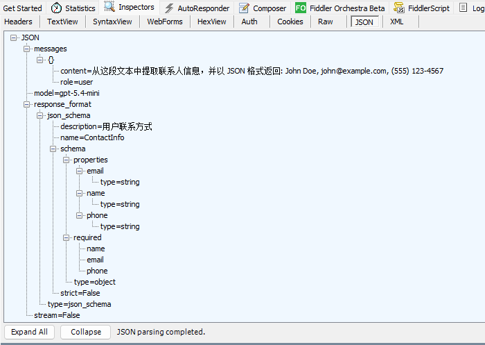
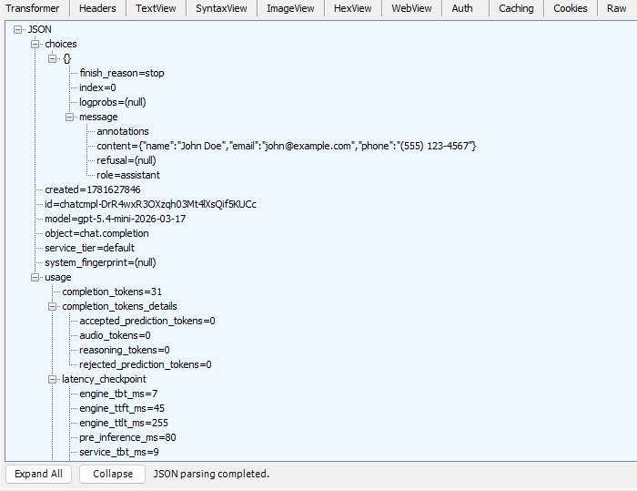
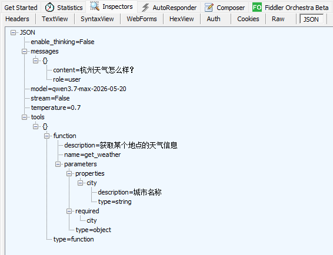
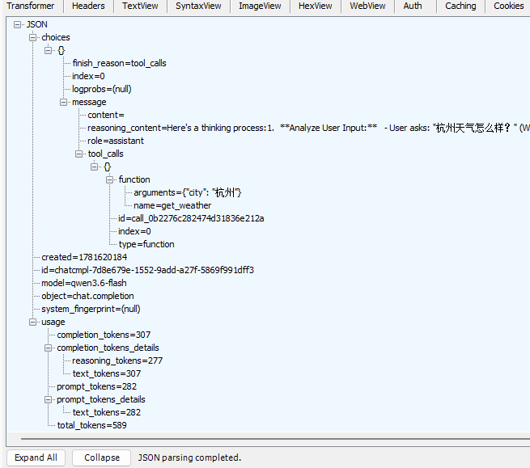
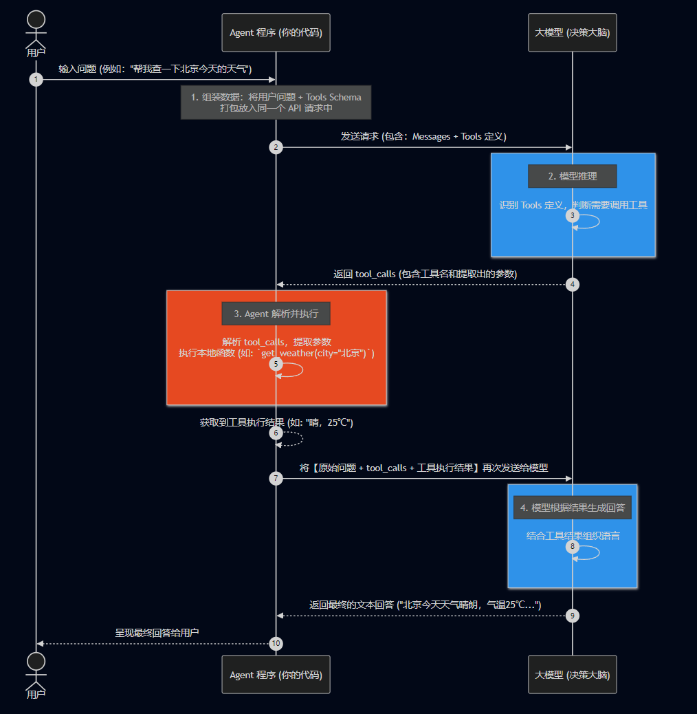

# 第一章：大模型基础篇

## 1.1 如何调用大模型
大模型的调用方式有多种层次，从底层的HTTP请求到高级的框架封装。本节将通过三个示例，循序渐进地介绍不同层次的调用方式。
注意：不管哪种方式调用大模型之前，都需要先把api_key写入环境变量中

为了方便，我这里就用代码的方式直接配置环境变量了，你可以配置到系统中，也可以用.env配置文件
```python
os.environ["DASHSCOPE_API_KEY"] = "sk-xxx"  
os.environ["OPENAI_API_KEY"] = "sk-xxx"  
```

### 1.1.1 HTTP方式调用（底层原理）
**核心概念**：直接通过HTTP POST请求与大模型API交互，这是最基础的调用方式，有助于理解API调用的本质。  
[百炼平台参考文档](https://help.aliyun.com/zh/model-studio/qwen-api-via-openai-chat-completions)

```python
import os
import requests
import rich

from util import env_util
env_util.setup_apikey() # 这里一定要记得配置一下环境变量

# url = "https://dashscope.aliyuncs.com/compatible-mode/v1/chat/completions" # 旧版
url = "https://{WorkspaceId}.cn-beijing.maas.aliyuncs.com/compatible-mode/v1/chat/completions" # 新版
url = url.replace("{WorkspaceId}", "")

api_key = os.getenv("DASHSCOPE_API_KEY")
print(f'api_key={api_key}')

headers = {
   "Authorization": f"Bearer {api_key}",
   "Content-Type": "application/json"
}

data = {
   "model": "qwen3.7-flash",
   "messages": [
	   {"role": "system", "content": "You are a helpful assistant."},
	   {"role": "user", "content": "你好，请做个自我介绍"}
   ]
}

response = requests.post(url, headers=headers, json=data)
rich.print(response.json())
```

**优点**：
- 无需安装额外的SDK
- 理解API调用的底层机制
- 适用于任何支持HTTP的环境

**缺点**：
- 需要手动处理错误、重试等逻辑
- 代码较为繁琐
- 流式输出实现复杂


### 1.1.2 SDK方式调用
**核心概念**：使用官方提供的SDK库，简化API调用流程，提供更好的开发体验。

#### 方式一：OpenAI兼容SDK
阿里云百炼平台提供了与OpenAI兼容的接口，可以使用OpenAI SDK进行调用：

```python
import rich
from openai import OpenAI
from util import env_util
env_util.setup_apikey()

messages = [  
    {"role": "system", "content": "你是一个乐于助人的助手"},  
    {"role": "user", "content": "你好，请你做个自我介绍。"},  
]

client = OpenAI(
    api_key=os.getenv("DASHSCOPE_API_KEY"),
    base_url="https://{WorkspaceId}.cn-beijing.maas.aliyuncs.com/compatible-mode/v1",
)

completion = client.chat.completions.create(
    model="qwen3.6-flash",
    messages=messages,
)

rich.print(completion)
```

#### 方式二：Ollama SDK（本地部署）
对于本地部署的模型，可以使用Ollama SDK：

```python
import ollama
from util import env_util
env_util.setup_apikey()

messages = [  
    {"role": "system", "content": "你是一个乐于助人的助手"},  
    {"role": "user", "content": "你好，请你做个自我介绍。"},  
]

client = ollama.Client(host='http://192.168.31.14:11434')
response = client.chat(
    model='qwen3.5:4b',
    messages=messages
)

print(response.model_dump_json())
```

#### 方式三：DashScope原生SDK
阿里云官方的DashScope SDK，支持更多高级功能（例如一些多模态的模型是不支持OpenAI的，必须DashScope SDK）

参考文档：https://bailian.console.aliyun.com/cn-beijing?spm=5176.29619931.J_gskoo9IcCWEOwPmyvhNFm.1.74cd10d7EIUr2K&tab=doc#/doc/?type=model&url=2841718

```python
import os
import dashscope
from util import env_util
env_util.setup_apikey()

messages = [  
    {"role": "system", "content": "你是一个乐于助人的助手"},  
    {"role": "user", "content": "你好，请你做个自我介绍。"},  
]

response = dashscope.MultiModalConversation.call(  
    api_key=os.getenv("DASHSCOPE_API_KEY"),  
    model="qwen3.6-flash",  
    messages=messages,  
    result_format="message",  
)  
  
print(response)
```

**优点**：
- 官方维护，稳定性好
- 支持更多高级特性（如流式输出、工具调用等）
- 完善的错误处理机制

**缺点**：
- 需要安装对应的SDK包
- 不同平台的SDK接口不统一


### 1.1.3 LangChain方式调用（框架封装）
**核心概念**：使用LangChain框架统一不同模型提供商的接口，提供更高层次的抽象和更丰富的功能。

#### 初始化模型
LangChain提供了统一的`init_chat_model`函数来初始化不同平台的模型：

```python
import os
from langchain.chat_models import init_chat_model
from langchain_core.language_models import BaseChatModel
from langchain_core.messages import AIMessage

from util import env_util
env_util.setup_apikey()

# 根据 provider 初始化不同平台的模型  
def create_model(provider: str = "dashscope", model: str = "qwen3.7-max-2026-05-20", temperature: float = 0.7, enable_thinking: bool = False,  **kwargs) -> BaseChatModel:  
  
    if provider == "openai":  
        print("正在初始化openai模型...")  
        chat_model = init_chat_model(  
            model=model,            # model="gpt-5.4-mini",  
            model_provider=provider, # provider="openai"  
            base_url="https://api.openai-proxy.org/v1",  
            api_key=os.getenv("OPENAI_API_KEY"),  
            temperature=temperature,  # 控制模型输出的随机性。数值越大，输出的响应就越具有创造性；数值越小，则输出的响应就越倾向于确定性。  
            max_retries=3,  # 重试次数  
            timeout=120,  
        )
        
		# from langchain_openai import ChatOpenAI  
		# chat_model = ChatOpenAI(  
		#     model=model,  
		#     base_url="https://api.openai-proxy.org/v1",  
		#     api_key=os.getenv("OPENAI_API_KEY"),  
		#     temperature=temperature,  
		#     timeout=120,  
		# )
    elif provider == "ollama":  
        print("正在初始化ollama模型...")  
        chat_model = init_chat_model(  
            model="qwen3.5:4b",  
            model_provider=provider,  
            base_url="http://192.168.31.14:11434",  
            temperature=temperature,  
            max_retries=3,  
            timeout=120,  
        )
        
        # from langchain_ollama import ChatOllama  
		# chat_model = ChatOllama(  
		#     model="qwen3.5:4b",  
		#     base_url="http://192.168.31.14:11434",  
		#     temperature=temperature,  
		#     timeout=120,  
		# )
    elif provider == "dashscope":  
        print("正在初始化阿里云百炼模型...")  
        chat_model = init_chat_model(  
            model=model,  
            model_provider="openai",  
            base_url="https://dashscope.aliyuncs.com/compatible-mode/v1",  
            api_key=os.getenv("DASHSCOPE_API_KEY"),  
            temperature=temperature,  
            max_retries=3,  
            timeout=120,  
            extra_body={"enable_thinking": enable_thinking},  
            **kwargs  
        )  
    else:  
        raise ValueError(f"不支持的模型提供商: {provider}")

    return chat_model
```

**参数说明**：
- `temperature`: 控制输出的随机性（0-1），值越大越有创造性，值越小越确定
- `max_retries`: 失败时的重试次数
- `timeout`: 请求超时时间（秒），如果你调用本地ollama中的模型，响应速度比较慢时容易超时，建议设大一些
- `kwargs`: 模型特定的额外参数，根据各个模型的api文档来传

**注意事项**：
- **DashScope兼容性**：LangChain1.0+移除了pydantic_v1，但`langchain-dashscope`尚未升级，会导致运行异常，建议使用OpenAI兼容模式
- **思考模式**：部分模型支持`enable_thinking`参数，可以启用深度思考能力

#### 同步调用（invoke）
最基本的调用方式，等待完整响应后返回一个AIMessage对象，不仅有大模型的回答，还有本次对话的token消耗信息等一些元数据

```python
model = create_model()
response: AIMessage = model.invoke('你好，请你做个自我介绍')
print(response)          # 查看完整的消息对象
```

**适用场景**：
- 简单的单次对话
- 需要完整响应后再处理的场景

#### 流式输出（stream）
逐块接收响应，提供更好的用户体验：

```python
for chunk in model.stream("你好，请你做个自我介绍"):
    print(chunk.text, end="", flush=True)
```

**优势**：
- 用户可以实时看到生成的内容
- 减少等待时间感知
- 适合长文本生成场景

#### 批量调用（batch）
一次性发送多个请求，等待所有完成后返回：

```python
for response in model.batch(["为什么鹦鹉有五颜六色的羽毛？", "飞机是如何飞行的？"]):
    print(response, end='\n\n')
```

**特点**：
- 并行处理多个请求
- 等待所有请求完成后统一返回
- 适合批量处理场景

#### 异步批量调用（batch_as_completed）
逐个返回完成的请求结果：

```python
for response in model.batch_as_completed(["为什么鹦鹉有五颜六色的羽毛？", "飞机是如何飞行的？"]):
    print(response)
```

**特点**：
- 哪个请求先完成就先返回哪个
- 不需要等待最慢的请求
- 提高整体响应速度

#### LangChain的优势
1. **统一接口**：无论使用哪个模型提供商，都使用相同的API
2. **丰富的功能**：内置流式输出、批量处理、重试机制等
3. **生态系统**：可以与LangChain的其他组件（链、Agent、RAG等）无缝集成
4. **可扩展性**：易于切换到不同的模型提供商


### 1.1.4 三种方式对比总结

| 特性        | HTTP方式     | SDK方式     | LangChain方式 |
|-----------|------------|-----------|-------------|
| **复杂度**   | 高          | 中         | 低           |
| **灵活性**   | 高          | 中         | 中           |
| **学习成本**  | 高          | 中         | 低           |
| **功能丰富度** | 低          | 中         | 高           |
| **跨平台支持** | 需自行实现      | 各平台独立     | 统一接口        |
| **适用场景**  | 理解原理、轻量级应用 | 生产环境、单一平台 | 复杂应用、多平台切换  |

**最佳实践**：根据项目需求灵活选择，不必拘泥于某一种方式

---

## 1.2 消息类型及多轮对话
不同的消息类型（Message Types）在序列中承担着不同的语义与角色。理解并严格遵循消息的序列化规约，是保证 LLM 稳定输出的核心基础。

### 1.2.1 四种核心消息类型

| 消息类型            | 角色        | 用途                                                   |
|-----------------|-----------|------------------------------------------------------|
| `SystemMessage` | system    | 系统级指令：设定 Agent 的角色人设、行为准则、可用工具说明及输出格式约束。通常固定位于序列最前端。 |
| `HumanMessage`  | user      | 用户输入：用户的提问或指令                                        |
| `AIMessage`     | assistant | 模型响应：模型的推理输出。包含普通文本回复或结构化工具调用指令（tool_calls）          |
| `ToolMessage`   | tool      | 工具执行结果：外部工具/API 执行完毕后的返回载体。必须绑定对应的 tool_call_id。     |

**两种表示方式**：
- **对象格式**：`SystemMessage(content="...")` - 类型安全，推荐
- **字典格式**：`{"role": "system", "content": "..."}` - 简洁，便于序列化

基础对话闭环：
> SystemMessage -> HumanMessage -> AIMessage

工具调用闭环：
> SystemMessage -> HumanMessage -> AIMessage(tool_calls) -> ToolMessage(with tool_call_id) -> AIMessage(final aanswer)

消息顺序不能乱，按时间先后排列


### 1.2.2 多轮对话
大模型本质上是一个无状态的函数，为了实现对话具备上下文感知能力，我们需要将对话历史维护为一个有序的消息序列，每次调用时发送完整历史。

#### 示例1 对象格式
```python
from langchain_core.messages import AIMessage, ToolMessage
model = create_model()

obj_messages = [
   # 设定系统人设/规则
   SystemMessage(content="你是一个实时的天气助手。"),
   # 用户发送的消息
   HumanMessage(content="北京今天天气怎么样？"),
   # 大模型返回的消息，模型发现自己无法回答，决定调用工具，当大模型决定使用工具时，它的 AIMessage 中会包含 `tool_calls` 属性
   AIMessage(
      content="我需要查询北京天气...",
      tool_calls=[{
         "id": "t_01",  # 关键：大模型生成的本次工具调用唯一 ID
         "name": "get_weather",  # 工具名称
         "args": {"city": "北京"},  # 工具参数
      }]
   ),
   # 外部 Python 代码执行完工具后，将结果反馈给大模型，ToolMessage 的 content 是工具执行的真实结果，且必须传入对应的 tool_call_id
   ToolMessage(
      content="晴转多云，25度",     # 调用外部工具获取的真实天气
      tool_call_id="t_01"         # 必须与上面 AIMessage 中的 id 严格对应
   ),
]

ai_message = model.invoke(obj_messages)
print(f"模型最终响应: {ai_message}")
```

#### 示例2 字典格式
```python
model = create_model()

# 字典格式下的 ToolMessage 表达（通常需要包含 name 和 tool_call_id）
dict_messages = [
   {"role": "system", "content": "你是一个实时的天气助手。"},
   {"role": "user", "content": "北京今天天气怎么样？"},
   # 模拟中间的工具交互 Dict
   {"role": "assistant", "content": "我正在查询北京天气...", "tool_calls": [{"id": "t_01", "name": "get_weather", "args": {"city": "北京"}}]},
   {"role": "tool", "content": "晴转多云，25度", "tool_call_id": "t_01"},
]

ai_message = model.invoke(dict_messages)
print(f"模型最终响应: {ai_message}")
```

#### 示例3 交互式连续对话
通过 while 循环实现命令行交互式对话，直观展示每轮对话后，用户输入和AI回复都会被追加到消息列表

```python
model = create_model()
# 初始化消息历史（包含系统消息）
messages = [SystemMessage(content="你是一个友好的AI助手，擅长回答各种问题。"),]

while True:
    # 获取用户输入
    user_input = input("👤 你: ").strip()
    # 退出条件
    if user_input.lower() in ['quit', 'exit', 'q']:
        print("\n👋 再见！感谢使用~")
        break

    # 空输入跳过
    if not user_input: continue

    # 将用户消息添加到历史
    messages.append(HumanMessage(content=user_input))

    # 调用模型（此时会发送完整的消息历史）
    ai_response = model.invoke(messages)

    # 显示AI回复
    print(f"🤖 AI: {ai_response.content}\n")

    # 将AI回复添加到历史（关键步骤：这样下一轮对话时模型才能"记住"）
    messages.append(ai_response)

    # 显示当前消息历史状态
    print(f"📊 本轮对话结束，当前消息历史共 {len(messages)} 条:")
    print("-" * 60)
```

---

## 1.3 大模型的结构化输出
结构化输出即：让模型返回指定格式的数据

**典型应用场景**：
- 📋 从文本中提取结构化信息（联系人、地址、日期等）
- 📊 生成符合特定schema的JSON数据
- 🔗 为下游系统提供标准化的数据接口

---

### 1.3.1 制定 JSON Schema 约束

```python
from typing_extensions import TypedDict

class ContactInfo(TypedDict):
    """用户联系方式"""
    name: str   # 用户名
    email: str  # 邮箱
    phone: str  # 电话
```

### 1.3.2 给模型绑定 Schema

```python
model = create_model(model="gpt-5.4-mini", provider="openai", enable_thinking=False) # model="gpt-5.4-mini", provider="openai"

# 绑定结构化输出
structured_model = model.with_structured_output(ContactInfo)

prompt = ChatPromptTemplate.from_template("从这段文本中提取联系人信息，并以 JSON 格式返回: {text}")
chain = prompt | structured_model

result = chain.invoke({"text": "我叫张三，我的联系电话是13288888888，我的邮箱是88888888@gmail.com"})
print(result)
# {'name': '张三', 'email': '88888888@gmail.com', 'phone': '13288888888'}
```

**实现原理**：
1. **Schema自动生成**：LangChain将 `TypedDict` 转换为 JSON Schema
2. **附加到模型配置**：将 schema 发送到模型API
3. **模型约束输出**：模型根据 schema 生成符合格式的响应
4. **自动解析**：LangChain将响应转换为 Python 字典，无需手动解析JSON

**请求抓包**：  


**响应抓包**：  


**注意事项**：  
- 结构化输出依赖模型自身的理解能力，小规格模型有可能无法按照要求返回指定的格式
- 避坑：qwen系列模型必须要求提示词中含有"json"，否则会报错
   > openai.BadRequestError: Error code: 400 - {'error': {'message': "<400> InternalError.Algo.InvalidParameter: 'messages' must contain the word 'json' in some form, to use 'response_format' of type 'json_object'.", 'type': 'invalid_request_error', 'param': None, 'code': 'invalid_parameter_error'}, 'id': 'chatcmpl-18199e86-acd8-9bc7-b657-9a041ce94054', 'request_id': '18199e86-acd8-9bc7-b657-9a041ce94054'}

**最佳实践**：
- 💡 使用 `TypedDict` 定义简单结构，`Pydantic BaseModel` 用于复杂验证
- 💡 字段描述要清晰详细，帮助模型准确提取
- 💡 结合提示词模板使用，提高提取准确率

---

## 1.4 大模型调用工具
工具是agent的核心能力，agent正是通过工具扩展了模型的能力，实现实时获取数据、执行代码、查询外部数据库等功能。


### 1.4.1 工具定义
工具：即一个本地函数，它的作用就是接收模型传入的参数，并将执行结果返回给模型。  
由于本章还未讲到Agent，所以我们暂时先只关注工具的定义部分，关于`@tool`装饰器的使用在后续的unit3章节中再具体讲解，减少认知负担。

```python
def get_weather(city: str) -> str:
    """获取某个地点的天气信息。
    
    Args:
        city: 城市名称，例如 "北京"、"上海"
        
    Returns:
        包含天气信息的字符串描述
    """
    return f"{city} 今天多云，20~28℃。"
```

**关键点**：  
**必须要用符合google style的docstring（多行文档字符串）来描述工具**

- 函数入参必须要定义类型
- 描述：在第一行简要描述工具的作用
- `Args`：详细说明每个参数的含义、类型、示例
- `Returns`：可选，说明返回值的格式
- 冒号不能用中文
- 描述、Args、returns之间要空一行


### 1.4.2 工具绑定
模型本身不知道外部有哪些工具可用，我们需要使用bind_tools()方法给模型绑定工具，告诉模型有哪些可用工具

```python
from unit1_大模型基础篇.a03_langchain调用模型 import create_model
from langchain_core.messages import HumanMessage
import rich

def test_bind_tools():
    """绑定工具"""
    model = create_model()
    model_with_tools = model.bind_tools([get_weather])

    messages = [HumanMessage(content="杭州天气怎么样？")]
    ai_message = model_with_tools.invoke(messages)
    rich.print(ai_message)

if __name__ == '__main__':
    test_bind_tools()
```


### 1.4.3 发生了什么？
绑定了工具之后，发生了什么？本质上就是在请求体中添加了tool schema

- `bind_tools()` 内部会去解析docstring，将它转换为tool schema，附加到模型的配置中
- `invoke()`，将用户问题与schema一并发给模型，模型在回答时，会分析是否需要调用这些工具

**请求包**：  


**响应包**：  


**关键理解**：
- 绑定是为了告诉模型「我有哪些工具」，如果模型认为它无法直接回答（需要调用工具）会返回一个包含tool_call的消息，模型它是不能调用我们本地方法的，真正的执行需要我们手动完成
- 绑定了工具，并不一定要执行，如果用户的问题与工具无关，那么模型就不会返回tool_call，而是直接回答后就结束了


### 1.4.4 tool_schema
bind_tools中是通过convert_to_openai_tool方法来生成tool schema的，我们也可以手动调用它生成tool schema，用于测试tool schema是否符合预期

```python
from langchain_core.utils.function_calling import convert_to_openai_tool

def get_tool_schema():
    tool_schema = convert_to_openai_tool(get_weather)
    rich.print(tool_schema)
```

**输出**：
```json
{
    "type": "function",
    "function": {
        "name": "get_weather",
        "description": "获取某个地点的天气信息",
        "parameters": {
            "properties": {
                "city": {"description": "城市名称", "type": "string"}
            },
            "required": ["city"],
            "type": "object"
        }
    }
}
```

---

## 1.5 天气查询助手练习
上一节我们已经讲解了如何绑定工具，但是我们只是拿到了模型返回的工具调用请求，最终并没有真正的去执行工具，在本节的天气查询助手练习中，将去完成真正的工具调用

### 1.5.1 定义工具
上一节中的查询天气的工具是写死的，并没有真正的去查询，本节中我们将对接高德api来获取到真实的天气数据

**前置准备**：高德api key，如果你懒得整，那就用上一节中的工具，看懂原理就行。

```python
import os
import requests
from unit1_大模型基础篇.a03_langchain调用模型 import create_model
from langchain_core.messages import HumanMessage, ToolMessage, SystemMessage

def get_weather(city: str) -> dict:
    """获取指定地区的天气信息

    Args:
        city: 城市或地区名称（不能有省市区这些行政区划后缀，如：杭州市->杭州，上海市->上海）
    """
    try:
        # 高德地图天气API配置
        api_key = os.getenv("GAO_DE_API_KEY")
        url = "https://restapi.amap.com/v3/weather/weatherInfo"

        # 构建请求参数 base返回实况天气，all返回预报天气
        adcode_map = {"杭州": "330100", "上海": "310100"}
        adcode = adcode_map.get(city)
        print(f'get_weather工具被调用：city={city}，adcode={adcode}')
        params = {"key": api_key, "city": adcode, "extensions": "base"}

        # 发送GET请求
        response = requests.get(url, params=params, timeout=10)
        print(f"get_weather工具执行结果：{type(response.json())}，{response.json()}", end='\n\n')
        return response.json()
    except Exception as e:
        return f"天气查询出错：{str(e)}"
```
此处为了演示简化，仅硬编码了杭州/上海的 adcode。生产环境中应对接高德行政区划查询 API 进行动态转换。

### 1.5.3 工具调用
```python
def weather_bot():
    model = create_model(enable_thinking=True)
    model_with_tools = model.bind_tools([get_weather])

    # 初始化消息历史（包含系统消息）
    messages = [SystemMessage(content="你是一个友好的AI助手，擅长回答各种问题。")]
    print("天气查询助手已启动，请输入你的问题（输入 'quit' 或 'exit' 退出）")

    while True:
        user_input = input("你: ").strip()
        messages.append(HumanMessage(content=user_input))
        
        # 第一轮交互，把用户问题和tools_schema一并发给大模型
        ai_message1 = model_with_tools.invoke(messages)
        messages.append(ai_message1)

        # 如果大模型返回了tool_calls，则表示需要调用本地工具
        if ai_message1.tool_calls:
            for tool_call in ai_message1.tool_calls:
                tool_name = tool_call["name"]
                tool_args = tool_call["args"]
                tool_id = tool_call["id"]  # 必须拿到 id，大模型靠这个 id 来匹配是谁（哪条消息）的执行结果

                # 1. 调用天气工具
                weather = get_weather(tool_args['city'])
                # 2. 将工具调用结果封装成ToolMessage并追加到消息列表中
                tool_message = ToolMessage(content=str(weather), tool_call_id=tool_id)
                messages.append(tool_message)

            # 3.第二轮交互，带着原始问题 + 模型工具意图 + 工具执行结果，再次推给模型
            ai_message2 = model_with_tools.invoke(messages)
            messages.append(ai_message2)
        else:
            print("没有工具调用，流程结束")

        for i, message in enumerate(messages):
            print(f"消息列表-{i+1} {type(message)}：\n {message}", end="\n\n")


if __name__ == '__main__':
    # get_weather("杭州")
    weather_bot()
```

**关键理解**：
1. 如果模型返回的消息中含有tool_calls，则表示需要调用本地工具来处理问题，这是模型想调用工具的"意图声明"
2. 从tool_calls中解析出工具调用信息，并手动调用本地工具
3. 将工具执行结果封装成ToolMessage，并追加到消息列表中，必须要有tool_call_id，与tool_call["id"]对应
4. 再次推给模型，此时模型就能根据工具执行结果，回答天气问题了


### 1.5.4 执行流程



### 1.5.5 局限性
通过本节的学习，你应该已经体会到手动实现的问题：

❌ **代码繁琐**：需要手动解析消息、匹配工具、封装结果  
❌ **容易出错**：消息顺序、ID 配对、参数格式都需要小心处理  
❌ **重复劳动**：每次都要写相同的模板代码  

这就是为什么我们需要langchain框架！在后续的章节中，你将学习到通过LangChain Agent来自动处理工具调用的整个流程  
**本节价值**：虽然手动实现不实用，但它让你理解了底层原理，这有助于你更好地使用高级框架。

--- 

## 1.6 本章总结

### 📚 核心知识点回顾
通过本章的学习，我们掌握了以下关键内容：

1. **三种调用方式**：从底层的HTTP请求 → SDK封装 → LangChain统一接口，理解不同层次的抽象
2. **消息类型系统**：SystemMessage、HumanMessage、AIMessage、ToolMessage 四种核心消息类型及其配对机制
3. **多轮对话实现**：通过维护消息历史列表，实现上下文连续的对话能力
4. **结构化输出**：使用 `with_structured_output()` 让模型返回符合指定schema的格式化数据
5. **工具调用原理**：手动实现工具调用的完整流程（绑定→意图识别→执行→结果封装→再次调用）

### 💡 关键理解
- 大模型本质上是**文本生成器**，它只能基于训练数据和当前上下文生成响应，给大模型绑定了工具相当于给大脑加上了手脚，llm+tools=agent
- 工具调用并非模型真正"执行"了代码，而是模型表达了"需要调用某个工具"的意图，真正执行工具调用的是我们的Agent程序


### 🤔 思考：大模型的能力边界在哪里？
通过本章的实践，你已经能够熟练地调用大模型、实现多轮对话、提取结构化信息和工具调用，但请思考以下问题：

**场景1：实时信息查询**
> 用户问："今天杭州的天气怎么样？"
> - ❌ 大模型无法访问实时数据，它的知识是静态的
> - ✅ 我们已经可以通过工具调用获取天气

**场景2：企业内部知识库问答**
> 假设你是一家公司的HR助手，员工问你："我们公司今年的年假政策是什么？"
> - ❌ 大模型的训练数据截止到某个时间点，不可能知道你们公司最新的内部政策
> - ❌ 即使你把政策文档发给模型，也会受到上下文窗口的限制

**这些问题的共同点是：大模型缺乏对「外部私有数据」和「实时信息」的访问能力。**


### 🎯 下一章预告：RAG（检索增强生成）
为了解决上述问题，我们需要引入 **RAG（Retrieval-Augmented Generation）** 技术：

**核心思想**：
```
用户提问 → 检索相关文档 → 将检索结果 + 问题一起发给模型 → 生成准确回答
```