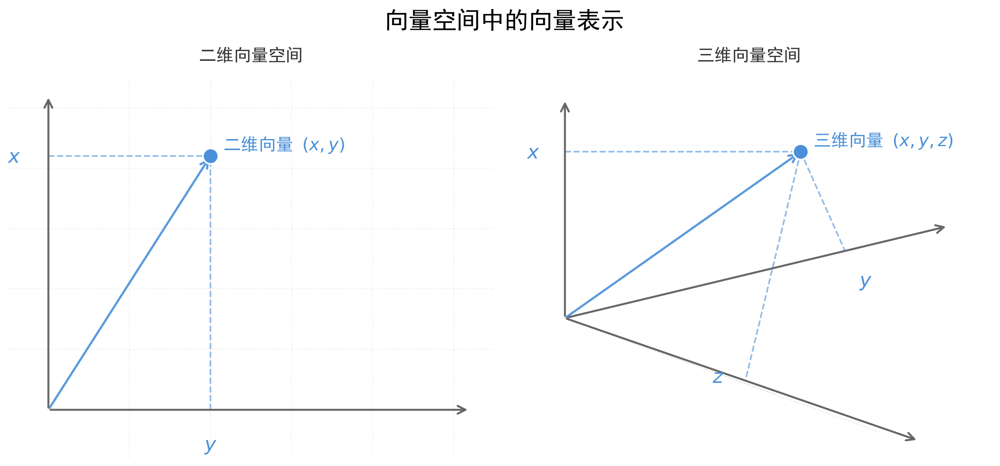
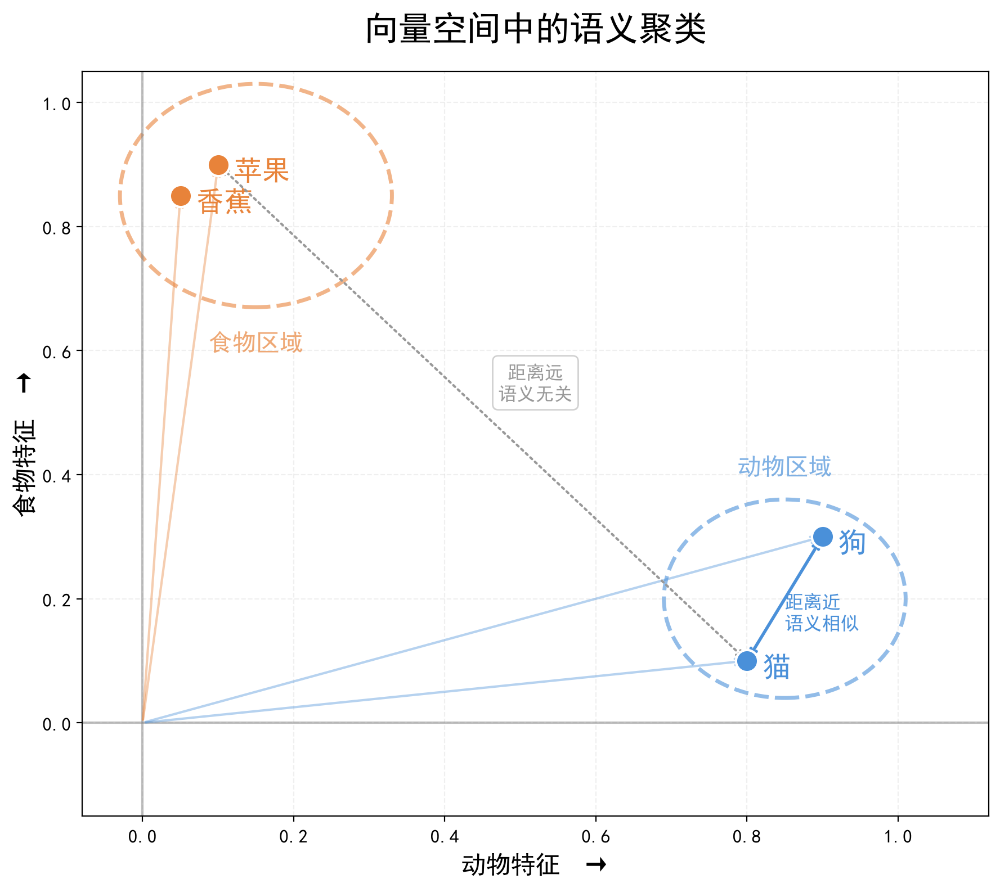

# 第二章：RAG基础篇

上一章结尾，我们抛出了一个思考，我们知道大模型的知识是冻结于训练完成那一刻的，它无法回答实时性的问题，
比如：今天天气怎么样？，不过这个问题我们已经通过给模型添加一个天气查询的工具来解决了

那除了实时性问题之外，还有一类问题大模型同样很难解决，那就是私有化知识的问题。
比如说：你问的是你们公司的员工规章制度相关问题
> 迟到一次扣多少钱？辱骂领导会怎么样？

这些都是企业内部的私有数据，不同公司的规定也完全不同。模型厂商在训练通用大模型的时候，不可能把每一家公司的内部规章制度都训练进去。
所以，我们需要通过 RAG，为大模型外挂一个企业自己的知识库，让模型能够回答这类私有化的知识问题。


## 2.1 RAG的概念

### 2.1.1 什么是RAG？
RAG是Retrieval Augmented Generation的简称，直译过来就是检索增强生成，是一种将外部知识库与大模型（LLM）结合的技术方案。

它的核心思想是：先从外部知识库中检索相关资料，再让大模型结合这些资料生成答案。

### 2.1.2 RAG的基本流程
1. **检索（Retrieval）**：根据用户的提问，去知识库中检索出与问题最相关的资料
2. **增强（Augmented）**：将检索到的参考资料，与用户的问题一起提供给大模型
3. **生成（Generation）**：大模型结合用户的问题和参考资料，生成最终的回答
> 用户提问 → 检索知识 → 增加上下文 → 大模型生成答案


### 2.1.3 知识扩展：RAG vs Fine-Tuning（微调）
除了 RAG 之外，我们还可以通过 Fine-Tuning（微调），让大模型具备特定领域的问题处理能力，
RAG 与 Fine-Tuning 并不是"谁优谁劣”的替代关系，而是各自侧重的方向不同。

两者的核心思想形象对比：
- **RAG（检索增强生成）** 相当于 **“开卷考试”**  
  大模型本身不需要死记硬背具体制度，回答前先去翻阅最新的资料，看完资料后再结合题目输出答案。

- **Fine-Tuning（微调）** 相当于 **“闭卷考试”**  
  通过训练数据调整模型参数，让模型逐渐学习特定领域的任务模式、表达方式和解决问题的能力。

> RAG 是给模型提供外部知识，Fine-Tuning 是调整模型本身的能力和行为。


RAG 与微调（Fine-Tuning）深度对比

| 对比维度        | RAG（检索增强生成）                             | Fine-Tuning / SFT（微调）          |
|:------------|:----------------------------------------|:-------------------------------|
| **核心作用**    | 向模型提供外部知识                               | 让模型学习特定任务、行为和表达模式              |
| **知识来源**    | 回答时从外部知识库动态获取                           | 在训练过程中通过训练数据影响模型参数             |
| **典型场景**    | 企业规章制度、产品文档、知识库问答                       | 特定任务、输出格式、表达风格、领域任务            |
| **知识更新**    | 更新知识库后即可使用，通常无需重新训练模型                   | 通常需要重新准备训练数据并进行训练              |
| **可追溯性**    | **容易实现**：可以关联检索到的文档、页码、URL等信息           | **较难实现**：知识融入模型参数后，很难准确对应到具体原文 |
| **权限控制**    | **较容易实现**：可以在检索阶段基于用户、Metadata等进行权限过滤   | **较难实现**：模型参数本身很难针对不同用户隔离知识    |
| **成本**      | 通常不需要对大模型进行训练，成本相对较低                    | 需要训练算力，成本通常更高                  |
| **适合解决的问题** | **“模型不知道某些外部知识”**                       | **“模型需要学习特定的任务、行为或表达方式”**      |


技术选型：
1. 如果核心需求只是做垂直领域的知识问答（比如智能客服系统），那么 RAG 是成本最低、上线最快、效果最稳的方案。
2. 如果核心需求是让模型更好的理解垂直领域的“专业术语”（如法律文书、医疗病例）、学习特定的输出格式（如法律领域的起诉状）、或拟合特定角色的说话方式，应选择微调。
3. RAG 和 Fine-Tuning 不是二选一，在一些复杂的实际场景中，可以将两者结合使用。
   
---

## 2.2 向量的概念
在 RAG 流程中，最关键的就是 **检索阶段**：如何从海量知识库中精准找到与用户问题相关的文本，而**向量**就是实现语义化检索的核心

### 2.2.1 什么是向量？
在数学中，向量指具有大小和方向的量，与向量对应的量叫做**标量**，只有大小，没有方向。
在物理学中又称之为**矢量**，常用于描述力、速度、加速度等物理量。

大家不要害怕听不懂，本教程中不讲数学和物理上的概念，在计算机中，我们可以把向量简单理解成一个浮点数数组（如 [0.15, 0.23, 0.88, ...]）

**向量在几何空间上的表示**：  
在坐标系中，向量可以表示为一个箭头，箭头的起点是原点，终点是向量指向的位置。  



- 一维空间：一个数字代表线上的点，如 $x = 3$
- 二维空间：两个数字代表平面上的点，如 $(x, y) = (2, 5)$
- 三维空间：三个数字代表立体空间的点，如 $(x, y, z) = (1, 2, 3)$
- 高维空间（NLP领域）：几百到上千个数字代表高维语义空间中的一个点，如 OpenAI 的 text-embedding-3-small 模型生成的向量包含 1536 个浮点数。


### 2.2.2 为什么要用向量？
向量是实现语义化检索的关键，传统数据库擅长的是精确匹配，例如 SQL 中的 WHERE name = '张三'，但无法直接理解人类语言的意思

> 比如："我想吃点东西"和"我肚子饿了"其实是同一个意思。
> 
> 假如知识库中有一篇标题为《深度学习概述及其在各领域的应用》的文章，
> 你输入"人工智能"的关键词是检索不到结果的，因为字面不匹配。
> 但从语义上看，“人工智能”和“深度学习”显然存在很强的关联，根据语义的相关性，这篇文章应该要被检索到。
> 
> 而知识问答的场景中，用户提问的方式是千奇百怪的，很难准确输入字面一样的检索关键词，所以要根据"语义"来检索出意思最接近的内容。


向量表征（Embedding）技术就是为了解决这个问题：
> 它将文本、图片、音频等非结构化数据，映射为高维空间中的坐标值。把“语义理解”转化为“数学运算”，
> 计算机只需要计算坐标之间的距离，就能判断两段文本的意思是否接近，从而实现语义搜索。

### 2.2.3 向量如何表示语义？
把向量看作是空间中的“坐标点”，通常语义相似的词，它们在空间中的点就靠得近；语义不相似的词，点就离得远。
> 向量的维度可以理解为面向对象思想中对象的属性，每一个维度就是一个高度抽象的“语义属性”，维度越高，描述的事物越详细。

```
我们用一个极简的例子来理解，假设我们用 2 个维度 [动物特征, 食物特征] 来表示词汇：

- 狗：[0.9, 0.3]（动物特征高，擅长奔跑，少部分地区会吃狗肉）
- 猫：[0.8, 0.1]（动物特征高，擅长跑酷，基本不作为食物）
- 苹果：[0.1, 0.9]（几乎不会动，是典型食物）
- 香蕉：[0.05, 0.85]（几乎不会动，是典型食物）

结论：狗和猫的坐标很接近，它们的“语义”就相近。这就是为什么我们可以通过计算向量的距离，来判断两段文本是否相关。
注意：这里为了好理解，我们给这2个维度设定为具象的语义特征了，实际的向量中每个维度都是抽象的，我们无法去形容某个维度代表的含义。
```




### 2.2.4 向量相似度如何计算？
#### 相似度量
判断两段文本是否相似，本质上就是计算它们在向量空间中的几何关系。常见的算法有三种：

| <div style="width: 120px;">比对维度</div> | <div style="width: 250px;">欧氏距离 (Euclidean Distance / L2)</div>   | <div style="width: 250px;">点积 (Dot Product / IP)</div>                                                                  | <div style="width: 250px;">余弦相似度 (Cosine Similarity)</div>                                             |
|---------------------------------------|-------------------------------------------------------------------|-------------------------------------------------------------------------------------------------------------------------|--------------------------------------------------------------------------------------------------------|
| **算法含义**                              | 计算高维空间中两个坐标点之间的 **“直线距离”**                                        | 计算两个向量对应分量的乘积之和                                                                                                         | 计算两个向量之间的 **“夹角余弦值”**                                                                                  |
| **计算公式**                              | $d(\mathbf{A}, \mathbf{B}) = \sqrt{\sum_{i=1}^{n} (A_i - B_i)^2}$ | $\mathbf{A} \cdot \mathbf{B} = \sum_{i=1}^{n} A_i B_i = \Vert{}\mathbf{A}\Vert{} \Vert{}\mathbf{B}\Vert{} \cos(\theta)$ | $\cos(\theta) = \frac{\mathbf{A} \cdot \mathbf{B}}{\Vert{}\mathbf{A}\Vert{} \Vert{}\mathbf{B}\Vert{}}$ |
| **取值范围**                              | $[0, +\infty)$                                                    | $(-\infty, +\infty)$ （归一化后缩放到 $[-1, 1]$）                                                                                | $[-1, 1]$                                                                                              |
| **相似度判定**                             | **数值越小越相似**（等于 0 表示完全重合）                                          | **数值越大越相似**（仅在归一化后适用）                                                                                                   | **数值越大越相似**（等于 1 表示方向完全一致）                                                                             |
| **影响因素**                              | 向量长度和方向都有影响                                                       | 向量长度和方向都有影响                                                                                                             | 只受方向影响                                                                                                 |
| **核心特点**                              | **优点**：符合直觉，空间距离概念清晰。**缺点**：受向量绝对长度干扰严重；涉及开方运算，计算较慢               | **优点**：仅涉及乘加运算，计算性能最高。**缺点**：未归一化时无法独立作为精准的语义相似度指标。                                                                     | **优点**：语义敏感度极高，不受模长影响，是语义比对的首选。**缺点**：分母需要计算模长（开方），直接计算性能稍低                                            |
| **适用场景**                              | 图像特征比对、音频信号处理、物理数值聚类（如 K-Means）等**关注绝对数值大小**的场景                   | 推荐系统（需兼顾用户偏好方向与偏好强度）                                                                                                    | **文本检索（RAG）、Agent 记忆匹配、问答系统**等语义场景                                                                     |


#### RAG中选择哪种相似度量？  
语义信息主要由向量"方向"承载，模长会受到文本长度、词频、信息密度等很多因素影响，所以 RAG 中通常会使用 **余弦相似度** 这种对模长不敏感的算法。

> 比如：用户输入的Query通常很短（一句话），而知识库里的一个文本段落通常较长（一篇或一段），  
> 这种 “短对长” 的不对称情况在RAG中是常态，如果选择模长敏感度高的算法，就可能会导致结果失真


#### 扩展：向量归一化
在向量数据库（如 Chroma、Qdrant、Milvus）中计算余弦相似度时，求模长（分母 $\Vert{}\mathbf{A}\Vert{} \Vert{}\mathbf{B}\Vert{}$）需要开平方根，计算成本较高。
因此，大部分主流Embedding模型（如 OpenAI、BGE 等）通常会默认进行归一化处理，在向量归一化的前提下，余弦相似度就等于点积。
即向量的模长固定为 $1$（即 $\Vert{}\mathbf{A}\Vert{} = 1, \Vert{}\mathbf{B}\Vert{} = 1$），此时：
> $$\text{余弦相似度} = \mathbf{A} \cdot \mathbf{B} = \text{点积}$$


### 2.2.5 代码实践：计算向量相似度
通过 Python 代码实现余弦相似度计算，验证前面的理论：

#### 核心步骤

1. **定义向量**：用 NumPy 数组表示语义空间中的坐标点
    ```python
    import numpy as np
    
    # 2维向量：[动物特征, 食物特征]
    vec_dog = np.array([0.9, 0.3])    # 狗：擅长奔跑，少部分地区会吃狗肉
    vec_cat = np.array([0.8, 0.1])    # 猫：擅长跑酷，基本不作为食物
    vec_apple = np.array([0.1, 0.9])  # 苹果：几乎不会动，是典型食物
    vec_banana = np.array([0.05, 0.85]) # 香蕉：几乎不会动，是典型食物
    ```

2. **实现余弦相似度公式**：(A·B) / (||A|| × ||B||)
    ```python
    def cosine_similarity(v1, v2):
        # 点积：对应位置相乘后求和
        dot_product = np.dot(v1, v2)
        
        # 求向量的模长（长度）
        norm_v1 = np.linalg.norm(v1)
        norm_v2 = np.linalg.norm(v2)
        
        return dot_product / (norm_v1 * norm_v2)
    ```

3. **计算并验证结果**
    ```python
    sim1 = cosine_similarity(vec_dog, vec_cat)      
    sim2 = cosine_similarity(vec_apple, vec_banana) 
    sim3 = cosine_similarity(vec_cat, vec_apple)   
    ```

#### 关键知识点

- **np.dot()**：计算点积，两个向量对应元素相乘后求和
- **np.linalg.norm()**：计算向量的模长（欧几里得范数）
- **结果范围**：余弦相似度值域为 [-1, 1]，越接近 1 表示越相似
- **实际意义**：狗和猫的相似度（0.98）远高于猫和苹果（0.25），符合直觉


#### ⚠️ 重要说明：教学演示 vs 实际应用
**当前代码中的向量值是手工设定的**（如 `[0.9, 0.3]`），仅用于教学演示，帮助理解向量和相似度的概念。  
**实际应用场景中**，我们不会手动编写向量值，而是通过 **Embedding 模型** 自动将文本、图像等数据转换为高维向量：

```
原始文本 → Embedding 模型 → 高维向量（如 768 维、1536 维）
```

例如：
- 输入：`"狗是一种忠诚的动物"`
- 输出：`[0.234, -0.567, 0.891, ..., 0.123]` （768 个浮点数）

**下一节我们将学习**：如何使用 Embedding 模型（阿里云百炼的text-embedding）将文本转化为真实向量，为后续的 RAG 检索打下基础。

---

## 2.3 Embedding模型

### 2.3.1 什么是 Embedding 模型？
**Embedding 模型**是一种专门用于将文本、图像等非结构化数据转换为固定长度的高维向量的模型。

- **语义编码**：相似的文本会生成相近的向量
- **固定维度**：无论输入多长，输出向量长度固定（如 768、1536 维）
- **通用性**：可用于搜索、分类、聚类等任务

#### 常见 Embedding 模型

| 系列         | 代表模型                                    | 向量维度                             | 支持语言                  | 是否开源         | 核心特点                                |
|------------|-----------------------------------------|----------------------------------|-----------------------|--------------|-------------------------------------|
| OpenAI     | text-embedding-3-small                  | 1536（可经 API 截到 256–1536）         | 多语言（英文最强，中文中等）        | 否，仅云端 API    | MRL 维度可截断；8K 上下文                    |
| OpenAI     | text-embedding-3-large                  | 3072（可截到 256–3072）               | 多语言（英文最强，中文中等）        | 否，仅云端 API    | MRL 维度可截断；8K 上下文                    |
| 阿里（百炼 API） | text-embedding-v4（属 Qwen3-Embedding 系列） | 64–2048 可选（默认 1024）              | 100+ 语言 + 多种编程语言      | 否，仅阿里云 API   | 32K 上下文；支持维度参数；中文/代码强               |
| 阿里（百炼 API） | text-embedding-v3                       | 64–1024 可选（默认 1024）              | 50+ 主流语种              | 否，仅阿里云 API   | 上一代 API 模型；8K 上下文，中文友好；成本低于 v4      |
| 阿里（开源权重）   | Qwen3-Embedding-8B                      | 4096（MRL 可截到 32–4096）            | 100+ 自然语言 + 100+ 编程语言 | 是，Apache-2.0 | 32K 上下文；指令感知；可自托管                   |
| 阿里（开源权重）   | Qwen3-Embedding-0.6B / 4B               | 0.6B→1024 维；4B→2560 维（均可 MRL 截断） | 同 8B                  | 是，Apache-2.0 | 小尺寸兜底；0.6B 可 CPU/边缘；4B 性价比高         |
| 智源         | bge-large-zh-v1.5                       | 1024                             | 中文为主（中英兼顾）            | 是，MIT 协议     | 中文 RAG 标杆；512 token 上下文；需本地/自托管 GPU |
| 智源         | bge-m3                                  | 1024（稠密）+ 稀疏 + ColBERT 多向量       | 100+ 语言               | 是，MIT 协议     | 多语言/长文本(8K)/混合检索三合一；单模型出稠密+稀疏+多向量   |


### 2.3.2 使用 LangChain 调用 Embedding 模型
LangChain 提供了统一的接口来调用不同厂商的 Embedding 模型，以阿里云百炼为例：

#### 步骤 1：创建 Embedding 模型实例
方式1：使用langchain的统一接口创建embeddings模型  
[百炼平台参考文档](https://bailian.console.aliyun.com/cn-beijing?spm=5176.29619931.J_gskoo9IcCWEOwPmyvhNFm.1.74cd10d7EIUr2K&tab=api#/api/?type=model&url=2712515)

```python
import os
from langchain.embeddings import init_embeddings
from util import env_util
env_util.setup_apikey()

embeddings = init_embeddings(
    model="text-embedding-v4",  # 你的模型名称
    provider="openai",  # 因为兼容 OpenAI 接口，所以 provider 指定为 openai
    base_url="https://{WorkspaceId}.cn-beijing.maas.aliyuncs.com/compatible-mode/v1",
    api_key=os.getenv("DASHSCOPE_API_KEY"),
    dimensions=1024,    # 向量维度
    chunk_size=10,  # 限制每次提交给 Embedding 接口的文本数量不超过 10
    check_embedding_ctx_length=False  # 关闭本地的 token 长度检查和切片
)
```

方式2：使用OpenAIEmbeddings类创建embeddings模型
```python
from langchain_openai import OpenAIEmbeddings

embeddings = OpenAIEmbeddings(
    model="text-embedding-v4",
    base_url="https://{WorkspaceId}.cn-beijing.maas.aliyuncs.com/compatible-mode/v1",
    api_key=os.getenv("DASHSCOPE_API_KEY"),
    dimensions=1024,    # 向量维度
    chunk_size=10, 
    check_embedding_ctx_length=False  # 关闭本地 token 检查
)
```

方式3：使用 OpenAI 原生 SDK
```python
from openai import OpenAI

client = OpenAI(
    api_key=os.getenv("DASHSCOPE_API_KEY"),
    base_url="https://{WorkspaceId}.cn-beijing.maas.aliyuncs.com/compatible-mode/v1"
)
```

**关键参数说明**：
- **model**：指定使用的模型名称
- **base_url**：API 端点地址（兼容模式）
- **dimensions**：向量维度
- **chunk_size**：单次API调用中能处理的文本数量上限
- **check_embedding_ctx_length=False**：跳过 token 长度检查，直接发送原始文本内容

避坑点：
> 1. chunk_size: 百炼平台的text-embedding-v4的批次大小为10，表示一次请求最多可传入10个文本，且每个文本不得超过 8192 个Token，注意不要超出
> 2. check_embedding_ctx_length：默认True，OpenAI 官方 API 会发送一个 token ID 的数组用于计算文本的 token 数量，确保不超过模型上下文长度限制。这要求服务端支持 token 计算接口。  
> 设置为 False 时：跳过 token 长度检查，直接发送原始文本内容，因为很多非 OpenAI 服务不支持 token 计算接口


#### 步骤 2：将单个查询转为向量

```python
# embed_query：处理单个查询字符串
def test_embed_query(embeddings: OpenAIEmbeddings, query: str):
    query_result: list[float] = embeddings.embed_query(query)
    print(f"type={type(query_result)}，len={len(query_result)}")
    print(f"前5个值: {query_result[:5]}")
    return query_result
```

#### 步骤 3：批量处理文档列表

```python
# embed_documents：批量处理多个文档
def test_embed_documents(embeddings: OpenAIEmbeddings, doc_list: list[str]):
    doc_results: list[list[float]] = embeddings.embed_documents(doc_list)

    for i, doc_result in enumerate(doc_results):
        print(f"文档 {i+1}，向量维度: {len(doc_result)}")
        print(f"前5个值: {doc_result[:5]}")

    return doc_results
```

#### 两个方法的区别

| 方法                  | 用途          | 输入    | 输出   |
|---------------------|-------------|-------|------|
| `embed_query()`     | 处理用户查询（单个）  | 单个字符串 | 单个向量 |
| `embed_documents()` | 处理知识库文档（批量） | 字符串列表 | 向量列表 |


### 2.3.3 计算真实文本的相似度
#### 代码示例

```python
vec_cat = test_embed_query(embeddings, "猫")
vec_dog = test_embed_query(embeddings, "狗")
vec_apple = test_embed_query(embeddings, "苹果")
vec_banana = test_embed_query(embeddings, "香蕉")

# 计算余弦相似度
sim1 = cosine_similarity(vec_cat, vec_dog)
print(f"猫-狗 相似度: {sim1:.4f}")

sim2 = cosine_similarity(vec_cat, vec_apple)
print(f"猫-苹果 相似度: {sim2:.4f}")

sim3 = cosine_similarity(vec_apple, vec_banana)
print(f"苹果-香蕉 相似度: {sim3:.4f}")

# 长句子测试
query = test_embed_query(embeddings, "人工智能")
docs = [
    "深度学习是机器学习的一个子集，它基于神经网络，尤其是深度神经网络，通过构建多层神经网络模型来模拟人脑神经元的工作方式",
    "布偶猫是一种体型大、性格温顺、长毛蓝眼的可爱动物",
    "‌咕咕嘎嘎‌是网络流行语，原为模拟婴儿声音的拟声词，没有实际含义，后演变为装傻、抽象兴奋的表达"
]
doc_results = test_embed_documents(embeddings, docs)

# 相似度计算
for i, doc in enumerate(doc_results):
    similarity = cosine_similarity(query, doc)
    print(f"文档 {i + 1} 的相似度: {similarity:.4f}")
```

#### 实际效果
通过 Embedding 模型，我们不再需要手工设定向量值，而是让模型自动理解文本语义：

- **语义相关**的文本（如"人工智能"和"深度学习"）→ 相似度高
- **语义无关**的文本（如"人工智能"和"布偶猫"）→ 相似度低

这就是 RAG 检索步骤中语义检索的核心原理！

---

## 2.4 向量数据库

在前面的章节中，我们已经学会了：
1. 用向量表示文本的语义
2. 用 Embedding 模型将文本自动转换为高维向量
3. 用余弦相似度计算两段文本的语义关联程度

接下来一个自然的问题就是：**这些向量存到哪里？怎么高效地检索？**
这就需要**向量数据库**。

### 2.4.1 什么是向量数据库？
**向量数据库**是一种专门用于存储、管理和检索高维向量的数据库系统。它和传统数据库最大的不同在于：
**传统数据库按"字面匹配"，而向量数据库按"语义匹配"。**

关键理解：
> 向量库不是只存储向量数据，原始文本也需要一并存入向量库中，向量数据只是用于检索，我们最终要的是文本数据

向量数据库 vs 传统数据库：

| 对比项  | 传统数据库（MySQL等） | 向量数据库（Qdrant等）   |
|------|---------------|------------------|
| 存储对象 | 表格数据（数字、字符串等） | 向量 + 元数据         |
| 查询方式 | 精确匹配、范围查询     | 向量相似度搜索 + 关键词    |
| 查询结果 | 满足条件的所有记录     | 语义最相近的 Top-K 条记录 |
| 适用场景 | 业务数据检索        | RAG语义搜索          |


### 2.4.2 常见向量数据库
| <div style="width: 100px;">比对维度</div> | FAISS                                        | Chroma                                 | Qdrant                                                | Milvus                                  |
|---------------------------------------|----------------------------------------------|----------------------------------------|-------------------------------------------------------|-----------------------------------------|
| 产品定位                                  | 纯向量计算/相似度检索算法引擎库 (Meta 开源)                   | 轻量级向量数据库                               | 轻量级高性能向量数据库                                           | 云原生企业级分布式向量数据库                          |
| 底层技术栈                                 | C++（提供 Python/NumPy 绑定，支持 GPU 加速）            | Python + SQLite + Rust 核心向量段引擎         | Rust（自研 Segment + WAL + mmap 内存映射存储引擎）                | C++（Knowhere 计算内核）+ Go（分布式调度）           |
| 本地嵌入运行                                | 支持（纯内存计算，直接在进程中运行）                           | 支持（指定 `path="./db"` 即可在进程内运行）          | 支持（指定 `path="./db"` 直接嵌入进程）                           | 支持（Milvus Lite版）                        |
| 数据持久化机制                               | 无自动持久化（需手动调用 API 序列化为 `.index` 二进制文件）        | 自动持久化（自动落盘至本地 SQLite 及向量段索引文件）         | 自动持久化（WAL 日志 + 基于 mmap 的段文件自动落盘）                      | 自动持久化（Lite 版落盘为单文件；集群落盘至 MinIO/S3 对象存储） |
| 元数据过滤                                 | 无（只存向量与整型 ID，需在外部自建字典/数据库比对）                 | 支持（简单 Dict 字典匹配或基于 SQLite 的 SQL 表达式过滤） | 极强 (Filterable HNSW)（在 HNSW 图遍历过程中同步校验 Payload，不失召回率） | 强（支持标量索引与强大的 SQL 式表达式条件过滤）              |
| 增删改查能力                                | 极差（不支持直接 Update，Delete 代价极高，基本仅限追加/只读）       | 完整支持（基础增删改查体验友好，适合中小型数据集）              | 完整支持（基于 Point ID 实现高效实时更新与精准/条件删除）                    | 完整支持（面向千万/亿级高并发 CRUD 场景优化）              |
| 混合检索                                  | 不支持（需在外部自建 BM25/搜索引擎，手动在 Python 中做 RRF 结果融合） | 支持（结合内置的 SQLite FTS5 全文索引与稠密向量联合召回）    | 支持（单集合同时存 Dense 稠密向量与 Sparse 稀疏向量/SPLADE，内置 RRF 融合）   | 支持（内置 BM25 稀疏向量生成引擎 + 稠密向量联合检索与重新打分）    |
| 分布式与扩展能力                              | 无（纯单机/单 GPU 内存级计算）                           | 自托管难度高，主要依赖 Chroma Cloud 托管            | 优秀（支持从嵌入式单机文件无缝平滑升级至基于 Raft 的分布式集群）                   | 顶级（存算分离架构，支持微服务级别的水平扩展与十亿级向量检索）         |
| 适用场景                                  | 算法研究、纯离线高吞吐向量计算、大模型 Embedding 评估与训练          | 快速 MVP 原型验证、小规模应用、本地运行首选               | 中小规模应用                                                | 亿级海量向量规模、企业级多租户微服务架构、高并发云原生生产环境         |

### 2.4.3 向量数据库中的核心概念
本教程以Qdrant向量库为例，要理解向量数据库，先搞清楚以下几个核心概念，它们可以和传统数据库的概念类比理解：

#### 集合（Collection） ≈ 表（Table）
就像 MySQL 中数据存在"表"里一样，Qdrant 中数据存在"集合"里。每个集合在创建时需要指定两个关键参数：
- **向量维度（size）**：即向量有多少个分量，比如 Embedding 模型输出 1024 维，集合的 size 就设为 1024
- **距离度量（distance）**：即用什么算法计算相似度，如 `COSINE`（余弦相似度）、`DOT`（点积）、`EUCLID`（欧氏距离）

#### 点（Point） ≈ 行（Row）
集合中的每条数据叫做一个"点"，每个点由三部分组成：

| 组成部分        | 说明                             | 类比         |
|-------------|--------------------------------|------------|
| **id**      | 唯一标识，可以是整数或 UUID               | 主键         |
| **vector**  | 向量数据（浮点数数组），维度必须与集合定义的 size 一致 | 最重要的"数据字段" |
| **payload** | 元数据（键值对），存储原始文本、分类标签等附加信息      | 普通字段       |

#### 元数据（Payload）的作用

**payload** 是附加在向量上的描述信息，它不是向量本身，而是帮助我们**过滤**和**理解**搜索结果的关键数据。

举个实际的例子：
```
Point = {
    id: 1,
    vector: [0.8, 0.1],           # 向量：用于相似度计算
    payload: {                    # 元数据：用于过滤和展示
        type: "animal",
        name: "cat",
        source: "维基百科"
    }
}
```

元数据的典型用途：
- **过滤搜索**：只在 `type="animal"` 的范围内搜索相似向量
- **结果展示**：搜索返回的不仅是向量，还有 payload 中的原始文本，方便用户阅读
- **数据管理**：通过 payload 字段定位要修改或删除的数据

> 向量管"语义匹配"，元数据管"条件过滤"，两者可配合使用


### 2.4.4 数据库的基本操作：增删改查

只要是数据库，不管是 MySQL 还是 Qdrant，都离不开 **增删改查（CRUD）** 四种基本操作。理解了这个共性，学习任何新数据库都不难。

| 操作            | 传统数据库                | Qdrant 向量数据库                                                                               |
|---------------|----------------------|--------------------------------------------------------------------------------------------|
| **增（Insert）** | `INSERT INTO ...`    | `upsert()` 新增或覆盖，当id已存在时，就是覆盖                                                              |
| **查（Select）** | `SELECT * FROM ...`  | `scroll()` 滚动查询 <br/> `query_points()` 按向量相似度搜索 <br/> `retrieve()` 按 ID 精确查询               |
| **改（Update）** | `UPDATE ... SET ...` | `set_payload()` 局部更新元数据 <br/> `overwrite_payload()` 全局覆盖元数据 <br/> `update_vectors()` 更新向量值 |
| **删（Delete）** | `DELETE FROM ...`    | `delete()` 删除指定数据 <br/> `delete_collection()` 删除整个集合                                       |

> 向量数据库最独特的"查"是 **向量相似度搜索**，这是和传统数据库最大的区别，下面我们通过 Qdrant 来实践这些操作。


### 2.4.5 Qdrant 实践：基本操作

#### 1. 初始化：连接数据库 + 创建集合
```python
from langchain_core.embeddings import Embeddings
from qdrant_client import QdrantClient
from qdrant_client.models import Distance, VectorParams, PointStruct, Filter, FieldCondition, MatchValue

def init_qdrant_client(path: str, collection: str, size: int = 1024) -> QdrantClient:
    client: QdrantClient = QdrantClient(path=path)
    print("已创建 Qdrant 数据库")

    # 创建一个集合
    if not client.collection_exists(collection):
        client.create_collection(
            collection_name=collection,
            vectors_config=VectorParams(
                size=size,  # 向量维度
                distance=Distance.DOT  # 距离度量
            ),
        )
        print(f"集合创建成功！")
    return client
```

**关键参数**：
- `path`：本地存储路径（Qdrant 也支持服务器模式：`host="localhost", port=6333`）
- `size`：向量维度，必须与后续插入的向量长度一致
- `distance`：距离度量算法，`COSINE` 是 RAG 场景的推荐选择
> 关于距离度量算法：我们之前提到说大部分云端的embedding模型都默认开启了归一化，在归一化的前提下，点积和余弦的结果是等价的，但是点积可以少两个运算步骤（除法和开根号）


#### 2. 添加数据
```python
def test_upsert(client: QdrantClient, collection: str, embeddings: Embeddings):
    docs = [
        {
            "type": "人工智能",
            "content": "深度学习是机器学习的一个子集，它基于神经网络，尤其是深度神经网络，通过构建多层神经网络模型来模拟人脑神经元的工作方式",
        },
        {
            "type": "宠物",
            "content": "布偶猫是一种体型大、性格温顺、长毛蓝眼的可爱动物",
        },
        {
            "type": "网络流行语",
            "content": "咕咕嘎嘎是网络流行语，原为模拟婴儿声音的拟声词，没有实际含义，后演变为装傻、抽象兴奋的表达",
        },
    ]

    # 准备要插入的数据（Points），包含：唯一的 ID（可以是整数或 UUID）、向量数据（长度必须与创建集合时指定的维度一致）、Payload（元数据）
    points = []

    for index, doc in enumerate(docs):
        vector = embeddings.embed_query(doc["content"])
        point = PointStruct(id=index+1, vector=vector, payload=doc)
        points.append(point)

    operation_info = client.upsert(collection_name=collection, points=points, wait=True)  # wait = True：等待操作在后台完全生效后再返回
    print(f"数据插入成功！operation_info={operation_info}")
```

#### 3. 查询数据
**查看所有集合**：
```python
def show_collections(client: QdrantClient):
    resp = client.get_collections()

    print(f"集合列表：{len(resp.collections)}")
    for c in resp.collections:
        print(c.name)
```

**查询所有数据**：
```python
def test_scroll(client: QdrantClient, collection):
    records, next_offset = client.scroll(
        collection,
        with_payload=True, # 返回元数据，默认True
        with_vectors=False # 不返回向量值，默认False
    )
    for record in records:
        print(record)
```

**查询指定id的数据**：
```python
def test_retrieve(client: QdrantClient, collection, ids):
    retrieved_points = client.retrieve(collection_name=collection, ids=ids)
    for point in retrieved_points:
        print(f"id查询结果: {point}")
```

**向量相似度搜索——最核心的能力**：
```python
def test_query_points(client: QdrantClient, collection, embeddings: Embeddings, query: str):
    # 先把query做向量化
    query_vector = embeddings.embed_query(query)

    # 搜索与 query_vector 最相似的 top 3 数据，如果需要根据元数据过滤，则使用query_filter
    search_result = client.query_points(
        collection_name=collection,
        query=query_vector,
        limit=3,  # 返回最相似的前 3 个
        # query_filter=Filter(
        #     must=[
        #         FieldCondition(key="type", match=MatchValue(value="人工智能"))
        #     ]
        #     # should：多条件“或”关系（OR），must_not：取反/排除条件（NOT）
        # )
    )

    print("--- 向量相似度搜索结果 ---")
    for point in search_result.points:
        print(f"point: {point}")
```
> query_filter：元数据过滤，must相当于是sql中的and条件，should相当于是sql中的or条件

#### 4. 修改元数据
```python
# set_payload 是局部更新
def test_set_payload(client: QdrantClient, collection):
    client.set_payload(
        collection_name=collection,
        payload={"type": "哈基咪"},
        points=[2],
    )

# overwrite_payload 是全局覆盖
def test_overwrite_payload(client: QdrantClient, collection):
    client.overwrite_payload(
        collection_name=collection,
        points=[2],  
        payload={"type": "宠物"},
    )
```

#### 5. 删除数据
**根据id删除**：
```python
def test_delete(client: QdrantClient, collection, ids):
    client.delete(
        collection_name=collection,
        points_selector=ids,  # 删除的 ID 列表
        wait=True
    )
    print("数据已删除")
```

**删除整个集合**：
```python
def test_delete_collection(client: QdrantClient, collection):
    client.delete_collection(collection_name=collection)
    print(f"删除后{collection}集合是否存在: {client.collection_exists(collection)}")
```

#### 6. 运行测试
```python
if __name__ == '__main__':
    collection = "b_03_dot"
    dimensions = 1024
    
    # 初始化embedding模型
    embeddings = create_embedding_model(dimensions)

    # 初始化客户端
    client = init_qdrant_client(path="./qdrant_db", collection=collection, size=dimensions)
    # 查看所有集合
    show_collections(client)

    # 测试插入数据
    test_upsert(client, collection, embeddings)
    test_scroll(client, collection)

    # 测试根据id获取数据
    test_retrieve(client, collection, [1,2])

    # 测试相似度查询
    test_query_points(client, collection, embeddings, "人工智能")

    # 测试修改元数据
    test_set_payload(client, collection)
    test_scroll(client, collection)
    
    test_overwrite_payload(client, collection)
    test_scroll(client, collection)
    
    # 测试删除数据
    test_delete(client, collection, [3])
    test_scroll(client, collection)

    # 测试删除集合
    test_delete_collection(client, collection)

    client.close()
    print("客户端已安全关闭")
```

⚠️ 注意事项
- **向量维度必须一致**：创建集合时设定的 `size`，必须与后续插入的向量长度完全一致，否则会报错
- **集合命名隔离**：不同脚本应使用不同的集合名称，避免数据相互污染
- **upsert vs insert**：`upsert` 是 "有则更新，无则插入"，比单纯的 `insert` 更安全，不会因为 ID 重复而报错

---

## 2.5 文档分块与嵌入-手动版
在前面的章节中，我们已经掌握了向量、Embedding 模型、向量数据库三大基础工具。现在把它们串联起来，完成 **RAG 的关键一步——把原始文档灌入向量库**。

### 2.5.1 RAG 数据准备的完整流程
从一份 PDF 文件到可以在向量库中检索的数据，需要经历三个阶段：

```
原始文档 → ① 解析提取文本 → ② 分块切割 → ③ 嵌入存入向量库
```

| 阶段     | 做什么                | 为什么需要                             | 使用的工具                          |
|--------|--------------------|-----------------------------------|--------------------------------|
| ① 解析   | 从 PDF 中提取文字内容      | PDF 不是纯文本，需要专门的库来读取               | pypdf                          |
| ② 分块   | 将长文本切分为短片段         | Embedding 模型和检索都有长度限制，太长的文本无法精确匹配 | RecursiveCharacterTextSplitter |
| ③ 嵌入存入 | 将文本块转为向量并存入 Qdrant | 只有存入向量库才能进行相似度检索                  | Embedding 模型 + Qdrant          |


### 2.5.2 阶段①：PDF 解析

#### 基本方法：pypdf
pypdf 是一个纯 Python 的 PDF 解析库，可以逐页提取文本内容：

```python
import os
from pypdf import PdfReader

def parse_with_pypdf(file_path: str) -> list[dict]:
    reader = PdfReader(file_path)
    total_pages = len(reader.pages)
    print(f"成功加载 PDF，总页数: {total_pages}")

    result: list[dict] = []
    # 解析每一页的文本内容，并封装为字典
    for i, page in enumerate(reader.pages):
        text = page.extract_text()
        if text and text.strip():  # 确保页面有文本，过滤空页
            # 封装时把页码作为 metadata 存入，后续检索时能知道出处
            result.append({
                "page_content": text,
                "metadata": {"file": os.path.basename(file_path), "page": i + 1}
            })

    return result
```

#### 注意事项：pypdf 只能解析文字版 PDF
**PDF 分为两种类型**：

| 类型          | 特点              | pypdf 能否解析 | 示例               |
|-------------|-----------------|------------|------------------|
| **文字版 PDF** | 内容由可选中的文字组成     | ✅ 可以       | Word 导出的 PDF、电子书 |
| **扫描版 PDF** | 内容是图片（扫描仪生成的图像） | ❌ 无法       | 扫描仪扫描的合同、旧书扫描件   |

扫描版 PDF 中，`extract_text()` 返回的是空字符串或乱码，因为页面上的"文字"本质上是图片像素，不是字符数据。

**扫描版 PDF 的解决方案**：需要先通过 OCR（光学字符识别）技术将图片中的文字识别出来，再进行后续处理：

```
扫描版 PDF → OCR 识别 → 提取出的文本 → 分块 → 嵌入 → 向量库
```

常用的 OCR 工具：
- **PaddleOCR**：百度开源，中文识别效果好，可在线解析，每天有免费额度（推荐）
- **MinerU**：可在线解析，每天有免费额度（推荐）
- **DeepSeek OCR**：DeepSeek OCR，可本地部署
- **云端视觉模型**：阿里云百炼平台上的视觉模型，识别精度高

> 💡 一句话总结：拿到 PDF 先判断是文字版还是扫描版，文字版用 pypdf，扫描版用 OCR，别盲目解析。


### 2.5.3 阶段②：文本分块

#### 为什么需要分块？
一份 PDF 可能几十页，提取出来的文本可能有几万字，但：
- Embedding 模型有输入长度限制（如 8192 token）
- 大模型生成回答时，也需要精确、简短的上下文片段

所以需要把长文本**切成合适大小的片段**。

#### 递归字符文本切分器
LangChain 提供了 `RecursiveCharacterTextSplitter`，它会**按优先级依次尝试不同分隔符**（段落 → 句子 → 字符），尽量保证语义完整性：

```python
from langchain_text_splitters import RecursiveCharacterTextSplitter

def split(pages: list[dict]) -> list[dict]:
    print("--- 开始文本切分 ---")
    # 推荐使用递归字符文本切分器，它会尽量保证段落和句子的完整性
    text_splitter = RecursiveCharacterTextSplitter(
        chunk_size=500,  # chunk_size 是每个块的最大字符数
        chunk_overlap=50,  # chunk_overlap 是相邻块的重叠字数（防止语义在切分点断掉）
        separators=["\n", "。", "！", "？", "；", "，", " ", ""],  # 自定义分隔符
    )
    split_result = []

    for i, page in enumerate(pages):
        print(f"正在切分 {i+1}/{len(pages)} {page['metadata']}")
        split_texts = text_splitter.split_text(page["page_content"])

        for j, split_text in enumerate(split_texts):
            split_text = split_text.replace(" ", "")
            split_result.append({"page_content": split_text, "metadata": page["metadata"]})

    return split_result
```

**关键参数**：
- **chunk_size**：每个块的最大字符数，太小会丢失上下文，太大检索不精确。一般 300-1000 之间
- **chunk_overlap**：相邻块重叠的字符数，防止关键信息恰好在切分边界处被截断，一般设为chunk_size的10%

**知识扩展**：
> `RecursiveCharacterTextSplitter`是比较通用的文本分割器，除此之外，还有很多其它的分割器：
> - MarkdownHeaderTextSplitter：Markdown文本分割器，可按md的标题结构切分
> - RecursiveJsonSplitter：json文本分割器
> - HTMLHeaderTextSplitter：html文本分割器
> - TokenTextSplitter：按token数量切分
> - XxxCodeTextSplitter：代码文本分割器，支持很多语言，如PythonCodeTextSplitter、JavaCodeTextSplitter


### 2.5.4 阶段③：嵌入存入向量库
```python
from uuid import uuid4
from langchain_openai import OpenAIEmbeddings
from qdrant_client.models import PointStruct
from qdrant_client import QdrantClient

def embedding(qdrant_client: QdrantClient, collection: str, embeddings: OpenAIEmbeddings, chunks: list[dict]):
    points: list[PointStruct] = []

    for i, chunk in enumerate(chunks):
        print(f"--正在嵌入 {i + 1}/{len(chunks)} {chunk}", end="\n\n")
        # 调用embedding模型将文本转向量
        vector = embeddings.embed_query(chunk["page_content"])

        point = PointStruct(id=str(uuid4()), vector=vector,  payload=chunk)
        points.append(point)

    operation_info = qdrant_client.upsert(collection_name=collection, points=points, wait=True)
    print(f"数据插入成功！operation_info={operation_info}")
```

### 2.5.5 运行测试
```python
# 相似度搜索
def similarity_search(qdrant_client: QdrantClient, query: str, collection: str, embeddings: OpenAIEmbeddings):
    query_vector = embeddings.embed_query(query)
    search_result = qdrant_client.query_points(collection_name=collection, query=query_vector, limit=3)

    print("--- 搜索结果 ---")
    for point in search_result.points:
        print(point, end="\n\n")
        
    
if __name__ == '__main__':
    file_path = r".\docs\建筑施工企业安全生产规章制度.pdf"

    # 解析 PDF
    pages = parse_with_pypdf(file_path)
    for page in pages: print(f"len={len(page['page_content'])}, page={page}", end="\n\n")

    # 切分
    chunks = split(pages)
    print(f"切分之后 chunks len={len(chunks)}")
    for chunk in chunks: print(f"len={len(chunk['page_content'])}, chunk={chunk}", end="\n\n")

    # 初始化 Qdrant 和 embedding
    collection = "rag_b04"
    qdrant_client = init_qdrant_client(path='./qdrant_db', collection=collection)
    embedding_model = create_embedding_model(1024)

    # 将文本进行分块、嵌入并写入 Qdrant
    embedding(qdrant_client, collection, embedding_model, chunks)

    # 进行相似度搜索
    similarity_search(qdrant_client, "动手打人罚款多少？", collection, embedding_model)

    qdrant_client.close()
```

**手动版的价值**：
- 看清每个文本块是如何被转化为向量的
- 理解 PointStruct 的结构（id + vector + payload）
- 理解 upsert 的含义（有则更新，无则插入）
- 适合教学演示和底层原理理解


## 2.6 文档分块与嵌入-自动版
qdrant_client自动版利用 LangChain 的 `QdrantVectorStore` 封装，将分块、嵌入、存储**一步完成**：

### 2.6.1 阶段①：文档解析
使用 pypdf 解析 PDF，与手动版不同的是，这里返回的是 LangChain 的 Document 对象列表

```python
import os
from pypdf import PdfReader
from langchain_core.documents import Document

def parse_with_pypdf(file_path: str) -> list[Document]:
    reader = PdfReader(file_path)
    total_pages = len(reader.pages)
    print(f"成功加载 PDF，总页数: {total_pages}")
    docs: list[Document] = []

    # 解析每一页的文本内容，并封装为 LangChain 的 Document
    for i, page in enumerate(reader.pages):
        text = page.extract_text()
        if text and text.strip():  # 确保页面有文本，过滤空页
            # 封装时把页码作为 metadata 存入，后续检索时能知道出处
            doc = Document(page_content=text, metadata={"file": os.path.basename(file_path), "page": i + 1})
            docs.append(doc)

    return docs
```

### 2.6.2 阶段②：文档分块和嵌入
```python
from langchain_qdrant import QdrantVectorStore
from langchain_text_splitters import RecursiveCharacterTextSplitter

def split_and_embedding(qdrant_store: QdrantVectorStore, docs: list[Document]):
    print("--- 开始文本切分 ---")
    # 推荐使用递归字符文本切分器，它会尽量保证段落和句子的完整性
    text_splitter = RecursiveCharacterTextSplitter(
        chunk_size=500,     # chunk_size 是每个块的最大字符数
        chunk_overlap=50,    # chunk_overlap 是相邻块的重叠字数（防止语义在切分点断掉）
        separators = ["\n", "。", "！", "？", "；", "，", " ", ""]
    )

    # 执行切分
    split_docs = text_splitter.split_documents(docs)
    print(f"切分完成，共生成 {len(split_docs)} 个文本块。")

    # 将切分后的文档自动计算向量并写入库中
    qdrant_store.add_documents(split_docs)
    print(f"所有文本块已成功嵌入并存入 Qdrant 向量库")
```

### 2.6.3 运行测试
```python
# 相似度搜索
def similarity_search(qdrant_store: QdrantVectorStore, query: str) -> list[str]:
    results = qdrant_store.similarity_search_with_score(query=query, k=3)

    for doc, score in results:
         print(f"[score={score:.4f}] {doc}", end="\n\n")


if __name__ == '__main__':
    file_path = r".\docs\建筑施工企业安全生产规章制度.pdf"

    # 解析 PDF
    docs = parse_with_pypdf(file_path)

    # 初始化 Qdrant 和 embedding
    collection = "rag_b05"
    qdrant_client = init_qdrant_client(path='./qdrant_db', collection=collection)
    embedding_model = create_embedding_model(1024)
    qdrant_store = QdrantVectorStore(client=qdrant_client, collection_name=collection, embedding=embedding_model)

    # 将文本进行分块、嵌入并写入 Qdrant
    split_and_embedding(qdrant_store, docs)

    # 进行相似度搜索
    similarity_search(qdrant_store, "动手打人罚款多少？")

    qdrant_store.client.close()
```

**自动版的价值**：
- 代码量大幅减少，开发效率高
- `add_documents()` 内部自动完成了 embed + 构造 Point + upsert
- `similarity_search_with_score()` 内部自动完成了 embed_query + query_points
- 适合实际项目开发


### 2.6.4 两种版本的核心差异对比

| 对比维度      | 手动版（b04）                                  | 自动版（b05）                              |
|-----------|-------------------------------------------|---------------------------------------|
| **数据结构**  | 自定义 dict（`page_content` + `metadata`）     | LangChain `Document` 对象               |
| **嵌入方式**  | 手动调用 `embed_query()` 逐块嵌入                 | `add_documents()` 自动批量嵌入              |
| **构造数据点** | 手动组装 `PointStruct`（id + vector + payload） | `QdrantVectorStore` 内部自动构造            |
| **写入向量库** | 手动调用 `client.upsert()`                    | `add_documents()` 自动写入                |
| **相似度检索** | 手动 `embed_query()` + `query_points()`     | `similarity_search_with_score()` 一行搞定 |
| **代码量**   | 多（每个步骤都要写）                                | 少（封装后几行代码）                            |
| **适用场景**  | 教学演示、理解底层原理                               | 实际项目、高效开发                             |

⚠️ 避坑提醒
- **PDF 类型判断**：拿到 PDF 先确认是文字版还是扫描版，扫描版用 pypdf 会提取出空文本
- **chunk_size 不是越小越好**：太小会丢失上下文语境，建议 300-1000 之间，根据业务场景调整
- **QdrantVectorStore 需要已有的 client**：自动版仍然需要先创建 QdrantClient 和集合，只是嵌入和写入被封装了

---

## 2.7 简易RAG练习
在前面几节中，我们分别学会了：
- 2.2 向量与相似度计算
- 2.3 Embedding 模型将文本转为向量
- 2.4 向量数据库存储和检索向量
- 2.5 文档分块与嵌入（把数据灌入向量库）

现在，我们将这四块知识串联起来，构建一个**简易的 RAG 应用**——从用户提问到大模型回答，跑通整个流程。

### 2.7.1 RAG 的核心流程
**RAG = Retrieval（检索） + Augmented（增强） + Generation（生成）**，三个词概括了整个流程：

```
用户提问 → ① 检索相关文档 → ② 增强提示词 → ③ 大模型生成回答
```

| 步骤   | 做什么                       | 对应代码                  |
|------|---------------------------|-----------------------|
| ① 检索 | 将用户问题转为向量，从向量库中找最相似的文档片段  | `similarity_search()` |
| ② 增强 | 把检索到的文档内容拼入提示词，作为大模型的参考资料 | 构造 SystemMessage      |
| ③ 生成 | 大模型基于增强后的上下文，生成最终回答       | `chat_model.stream()` |


### 2.7.2 代码实践：三步走
#### 步骤0：初始化
```python
from langchain.messages import SystemMessage
from langchain_core.messages import HumanMessage
from langchain_qdrant import QdrantVectorStore

from unit1_大模型基础篇.a03_langchain调用模型 import create_model
from unit2_rag_基础篇.b02_调用embedding模型 import create_embedding_model
from unit2_rag_基础篇.b03_qdrant的基本使用 import init_qdrant_client


# 初始化Qdrant 和 embedding
collection = "rag_b05"
embeddings = create_embedding_model(1024)
qdrant_client = init_qdrant_client(path="./qdrant_db", collection=collection)
qdrant_store = QdrantVectorStore(client=qdrant_client, collection_name=collection, embedding=embeddings)
```

#### 步骤1：知识库检索
将用户的问题输入向量库，检索出语义最相关的文档片段：

```python
def similarity_search(query):
    result: list[dict] = []
    docs = qdrant_store.similarity_search_with_score(query=query, k=3)

    for doc, score in docs:
        result.append({
            'page_content': doc.page_content,
            'file': doc.metadata['file'],
            'page': doc.metadata['page']
        })

    # 将检索到的文档内容合并为一个字符串
    return result if result else "未找到相关资料"
```

#### 步骤2：提示词增强 
把检索到的上下文拼入系统提示词，让大模型"带着参考资料回答"：

```python
# 提示词增强
system_prompt = f"""你是一个知识问答助手，请根据以下资料提供的上下文回答用户问题。
参考资料：{docs}\n
请基于以上资料回答用户问题，回答时必须先说明资料出处，如果资料中没有相关信息，请如实告知用户。"""

messages = [SystemMessage(content=system_prompt), HumanMessage(content=query)]
```

**关键设计**：
- SystemMessage 承载"参考资料"，HumanMessage 承载"用户问题"
- 提示词中明确要求"基于资料回答"，避免大模型胡编（幻觉问题）
- 提示词中明确要求"没有相关信息要如实告知"，避免强行回答（防御性设计）

#### 步骤3：生成回答
大模型基于增强后的提示词来回答问题：

```python
def chat(query, docs):
    # 提示词增强
    system_prompt = f"""你是一个知识问答助手，请根据以下资料提供的上下文回答用户问题。
    参考资料：{docs}\n
    请基于以上资料回答用户问题，回答时必须先说明资料出处，如果资料中没有相关信息，请如实告知用户。"""

    messages = [
        SystemMessage(content=system_prompt),
        HumanMessage(content=query),
    ]

    print(messages, end="\n\n")
    chat_model = create_model()

    for chunk in chat_model.stream(messages):
        print(chunk.text, end='', flush=True)
```

#### 测试运行
```python
if __name__ == "__main__":
    query = "动手打人罚款多少？"

    docs = similarity_search(query)
    print(docs)

    chat(query, docs)

    qdrant_store.client.close()
```

### 2.7.3 重要说明：本示例仅为最简版本
本节实现的 RAG 是**最基础的教学版本**，仅用于理解 RAG 的核心流程。在实际生产环境中，还需要加入多种优化手段来提升检索质量和回答准确性：

| 优化手段                 | 解决什么问题                    | 简要说明                             |
|----------------------|---------------------------|----------------------------------|
| **Agentic RAG（最重要）** | 简易RAG只能单次检索，一旦检索没有命中，就歇菜了 | 让Agent自主决策检索策略，可以多次检索、换关键词，换策略   |
| **Query 重写**         | 用户问题表述不清或太短               | 对原始问题进行改写、扩展，提升检索命中率             |
| **混合检索**             | 单一向量检索可能遗漏关键词匹配           | 同时使用向量检索（语义匹配）+ 关键词检索（精确匹配），取长补短 |
| **父子文档**             | 小块检索精确，但上下文不足             | 检索时用小块（精确），返回时用大块（上下文完整）         |
| **重排序（Reranker）**    | 初步检索结果排序不够精准              | 用专门的排序模型对检索结果二次排序，把最相关的排在前面      |

```
最简 RAG：  问 → 检 → 拼 → 答
优化 RAG：  问 → 重写 → 检(向量+关键词) → 粗排 → 重排 → 拼 → 答
```

这些优化手段将在后续的章节中逐一讲解。

---

## 本章回顾
本章从零开始，一步步构建了 RAG 的完整知识体系，以下是各节的核心要点：

| 知识点              | 核心问题          | 关键结论                                                             |
|------------------|---------------|------------------------------------------------------------------|
| **RAG的概念**       | 为什么需要RAG      | 大模型无法回答私有化的知识问题                                                  |
| **向量的概念**        | 如何用数学方式表示语义？  | 向量是空间中的坐标点，意思相近的点靠得近；余弦相似度最适合 RAG（对文本长度不敏感）                      |
| **Embedding 模型** | 如何把文本自动转为向量？  | Embedding 模型将文本转为固定维度的高维向量；阿里云百炼需关闭 `check_embedding_ctx_length` |
| **向量数据库**        | 向量存哪里？怎么高效检索？ | Qdrant 存储 Point（id + vector + payload）；向量管语义，元数据管过滤              |
| **文档分块与嵌入**      | 如何把原始文档灌入向量库？ | 解析 → 分块 → 嵌入存入三步走；文字版 PDF 用 pypdf，扫描版用 OCR；手动版理解原理，自动版高效开发       |
| **简易 RAG**       | 如何把检索和生成串起来？  | 检索 → 增强 → 生成；本示例为最简版本，实际项目需加入多种优化                                |

### 本章核心脉络

```
向量（语义表示） → Embedding（自动向量化） → 向量数据库（存储与检索） → 文档灌库（数据准备） → 简易 RAG（实际应用）
```

### 下一章预告  
在下一章节中，我们将正式开始Agent的学习，学完Agent后，我们会加入Query重写、混合检索、父子文档等RAG优化手段，让检索更精准、回答更可靠。