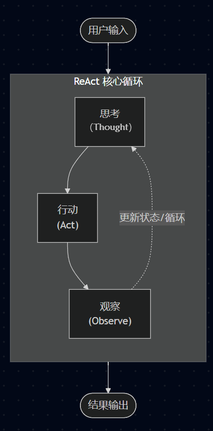
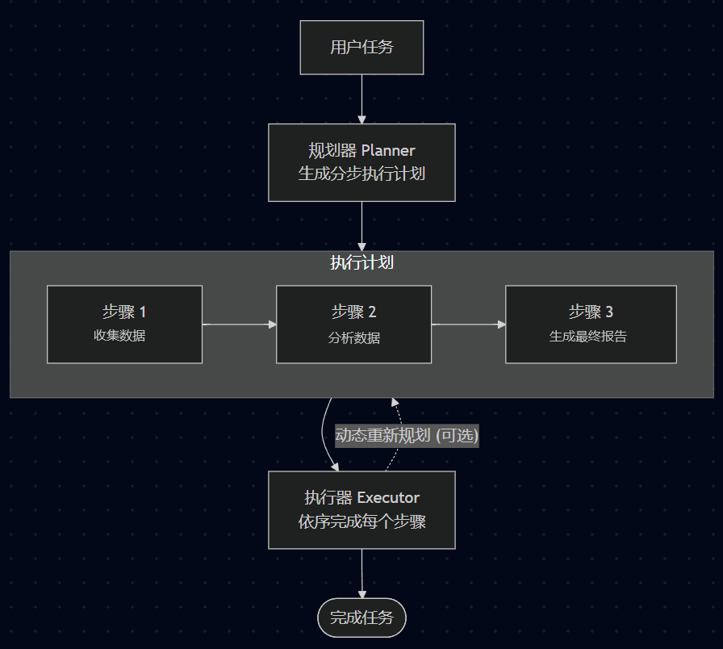
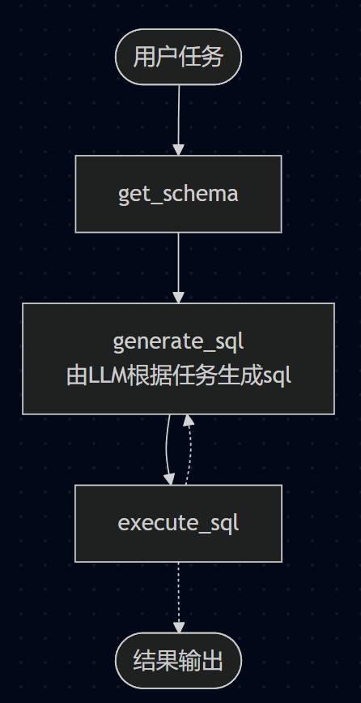

# 第三章：Agent 基础篇

在前两章的学习中，我们已经掌握了Agent开发的两个前置：
> - **第一章**中，我们学会了调用大模型，理解了消息类型、多轮对话、结构化输出，还掌握了工具调用（Tool Calling）的机制——让模型表达"需要调用某个函数"的意图，并手动完成了从意图解析到执行再到结果回填的完整流程。
> - **第二章**中，我们从向量概念出发，一步步学会了 Embedding、向量数据库、文档分块，最终把检索和生成串起来，构建了一个简易的 RAG 系统——让大模型能够"读到"私有文档。


回顾我们在 第一章中学习的 `天气查询助手` 练习代码，为了让模型成功调用工具并给出最终回答，我们手动做了大量繁琐的操作：
> 1. **手动解析意图**：检查 `AIMessage` 中是否包含 `tool_calls` 属性。
> 2. **手动匹配与执行**：提取工具名称与参数，去本地函数字典中查找并执行。
> 3. **手动维护消息队列与 ID 配对**：将执行结果封装为 `ToolMessage`，必须严格保证 `tool_call_id` 与上一轮的 `tool_call` 匹配，并手动 `append` 到 `messages` 列表中。
> 4. **手动编写循环控制逻辑**：用 `while True` 维护对话生命周期，再次带着更新后的消息队列推给大模型。


这种“手动挡”的方式虽然能跑通流程，但在实际开发复杂的 AI 应用时，会带来严重的工程痛点：
> * ❌ **代码极度冗长繁琐**：每新增一个功能或工具，都需要编写大量重复的解析、转换、拼接等“胶水代码”。
> * ❌ **状态维护极易出错**：消息顺序错乱、`tool_call_id` 丢失或无法匹配，都会直接导致大模型 API 报错或逻辑崩塌。
> * ❌ **缺乏统一的抽象**：一旦业务逻辑变复杂（比如需要多工具协同、失败重试、中间干预），手写的循环控制代码会迅速变得不可维护。

本章我们正式开始进入`langchain`的`agent`内容讲解，看看langchain是如何解决这些问题的。


## 3.1 agent的概念
> **Agent = 大模型（大脑） + 工具（手脚） + 上下文管理**  

**Agent（智能体）并不是什么高深莫测的技术，它的本质就是对这套“工具调用循环与消息状态管理”的框架级封装。**  

正如我们不会在 Web 开发中手写 HTTP 协议解析器，而是选择 Django、FastAPI 或 Spring 框架一样，在 LangChain 中学习 Agent，本质上是**从“手动造轮子”走向“使用标准框架”**。

Agent 框架帮我们自动接管了以下繁琐工作：
> * 🤖 **自动解析意图**：识别模型是否需要调用工具。
> * 🛠️ **自动调度工具**：自动提取参数并执行对应的本地函数。
> * 📝 **自动维护状态**：自动完成 `ToolMessage` 的封装、`tool_call_id` 的绑定以及消息历史的更新。
> * 🔁 **自动控制循环**：自动进行“思考-行动-观察”的迭代，直至获取最终答案。

原本在 1.5 节中需要几十行胶水代码才能维护好的工具调用流程，在 Agent 框架中只需要**一行代码或几个配置**就能轻松搞定。

---

## 3.2 Agent 的工作模式
在深入代码之前，我们先从宏观层面理解 Agent 的几种主流工作模式。不同模式的核心区别，可以简单理解为一个问题：
> 任务执行过程中，下一步该做什么，由谁决定、在什么时候决定？

常见的 Agent 工作模式主要有：
- ReAct：走一步看一步
- Planning：先做计划，再按计划执行
- Workflow：由开发者预先规定执行流程

### 3.2.1 ReAct 模式（边推理边行动）
**核心机制：**  
> 一个 Thought → Action → Observation 的循环。模型每一步都先"思考"，再"行动"，然后观察"结果"，
> 根据当前状态和上一步的结果，动态决定下一步行动，直到任务完成。



**运行流程**：
```
Thought（思考）：分析当前状态，决定下一步做什么
Action（行动）：调用工具执行操作
Observation（观察）：获取工具执行结果，并将结果纳入下一轮决策
→ 回到 Thought，直到信息足够，输出 Final Answer
```

**优点**：  
- 灵活性高，能根据环境反馈调整行为

**缺点**：
- 对复杂长程任务，如果缺乏额外的任务规划和上下文管理，容易出现任务偏移、重复操作或遗漏步骤
- 执行过程中需要不断进行决策，可能增加模型调用次数和执行成本

**适用场景**：  
适合路径不确定、需要"走一步看一步"的探索性任务。  

**典型实现**：
> LangChain中create_agent 创建的 Agent，就是标准的ReAct模式


### 3.2.2 Planning 模式（先规划再执行）
**核心机制：**  
> 与 ReAct "走一步看一步"不同，Planning 是"先计划再行动"，
> 在执行任务之前，先对任务进行整体分析，把复杂任务拆解成多个子任务，形成一个相对完整的执行计划。



**运行流程**：
```
Planner（规划）：分析任务，拆解为多个子步骤，生成计划列表（todo list）
Execute（执行）：按计划逐步执行，收集结果
Synthesize（总结）：汇总所有结果，输出最终答案
```

补充说明：
> 执行计划是可以在执行过程中动态调整的，并非“一次规划，永远不变”  
> Planner 和 Executor 可以是两个独立组件，也可以由同一个 Agent 完成。

**优点**：
- 先计划再执行，有任务列表，相比ReAct不容易跑偏
- 计划可审查、可修改，可靠性比ReAct更好

**缺点**：
- 起点依赖强，如果初始规划就拆错了（对任务理解有偏差），后面执行得再好也是白搭
- 如果任务很简单，制定计划反而增加成本

**适合场景**：  
步骤明确、可预测、结构化强的多步骤任务

**典型实现**：
> - 在create_agent的基础之上，添加TodoListMiddleware中间件来实现任务规划
> - DeepAgents的create_deep_agent内置了复杂任务的规划能力


### 3.2.3 Workflow 模式（人工编排流程）
**核心机制**：
> 由开发者来制定任务的执行流程，每一步做什么都是固定的，模型只在某些节点参与



**运行流程**：先获取表结构 → 根据用户问题和表结构生成sql → 执行sql

**优点**：
- **路径确定**：流程由开发者定义，模型不参与流程决策
- **高度可控**：每一步都可预测、可调试、可监控

**缺点**：
- 灵活性差，遇到预设之外的情况就无法处理了
- 开发难度较高，流程复杂后，编排逻辑本身会变成维护负担

**适合场景**：  
业务流程固定、边界清晰、需要高度可控的生产场景

**典型实现**：
> LangGraph的流程编排框架就是用于构建Workflow模式的


### 3.2.4 横向对比

| 维度    | ReAct                    | Planning                       | Workflow             |
|-------|--------------------------|--------------------------------|----------------------|
| 决策方式  | 边执行边决定                   | 先规划，再执行                        | 开发者预定义               |
| 路径确定性 | 低                        | 中                              | 高                    |
| 灵活性   | 高                        | 较高                             | 较低                   |
| 可控性   | 较低                       | 中                              | 高                    |
| 规划成本  | 低                        | 较高                             | 低                    |
| 适合任务  | 探索、不确定任务                 | 复杂、多步骤任务                       | 固定、标准化流程             |
| 典型实现  | LangChain的`create_agent` | DeepAgents的`create_deep_agent` | LangGraph的StateGraph |


> 选择哪种模式，取决于你对 **灵活性** 和 **可控性** 的权衡。越灵活，越智能，但越难控制；越固定，越稳定，但越难应对变化。
> 这三种模式不是互斥的，实际开发中往往会组合使用

---

## 3.3 使用 `create_agent` 创建 Agent
在了解了 ReAct 模式的模式之后，接下来我们使用 LangChain 的 `create_agent` 来快速的构建一个React Agent。  

### 3.3.1 定义工具
Agent 的能力来源于工具，我们定义两个简单的工具函数：

```python
def get_location() -> str:
    """获取用户所在地区"""
    return "杭州"

def get_weather(city: str) -> str:
    """获取给定城市的天气"""
    return f"{city} 今天（09/02）多云，28~33℃。"
```

### 3.3.2 一行代码创建 Agent

```python
from langchain.agents import create_agent

model = create_model()
agent = create_agent(
    model=model,
    tools=[get_location, get_weather],
    system_prompt="你是一个天气查询助手",
)
```

**就这么简单！** `create_agent` 在内部自动完成了：
- 将工具 Schema 绑定到模型
- 实现 ReAct 循环（思考→调用工具→观察结果→继续思考）
- 消息列表的维护和工具调用的配对


### 3.3.3 运行测试
```python
from rich import print as rprint

messages = {"messages": [{"role": "user", "content": "杭州今天天气怎么样？"}]}
result = agent.invoke(input=messages)
rprint(result)
```

**关键理解**：
> - agent的调用方式和模型的调用方式一样，也是通过invoke或者stream来调用的  
> - 与模型调用不同的是，agent的invoke方法传入的是一个字典，返回的也是一个字典
> - 这个字典本质上是底层LangGraph中的state，state中目前只有一个messages属性，保存的就是本次会话的聊天记录，我们现在没讲到LangGraph，先来简单了解即可

数据示例（简化版）：
```json
{
    'messages': [
        HumanMessage(
            content='杭州今天天气怎么样？',
            additional_kwargs={},
            response_metadata={},
            id='b74ab02f-c025-4a8e-bcf1-6a2bd86aae1c'
        ),
        AIMessage(
            content='',
            additional_kwargs={'refusal': None},
            response_metadata={
                'token_usage': {
                    'completion_tokens': 25,
                    'prompt_tokens': 316,
                    'total_tokens': 341,
                    'completion_tokens_details': None,
                    'prompt_tokens_details': {
                        'audio_tokens': None,
                        'cached_tokens': 0
                    }
                },
                'model_provider': 'openai',
                'model_name': 'qwen3.7-max-2026-05-20',
                'system_fingerprint': None,
                'id': 'chatcmpl-894c1c64-bafb-9439-98b5-ee7b35d9fa72',
                'finish_reason': 'tool_calls',
                'logprobs': None
            },
            id='lc_run--019fc7e3-6c7f-7f72-9ad0-6e1c400c25e3-0',
            tool_calls=[
                {
                    'name': 'get_weather',
                    'args': {'city': '杭州'},
                    'id': 'call_277418fe50774dfc981dca14',
                    'type': 'tool_call'
                }
            ],
            invalid_tool_calls=[],
            usage_metadata={
                'input_tokens': 316,
                'output_tokens': 25,
                'total_tokens': 341,
                'input_token_details': {'cache_read': 0},
                'output_token_details': {}
            }
        ),
        ToolMessage(
            content='杭州 今天（09/02）多云，28~33℃。',
            name='get_weather',
            id='927199fd-a169-4e2c-96e0-d636fabe708d',
            tool_call_id='call_277418fe50774dfc981dca14'
        ),
        AIMessage(
            content='杭州今天（6月2日）天气多云，气温在28℃到33℃之间。天气较热，请注意防暑降温。',
            additional_kwargs={'refusal': None},
            response_metadata={...},
            id='lc_run--019fc7e3-6fcd-7181-8e7f-67eac7820690-0',
            tool_calls=[],
            invalid_tool_calls=[],
            usage_metadata={...}
        )
    ]
}

```

### 3.3.4 Agent 的执行流程
LangChain 的 Agent 本质上是一个状态图（底层是依赖LangGraph作为运行时的），可以一键导出可视化：

```python
def draw_graph(agent, output_path: str):
    graph_png = agent.get_graph(xray=True).draw_mermaid_png()

    with open(output_path, "wb") as f:
        f.write(graph_png)

    print(f"Agent graph 已保存到: {output_path}")
```
  

从导出的图中，你可以清晰地看到 Agent 的决策节点、工具调用节点，这对于理解 Agent 的内部运转非常有帮助。

---

## 3.4 @tool装饰器
第一章中是使用`model.bind_tools`来绑定工具的，上一节中是通过`create_agent`方法的`tools`参数来绑定工具的，我们传入的都是普通python函数，
既然不用`@tool`装饰器也能用，那为什么还需要`@tool`装饰器呢？

`@tool`装饰器的作用是将普通函数显式定义为 LangChain Tool，不加@tool也能用是因为`bind_tools()`、`create_agent()`这些方法内部会根据类型判断，
如果是普通函数，则会自动隐式转换，降低使用门槛。

使用`@tool`装饰器显式将普通函数转换为`Tool`，主要是方便做更多的配置


### 3.4.1 自定义工具属性
```python
from langchain_core.tools import tool

@tool(name_or_callable='get_location', description='获取用户所在地区')
def get_location_mock()-> str:
    print("get_location 被调用")
    # return "纽约市皇后区"
    return "杭州市西湖区"
```

- `name_or_callable`：工具名称，默认为函数名，如果你需要自定义工具名称，可以用`name_or_callable`来指定
- `description`：工具描述，如果你不想用docstring的方式，那么可以用`description`来描述工具


### 3.4.2 复杂的参数描述
工具的输入参数较多、参数结构复杂，或者需要校验时，可以使用`args_schema`来定义参数描述。

```python
from pydantic import BaseModel, Field
from typing import Optional, Literal

class Location(BaseModel):
    city: str = Field(description="城市名称，例如：杭州市")
    district: Optional[str] = Field(None, description="区/县，例如：西湖区")

class WeatherInput(BaseModel):
    location: Location = Field(description="地理位置详细信息")
    units: Literal["celsius", "fahrenheit"] = Field(default="celsius", description="温度单位偏好，中国地区用摄氏度，美国地区用华氏度")

@tool(args_schema=WeatherInput, description='获取某个地点的天气信息')
def get_weather1(location: Location, units: str) -> str:
    print(f"get_weather被调用：location={location}, units={units}")
    district = location.district if location.district else ''
    return f"{location.city} {district} 今天（08/02）多云，温度28~33"
```


### 3.4.3 直接从工具返回
如果工具的执行结果不需要发送给模型进一步处理，那么可以使用`return_direct`参数将工具执行结果直接作为 Agent 的最终结果返回，不再继续后续的 Agent 循环

```python
@tool(args_schema=WeatherInput, description='获取某个地点的天气信息', return_direct=True)
def get_weather1(location: Location, units: str) -> str:
    print(f"get_weather被调用：location={location}, units={units}")
    district = location.district if location.district else ''
    return f"{location.city} {district} 今天（08/02）多云，温度28~33"
```


### 3.4.4 主动解析docstring
**避坑：** agent绑定工具和第一章的模型绑定工具，它们的底层机制不一样，给模型绑定工具时，即使不加@tool装饰器，工具中的docstring默认会被解析，
但是agent中绑定的工具，默认是不会去解析docstring的，而会把 docstring 整体作为工具 description，
所以，如果你的工具中有docstring，并且需要解析Args的，那就必须使用`parse_docstring`参数来主动解析

```python
@tool(name_or_callable="get_weather", parse_docstring=True)
def get_weather2(city: str, units: str="celsius") -> str:
    """获取给定城市的天气

    Args:
        city: 城市名称
        units: 温度单位偏好，中国地区用摄氏度，美国地区用华氏度
    """
    print(f"get_weather被调用：city={city}, units={units}")
    return f"{city} 今天（08/02）多云，温度28~33"
```

不加parse_docstring=True时的tool schema：
```json
{
    'type': 'function',
    'function': {
        'name': 'get_weather',
        'description': '获取给定城市的天气\n\n    Args:\n        city:城市名称\n        units: 温度单位偏好，中国地区用摄氏度，美国地区用华氏度',
        'parameters': {
            'properties': {
                'city': {'type': 'string'},
                'units': {'default': 'celsius', 'type': 'string'}
            },
            'required': ['city'],
            'type': 'object'
        }
    }
}
```

加上parse_docstring=True时的tool schema：
```json
{
    'type': 'function',
    'function': {
        'name': 'get_weather',
        'description': '获取给定城市的天气',
        'parameters': {
            'properties': {
                'city': {'description': '城市名称', 'type': 'string'},
                'units': {
                    'default': 'celsius',
                    'description': '温度单位偏好，中国地区用摄氏度，美国地区用华氏度',
                    'type': 'string'
                }
            },
            'required': ['city'],
            'type': 'object'
        }
    }
}
```

### 3.4.5 ToolRuntime参数
工具方法中有一个`runtime`的注入参数，工具中可以通过`runtime`来访问`state`、`context`、`store`、`config`等数据。

```python
from langgraph.prebuilt import ToolRuntime

class UserContext(BaseModel):
    user_id: str = Field(description="用户id")
    
def get_weather3(city: str, runtime: ToolRuntime) -> str:
    """获取给定城市的天气

    Args:
        city: 城市名称
    """
    state = runtime.state
    print(f'state：{state}', end="\n\n")

    config = runtime.config
    print(f'config：{config}', end="\n\n")

    context = runtime.context
    print(f'context：{context}', end="\n\n")
    return f"今天（08/02）多云，温度28~33"
```

[关于runtime的更多用法请参考文档](https://docs.langchain.com/oss/python/langchain/tools#access-context)


### 3.4.6 测试运行
```python
from rich import print as rprint
from langchain.agents import create_agent
from langgraph.checkpoint.memory import InMemorySaver
from langchain_core.utils.function_calling import convert_to_openai_tool

if __name__ == '__main__':
    tool_schema = convert_to_openai_tool(get_weather3)
    rprint(tool_schema)

    model = create_model()

    agent = create_agent(
        model=model,
        tools=[get_location_mock, get_weather3],
        system_prompt="你是一个天气查询助手",
        checkpointer=InMemorySaver(),
        context_schema=UserContext
    )

    config = {'configurable': {'thread_id': '001'}}
    context = UserContext(user_id='9527')
    messages = {"messages": [{"role": "user", "content": "今天天气怎么样？"}]}

    result = agent.invoke(input=messages, config=config, context=context)
    print(result['messages'][-1])
```

---

## 3.5 Streaming
大模型的流式输出，我们在第一章中已经接触过了，不过在Agent中，流式输出的用法还是比较多的，有streaming和event streaming两套实现  

普通流 (streaming)：
>它直接向你暴露底层 Pregel 引擎的原始输出。你需要通过显式指定 stream_mode（如 "values"、"updates"、"messages"）来告诉它你要看什么。
它返回的是一个包含原始字典（Dict）的生成器，你必须自己编写判断逻辑去解析这些字典。

stream流式输出主要支持以下三种核心模式：
- messages：大模型的内容输出
- updates：state内容变更
- custom：自定义数据流

你可以单独使用某一种模式，也可以将它们组合在一个列表中（如 ["updates", "messages"]）同时使用。

### 3.5.1 前置代码
```python
import time
import rich
from langchain_core.tools import tool
from langchain.agents import create_agent
from langchain_core.messages import AIMessageChunk
from langgraph.prebuilt import ToolRuntime
from unit1_大模型基础篇.a03_langchain调用模型 import create_model


@tool(name_or_callable="get_weather", description="获取给定城市的天气")
def get_weather_for_writer(city: str, runtime: ToolRuntime) -> str:
    runtime.stream_writer(f"get_weather被调用：city={city}")

    for i in range(1, 10):
        runtime.stream_writer(f"{i}，")
        time.sleep(0.2)

    return f"{city} 今天（09/02）多云，28~33℃。"


model = create_model()

agent = create_agent(
    model=model,
    tools=[get_weather_for_writer],
    system_prompt="你是一个天气查询助手",
)

messages = {"messages": [{"role": "user", "content": "杭州今天天气怎么样？"}]}
```

### 3.5.2 messages模式
当stream_mode="messages"时，表示只要大模型或工具有响应就输出，chunk是一个字典，包含AIMessageChunk和ToolMessage两种：

```python
def test_stream_messages():
    status = None
    
    for chunk in agent.stream(messages, stream_mode="messages", version="v2"):
        rich.print(chunk, end="\n\n")
        
        # data = chunk["data"][0]
        # if isinstance(data, AIMessageChunk):
        #     reasoning = data.additional_kwargs.get("reasoning_content")
        #     content = data.content
        # 
        #     # 推理过程
        #     if reasoning:
        #         if status != "reasoning":
        #             print(f"\n{'=' * 50} 推理过程↓↓↓ {'=' * 50}")
        #             status = "reasoning"
        #         print(reasoning, end="", flush=True)
        #     # 正文
        #     elif content:
        #         if status != "answer":
        #             print(f"\n{'=' * 50} 最终回答↓↓↓ {'=' * 50}")
        #             status = "answer"
        #         print(content, end="", flush=True)
        # elif isinstance(data, ToolMessage):
        #     if status != "tool":
        #         print(f"\n{'=' * 50} 工具执行结果↓↓↓ {'=' * 50}")
        #         status = "tool"
        #     print(data.content, end='\n\n')
```


messages模式的chunk格式（v2）：
```json
{
  "type": "messages",
    "data": (
      AIMessageChunk(content="Hello") | ToolMessage(content='杭州 今天（09/02）多云，28~33℃。'),  // 包含文本或工具调用碎片的对象
      {"langgraph_node": "model"...}      // 元数据，标明是谁产生的
    )
}
```

AIMessageChunk样例：
```json
AIMessageChunk(
    content='今天',
    additional_kwargs={},
    response_metadata={'model_provider': 'openai'},
    id='lc_run--019fc95d-02f5-7812-902d-545a93b92b2c',
    tool_calls=[],
    invalid_tool_calls=[],
    tool_call_chunks=[]
)
```

为什么AIMessage是chunk，而ToolMessage是完整消息？
> 因为工具的执行结果就是一次性返回的，如果需要在工具中实时的输出一些进度信息，请看下面的custom模式


### 3.5.3 updates模式
updates模式本质上是指：在`LangGraph`的底层机制中，节点执行完毕后对`state`中的数据更新时，输出节点更新的数据。
由于现在还没讲到graph，所以暂时可以简单理解为工具执行完毕、模型输出完毕时触发，输出工具执行结果和模型输出结果。

```python
def test_stream_updates():
    for chunk in agent.stream(messages, stream_mode="updates", version="v2"):
        rich.print(chunk, end="\n\n")

        # if 'tools' in chunk["data"]:
        #     print(f'ToolMessage：{chunk["data"]["tools"]["messages"][0].content}')
        # elif 'model' in chunk["data"]:
        #     if chunk["data"]["model"]["messages"][0].content:
        #         print(f'AIMessage content：{chunk["data"]["model"]["messages"][0].content}')
        #     elif chunk["data"]["model"]["messages"][0].tool_calls:
        #         print(f'AIMessage tool_calls：{chunk["data"]["model"]["messages"][0].tool_calls}')
```

updates模式的chunk格式（v2）：
```json
  {
    "type": "updates",
    "data": {
      "tools" | "model": {  // 节点名称 (如 "model" 或 "tools")
        "messages": [ToolMessage(...) | AIMessage(...)] // 该节点的执行结果
      }
    }
  }
```
实际输出样例1：tools
```json
{
    'type': 'updates',
    'ns': (),
    'data': {
        'tools': {
            'messages': [
                ToolMessage(
                    content='杭州 今天（09/02）多云，28~33℃。',
                    name='get_weather',
                    id='0e311bb9-9038-470d-ab36-f2175d67a6d7',
                    tool_call_id='call_7c6dc4b1d08d4a568bb68a3a'
                )
            ]
        }
    }
}
```
实际输出样例2：model
```json
{
    'type': 'updates',
    'ns': (),
    'data': {
        'model': {
            'messages': [
                AIMessage(
                    content='今天杭州天气多云，气温在28℃到33℃之间，体感较热，请注意防暑降温。',
                    additional_kwargs={'refusal': None},
                    response_metadata={...},
                    id='lc_run--019fc9c0-3a93-7af2-ab8d-11fda3074e3c-0',
                    tool_calls=[],
                    invalid_tool_calls=[],
                    usage_metadata={...}
                )
            ]
        }
    }
}
```

### 3.5.4 custom模式
如果你想在工具中发送一些自定义的数据，可以通过 `runtime.stream_writer` 或者 `get_stream_writer()` 获取一个 writer 对象，然后调用 writer() 方法发送自定义数据。  

```python
def test_stream_custom():
    for chunk in agent.stream(messages, stream_mode="custom", version="v2"):
        print(chunk, end="\n\n")
```

custom模式的chunk格式（v2）：
```json
{'type': 'custom', 'ns': (), 'data': 'get_weather被调用：city=杭州'}
{'type': 'custom', 'ns': (), 'data': '1，'}
...
```

> 使用场景示例：在执行长耗时工具（如爬取多个网页、查询数据库）时，向用户发送一些进度信息，如：“已处理 10 条…”、“已处理 50 条…”。  


### 3.5.5 多模式组合
stream_mode也可以传入一个数组，同时监听多个模式。
```python
def test_stream_all():
    for chunk in agent.stream(messages, stream_mode=["messages", "updates", "custom"], version="v2"):
        print(chunk, end="\n\n")
```


### 3.5.6 v1与v2的区别
LangChain 的流式输出 API 经历了 v1 到 v2 的演进。在调用时通过 version="v2" 指定，如果不指定 version 参数，默认为 v1，但不推荐使用v1

在 v1 中，如果你同时使用多个流模式（例如 stream_mode=["updates", "messages"]），返回的数据格式是不统一的。
你拿到的可能是一个裸元组（相当于只有data），你需要写大量的 if-else 去猜测这个 chunk 到底属于哪个模式、数据存在哪个键里。

v2 版本最大的贡献是统一了数据结构（标准化），引入了 StreamPart 规范。 无论你监听的是什么模式，v2 返回的每一个 chunk 永远长这样：
```json
{
    "type": "messages" | "updates" | "custom",  # 明确告诉你这是什么模式的数据
    "data": ...,                                # 真正的载荷数据
    "ns": ["node_name"]                         # 命名空间，标明数据来自哪个节点或子图
}
```

---

## 3.6 Event Streaming

>在LangChain的1.3版本中，新增了一个Event streaming事件流，
>它是建立在普通流之上的抽象层。它在后台收集所有底层的原始事件，进行规范化清洗，然后分流到不同的“投影”上。
>你不再需要手动解析字典，而是直接消费它已经为你准备好的属性对象（如 stream.messages、stream.values）。

我们先回顾一下普通 `stream` 的使用体验：
当我们在 `stream_mode=["updates", "messages"]` 中同时监听多种流时，即使有了 v2 的 `StreamPart` 规范，
你在代码里拿到数据后，**依然需要写一堆 `if-else` 来判断当前这个 chunk 到底是文本碎片、还是工具结果、还是状态更新**，
然后再层层剥开 `chunk["data"]` 里面的字段去取值。

使用事件流非常简单，只需将 `agent.stream()` 替换为 `agent.stream_events()`，并指定 `version="v3"`
（注意：stream_events必须传v3，如果不传，默认是v2会报错）。

```text
NotImplementedError: stream_events(version='v2') is not supported. 
Use astream_events() for v1/v2, or stream_events(version='v3') on a supported subclass.
```

事件流为你提供了多种 **Projection（投影）**，你可以根据自己的需求按需取用：

| 事件通道（Projection）      | 通道说明                      | 应用场景            |
|-----------------------|---------------------------|-----------------|
| `for event in stream` | 原始事件（raw protocol events） | 日志、监控           |
| `stream.messages`     | 模型调用事件                    | 获取模型的返回内容（流式输出） |
| `stream.tool_calls`   | 工具调用事件                    | 获取工具的执行结果       |
| `stream.values`       | state变更事件                 | 获取当前state快照     |
| `stream.output`       | agent结束事件                 | 获取最终state快照     |
| `stream.extensions`   | 自定义事件                     | 获取自定义的输出内容      |
| `stream.subgraphs`    | 子智能体事件                    |                 |


前置代码

```python
import rich
from langchain.agents import create_agent
from unit1_大模型基础篇.a03_langchain调用模型 import create_model
from unit3_agent_基础篇.c03_agent_stream import get_weather_for_writer

model = create_model()

agent = create_agent(
    model=model,
    tools=[get_weather_for_writer],
    system_prompt="你是一个天气查询助手",
)

messages = {"messages": [{"role": "user", "content": "杭州今天天气怎么样？"}]}
```

### 3.6.1 原始事件
原始事件通道中包含了所有类型的数据，它是 Event Streaming 的底层数据格式，实际开发中一般是使用上层封装的数据，不会去解析底层，我们简单了解即可

```python
def test_event_stream():
    stream = agent.stream_events(messages, version="v3")

    for event in stream:
        print(event, end="\n\n")
```

event数据格式：
```json
{
    'type': 'event',
    'method': 'values' | 'messages' | 'tools' | 'custom',
    'params': {
        'namespace': [],
        'timestamp': 1785858841200,
        'data': dict | tuple | str,
        'interrupts': ()
    },
    'seq': 1
}
```

### 3.6.2. stream.messages
当你需要实时展示大模型输出的文字时，用 `stream.messages`，message中有多个属性：

| 属性                   | 用途                             |
|----------------------|--------------------------------|
| `message.reasoning`  | 思考过程chunk                      |
| `message.text`       | 消息正文chunk                      |
| `message.tool_calls` | 工具调用意图                         |
| `message.output`     | 完整消息对象，包含元数据（可以从元数据中获取token统计） |

```python
def test_stream_messages():
    stream = agent.stream_events(messages, version="v3")

    for message in stream.messages:
        # 思考过程，由于langchain底层扩展字段丢失，所以这里的reasoning实际上是空的
        # print(f"{'-'*50}思考过程{'-'*50}")
        # for reasoning in message.reasoning:
        #     print(reasoning, end="", flush=True)

        # 消息chunk
        print(f'{"-" * 50} 消息chunk {"-" * 50}')
        for text in message.text:
            print(f'[{text}]', end=" ", flush=True)
        print()

        # 工具调用请求
        tool_calls = message.tool_calls.get()
        if tool_calls:
            print(f"{'-' * 50} 工具调用 {'-' * 50}")
            print(tool_calls)

        # 也可以通过message.text一次性拿完整文本
        full_text = str(message.text)
        if full_text:
            print(f"{'-' * 50} 完整消息 {'-' * 50}")
            print(full_text)


        print(f"{'-' * 50} 消息对象 {'-' * 50}")
        rich.print(message.output)
```

输出结果：
```json
--------------------------------------------------工具调用--------------------------------------------------
[{'type': 'tool_call', 'id': '', 'name': 'get_weather', 'args': {'city': '杭州'}}]
--------------------------------------------------消息对象--------------------------------------------------
AIMessage(
    content=[{'type': 'tool_call', 'id': '', 'name': 'get_weather', 'args': {'city': '杭州'}}],
    additional_kwargs={},
    response_metadata={...},
    id='lc_run--019fce03-9185-7fc2-9750-d61007930b15',
    tool_calls=[{'name': 'get_weather', 'args': {'city': '杭州'}, 'id': '', 'type': 'tool_call'}],
    invalid_tool_calls=[],
    usage_metadata={...}
)
--------------------------------------------------消息chunk--------------------------------------------------
[今天],[杭州的天气],[是多云，气温],[在28℃],[到33℃],[之间。],[天气比较炎热，],[请注意防暑降温],[！],
--------------------------------------------------完整消息--------------------------------------------------
今天杭州的天气是多云，气温在28℃到33℃之间。天气比较炎热，请注意防暑降温！
--------------------------------------------------消息对象--------------------------------------------------
AIMessage(
    content=[{'type': 'text', 'text': '今天杭州的天气是多云，气温在28℃到33℃之间。天气比较炎热，请注意防暑降温！', 'index': 0}],
    additional_kwargs={},
    response_metadata={...},
    id='lc_run--019fce03-95be-7a83-9351-5eaf88aef62f',
    tool_calls=[],
    invalid_tool_calls=[],
    usage_metadata={...}
)
```


### 3.6.3. stream.tool_calls
注意：前面的`message.tool_calls`只是大模型输出的工具调用意图，它是只能看到模型决定调用什么工具、参数是什么，没有执行结果的。
`stream.tool_calls` 才是用于监听工具实际执行过程，并获取工具执行结果，这两个`tool_calls`不要搞混！

```python
def test_stream_tool_calls():
    stream = agent.stream_events(messages, version="v3")

    for call in stream.tool_calls:
        print(f"\n工具 {call.tool_name} 开始执行，入参: {call.input}，tool_call_id：{call.tool_call_id}")

        # 注意：call.output_deltas是一个生成器，要遍历后才能获取 call.output 工具执行结果，否则output是none
        for delta in call.output_deltas:
            print(delta, end="~", flush=True)

        # 或者用 list() 强制消费完生成器，驱动 LangChain 在后台完成 output 的拼接
        # list(call.output_deltas)

        print(f"\n工具执行完毕，最终结果: {call.output}", end="\n\n")
```

执行结果：
```text
工具 get_weather 开始执行，入参: {'city': '杭州'}

工具执行完毕，最终结果: content='杭州 今天（09/02）多云，28~33℃。' name='get_weather' id='df8034b8-615c-4f8a-8537-c1d20fb36e92' tool_call_id=''
```

### 3.6.4. stream.values、stream.output
关于 stream.values 与 stream.output，二者均用于观测 state 中的数据

- stream.values：state每次变更（如模型生成回复或工具返回结果）后的快照；
- stream.output：agent执行结束时，state的最终快照；

```python
def test_stream_values():
    stream = agent.stream_events(messages, version="v3")
    for i, value in enumerate(stream.values):
        print(f'{'-' * 50} 第{i+1}个快照 {'-' * 50}')
        rich.print(value)

    print(f"{'-' * 50} 最终状态 {'-' * 50}")
    rich.print(stream.output)
```

### 3.6.5 extensions（自定义事件）
我们之前用原始事件流时，并没有打印出工具中通过runtime.stream_writer输出的内容，因为自定义事件流需要配置消息转换器

```python
from langgraph.stream import StreamTransformer, StreamChannel, ProtocolEvent

# 自定义的消息转换器，用于处理自定义的协议事件
class MyCustomTransformer(StreamTransformer):
    # 表示这个消息转换器只对"custom"模式的事件流生效，当agent运行并产生 custom 类型的事件时，就会触发该转换器的 process 方法。
    required_stream_modes = ("custom",)

    def __init__(self, scope: tuple[str, ...] = ()) -> None:
        super().__init__(scope)
        # 1. 创建一个新的事件通道
        self.channel = StreamChannel()

    # 2. 把 channel 注册到 stream.extensions，通道名为custom_extension
    def init(self) -> dict[str, StreamChannel]:
        return {"custom_extension": self.channel}

    # 3. 通过channel把custom数据推送出去，外部就可以通过stream.extensions["custom_extension"]来获取了
    def process(self, event: ProtocolEvent) -> bool:
        if event["method"] == "custom":
            data = event["params"]["data"]
            self.channel.push(data)
        # 返回 True 表示“放行”事件：处理完后，原始事件依然保留在主流（raw stream）中，不会被截断
        return True


def test_stream_extensions():
    stream = agent.stream_events(messages, version="v3", transformers=[MyCustomTransformer])
    for item in stream.extensions["custom_extension"]:
        print(f'custom_extension：{item}')
```

### 3.6.6. stream.interleave（多事件组合）
stream.interleave可以传入多个事件通道，即同时监听多个流，它的主要作用是让不同类型的消息按时序输出

```python
def test_stream_interleave():
    stream = agent.stream_events(messages, version="v3")

    for name, item in stream.interleave("messages", "tool_calls"):
        if name == "messages":
            # item 是 message 对象
            content = str(item.text)
            print(f'content: {content}')
        elif name == "tool_calls":
            # item 是 call 对象
            print(f"\n[进度] 工具 {item.tool_name} 开始执行...")
            list(item.output_deltas)
            print(f"[完成] {item.tool_name} 执行完毕，结果：{item.output}")
```

反面示例：
> 如果不使用 interleave，单独去监听多个事件流是不行的，stream 底层是一个单次消费的生成器，第二次循环已经没有可消费的事件了

```python
for msg in stream.messages:
    print(msg) # 先输出所有的AIMessage

for call in stream.tool_calls:
    print(call) # 期望这里再输出所有的ToolMessage，实际上第二次遍历时不会输出任何内容
```

---

## 3.7 Agent的结构化输出
在第一章中，我们是通过 `model.with_structured_output()` 让模型返回指定格式的数据，agent中是通过`create_agent`方法的`response_format` 参数，
传入指的数据格式

### 3.7.1 实现方式

回顾第一章的方式：
```python
# 第一章：单次模型调用 + 结构化输出
structured_model = model.with_structured_output(ContactInfo)
result = structured_model.invoke("从这段文本中提取联系人信息...")
# result 直接就是 {'name': 'John Doe', 'email': '...', 'phone': '...'}
```

Agent 的方式：
```python
# 1. 使用 TypedDict 定义结构
class ContactInfo(TypedDict):
    """用户联系方式"""
    name: str # 用户名
    email: str # 邮箱
    phone: str # 电话

# 2. 初始化模型
model = create_model(provider="openai", model="gpt-5.4-mini") # 注意：结构化输出不支持thinking模式

# 3. 创建agent 并绑定结构化输出
agent = create_agent(
    model=model,
    response_format=ContactInfo,
    system_prompt="从这段文本中提取联系人信息，并以指定的 JSON 格式返回",
    # 避坑：qwen系列模型必须要在提示词中明确包含"json"字样
)

# 4. 运行测试
result = agent.invoke({
    "messages": [{"role": "user", "content": "Extract contact info from: John Doe, john@example.com, (555) 123-4567"}]
})

print(result)
print(f'structured_response：{result['structured_response']}')
# {'name': 'John Doe', 'email': 'john@example.com', 'phone': '(555) 123-4567'}
```

### 3.7.2 使用要点
1. **定义结构**：与第一章一样，用 `TypedDict` 或 `Pydantic BaseModel` 定义目标格式。
2. **传入 `response_format`**：在 `create_agent` 中指定，框架会自动处理 schema 绑定和结果解析。
3. **⚠️ 必须关闭思考模式**：结构化输出与模型的 thinking 模式冲突，创建模型时需设置 `enable_thinking=False`。
4. **⚠️ 提示词需含 `json` 关键词**：部分模型（如 Qwen 系列）要求提示词中包含 "json"，否则会报 400 错误。

---

## 3.8 text2sql项目实战
前面的章节中，我们已经掌握了agent的基本使用。现在让我们把这些知识组合起来，构建一个真正有实用价值的 Agent——**Text2SQL**：
实现用自然语言查询数据库，Agent 自动生成 SQL 并执行，输出结果。

### 3.8.1 什么是 Text2SQL？
无需编写SQL，用自然语言描述需求，由 Agent "理解意图 → 生成 SQL → 执行查询 → 总结结果"的流程

```
用户：「一共有哪些部门？」
  → Agent 调用 get_db_schema，了解表结构
  → Agent 生成 SQL：SELECT DNAME FROM DEPT
  → Agent 调用 execute_sql，执行查询
  → Agent 总结：「共有 4 个部门：ACCOUNTING、RESEARCH、SALES、OPERATIONS」
```

这正是 ReAct 模式的典型应用：步骤不确定（可能需要多次修正 SQL），每一步依赖上一步的结果。

### 3.8.2 数据准备
部门表
```sql
CREATE TABLE DEPT (
    DEPT_NO INT PRIMARY KEY,
    DNAME VARCHAR(14),
    LOCATION VARCHAR(13)
);
```

员工表
```sql
CREATE TABLE EMP (
    EMP_NO INT PRIMARY KEY,
    ENAME VARCHAR(10),
    JOB VARCHAR(9),
    SUPERIOR_NO INT,
    HIRE_DATE DATE,
    SALARY DECIMAL(7,2),
    BONUS DECIMAL(7,2),
    DEPT_NO INT,
    FOREIGN KEY (DEPT_NO) REFERENCES DEPT(DEPT_NO)
);
```
[数据初始化脚本](./sqlite/init_db.py)


### 3.8.3 设计两个核心工具
Text2SQL Agent 只需要两个工具，职责清晰：

| 工具              | 职责                  | 为什么需要                 |
|-----------------|---------------------|-----------------------|
| `get_db_schema` | 返回所有表的 DDL 定义       | 模型不知道表名和列名，必须先"看地图"   |
| `execute_sql`   | 执行 SQL 并返回结果（或错误信息） | 模型只会生成 SQL，执行需要本地代码完成 |


**get_db_schema实现**：
```python
import os
import sqlite3

# 1. 动态获取当前文件 (text2sql_agent.py) 所在的绝对目录
CURRENT_DIR = os.path.dirname(os.path.abspath(__file__))
# 2. 拼接出 db 文件的绝对路径
DB_PATH = os.path.join(CURRENT_DIR, "sqlite", "text2sql.db")

def get_db_schema() -> str:
    """获取数据库中所有表的结构（DDL定义）。在编写任何 SQL 查询之前，必须先调用此工具来了解表名和列名。"""
    conn = sqlite3.connect(DB_PATH)
    cursor = conn.cursor()

    # 查询所有用户创建的表
    cursor.execute("SELECT name FROM sqlite_master WHERE type='table';")
    tables = cursor.fetchall()

    schema_info = []
    for table in tables:
        table_name = table[0]
        if table_name == 'sqlite_sequence':  # 排除内置表
            continue
        cursor.execute(f"SELECT sql FROM sqlite_master WHERE type='table' AND name='{table_name}';")
        ddl = cursor.fetchone()[0]
        schema_info.append(ddl)

    conn.close()
    return "\n\n".join(schema_info)
```

**execute_sql实现**：
```python
def execute_sql(query: str) -> str:
    """执行标准 SQL 查询语句，并以字符串形式返回执行结果。如果 SQL 语法有误，将返回具体的错误信息。"""
    conn = sqlite3.connect(DB_PATH)
    cursor = conn.cursor()

    try:
        # 执行 LLM 生成的 SQL
        cursor.execute(query)
        # 判断是否为查询语句
        if query.strip().upper().startswith('SELECT'):
            result = cursor.fetchall()
            # 提取列名，让结果可读性更好
            columns = [description[0] for description in cursor.description]
            formatted_result = [f"Columns: {columns}"]
            for row in result:
                formatted_result.append(str(row))

            return "\n".join(formatted_result)
        else:
            # 修改操作（UPDATE/INSERT/DELETE）返回影响行数
            conn.commit()
            return f"操作成功，影响了 {cursor.rowcount} 行数据"
    except Exception as e:
        # 关键点：把异常原封不动抛给 LLM，它看到报错后会自动修正 SQL 并重新运行！
        return f"SQL Error: {str(e)}"
    finally:
        conn.close()
```
> **错误也是上下文**：`execute_sql` 在 SQL 报错时，不会抛异常中断流程，而是把错误信息原样返回给模型。模型看到报错后会**自动修正 SQL 并重新执行**，这正是 ReAct "观察→调整"循环的能力

提示词：
```python
def get_text2sql_prompt() -> str:
    return (
        "你是一个精通 SQL 的数据库分析专家。"
        "当你收到用户的数据查询需求时，请先调用 get_db_schema 工具了解表结构，"
        "然后编写正确的 SQLite 语句并调用 execute_sql 得到结果。"
        "如果执行报错，请仔细检查错误信息并修正 SQL，直到获得正确答案。"
        "最后，用通俗易懂的中文总结数据并回答用户。"
    )
```

**系统提示词的三个指令**：
1. **先看表结构**：确保模型不会"盲猜" SQL
2. **报错就修正**：明确告诉模型可以多次尝试，增强容错
3. **用中文总结**：原始查询结果是表格数据，需要转化为用户友好的回答


### 3.8.4 组装 Agent
```python
if __name__ == "__main__":
    model = create_model(enable_thinking=True)

    # 组装 Agent，把我们的数据库的两个工具塞进去
    agent = create_agent(
        model=model,
        tools=[get_db_schema, execute_sql],
        system_prompt=get_text2sql_prompt()
    )

    print("=== 数据库查询助手已启动 ===")
    print("请输入你的问题：\n") # 查询所有员工数据

    while True:
        user_input = input("你: ").strip()
        messages = {"messages": [{"role": "user", "content": user_input}]}
        stream = agent.stream_events(input=messages, version="v3")
        print_event_stream(stream)
```

流式输出打印过程太长，为了代码简洁，所以把输出过程封装成工具方法：print_event_stream
```python
import rich

def print_event_stream(stream):
    for name, item in stream.interleave("messages", "tool_calls"):
        if name == "messages":
            # 1. 先遍历 item.text 流式打印ai回复内容
            has_text = False
            for delta in item.text:
                if not has_text: print(f'{"-" * 50} 模型回复 {"-" * 50}')
                print(delta, end="", flush=True)
                has_text = True  # 只要输出了字符，就标记为已拿到文本

            # 2. 如果消息中没有文本输出，说明这次消息是【工具调用请求】
            tool_calls = item.tool_calls.get()
            if not has_text and tool_calls:
                print(f'{"-" * 50} 工具调用 {"-" * 50}')
                rich.print(tool_calls)
                print()
        elif name == "tool_calls":
            # 3. 工具执行结果
            list(item.output_deltas)
            print(f'{"-" * 50} {item.tool_name} 执行结果 {"-" * 50}')
            rich.print(item.output.content)
            print()

    print('\n\n' + '='*100 + '\n')
```


### 3.8.5 Agent 的执行流程
当用户问"一共有哪些部门？"时，Agent 的完整执行过程：

```
第1轮：模型思考 → 调用 get_db_schema → 获取 DEPT 和 EMP 表的 DDL
第2轮：模型思考 → 调用 execute_sql("SELECT DNAME FROM DEPT") → 获取查询结果
第3轮：模型思考 → 信息足够 → 输出最终答案："共有 4 个部门..."
```

如果 SQL 写错了，流程会变成：

```
第2轮：execute_sql("SELECT * FROM dept") → 返回 "SQL Error: no such table: dept"
第3轮：模型看到错误 → 修正为 "SELECT * FROM DEPT" → 再次调用 execute_sql
第4轮：查询成功 → 输出最终答案
```

> 💡 这就是 ReAct 的魅力：**Agent 不是一次就成功，而是像人一样"试错→修正→再试"**，直到解决问题。

---

## 3.9 本章总结

### 📚 核心知识点回顾
1. **Agent 的三种工作模式**：ReAct（边想边做）、Planning（先规划再执行）、Workflow（预定义流程），灵活度和可控性各有取舍
2. **`create_agent` 快速构建**：一行代码创建 ReAct Agent，框架自动处理工具绑定、循环决策、消息配对
3. **流式输出**：普通 stream（v2）提供原始字典，事件流 stream_events（v3）提供类型化的 Projection 对象，开发体验大幅升级
4. **结构化输出**：Agent 通过 `response_format` 参数，在 ReAct 循环中融合结构化输出能力
5. **Text2SQL 实战**：两个工具（查 schema + 执行 SQL）+ 系统提示词 = 完整的数据库查询 Agent

### 💡 关键理解
- Agent 的本质是**大模型自主决策的循环**：不是调一次工具就结束，而是让模型在每次观察后重新决策
- 工具的**文档字符串**决定了 Agent 的能力边界——模型完全依赖它来判断何时调用、传什么参数
- **错误也是上下文**：把错误信息返回给模型，让它自主修正，是 ReAct 模式的重要设计思路

### 🎯 下一章预告
本章学习了 Agent 的基础部分，下一章我们将学习 Agent 中的高级部分：
- 🔧 **中间件**：一种用于在 agent 执行循环的关键节点进行拦截、检查和修改的扩展机制
- 🧠 **Agent 记忆**：短期记忆（对话上下文）与长期记忆（跨会话知识）
- 🛑 **人机协同（HITL）**：在 Agent 流程中插入人工审核节点
