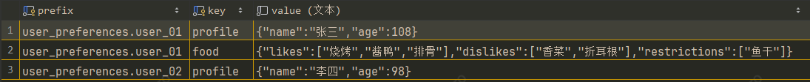

# 第四章：Agent 高级篇

在第三章中，我们已经掌握了 Agent 的基础知识：从 ReAct 模式的"思考→行动→观察"循环，到用 `create_agent` 一行代码构建 Agent，
还掌握了流式输出、结构化输出和 Text2SQL 实战。

至此，你已经能够构建一个**能自主决策、能调用工具、能多步推理**的 Agent 了。但如果要在生产环境中真正落地，你会发现上一章的 Agent 还存在一些问题：
- 缺少持久化：上一章的 Agent 每次调用都是无状态的，历史消息没有保存
- 缺少上下文管理：上下文窗口是有限的，如果历史消息一直累积，将会超出模型的上限，且token消耗也会越来越大。
- 缺少人工审核：想象一下假如我们的sql agent允许修改或者删除操作，那在真正执行变更之前，如果模型抽风了，写了个删库的sql怎么办？

带着这些问题开始本章的学习，看看langchain中是如何解决这些问题的。

---

## 4.1 Agent 中间件1（装饰器）

### 4.1.1 什么是中间件？
在第三章中，我们用 `create_agent` 创建的 Agent 是一个"黑盒"——你传入模型和工具，它自动跑完 ReAct 循环，中间没有任何"插手"的机会。但在实际业务中，你往往需要在特定环节做额外的事情：

- 模型调用**前**：检查用户权限、校验 token 余额、注入上下文
- 模型调用**后**：记录 token 消耗、审计输出内容、计费扣费
- 工具执行**前**：参数校验、权限检查、日志记录
- 工具执行**后**：结果脱敏、耗时统计、异常重试
- Agent 启动/结束时：初始化上下文、资源清理

**中间件（Middleware）** 就是 LangChain 为此提供的扩展机制。它允许你在 Agent 执行流程的关键节点注册回调函数，**在不修改 Agent 核心逻辑的前提下，插入自定义行为**。
> 如果你有前端或者java的开发经验，那么你对此肯定很眼熟，before_xxx就相当于是vue中的组件生命周期函数，wrap_xxx就像是spring aop中的环绕通知

LangChain 提供了6种中间件装饰器：

| 中间件                | 触发时机            | 典型用途                    |
|--------------------|-----------------|-------------------------|
| `@before_agent`    | Agent 开始执行前（一次） | 初始化上下文、记录会话开始           |
| `@after_agent`     | Agent 执行完毕后（一次） | 资源清理、记录会话结束             |
| `@before_model`    | 每次调用大模型前        | 权限校验、token 检查、上下文裁剪     |
| `@after_model`     | 每次大模型返回后        | 计费扣费、输出审计、状态更新          |
| `@wrap_tool_call`  | 包裹每次工具调用        | 参数校验、权限检查、日志监控、**人工拦截** |
| `@wrap_model_call` | 包装每次模型调用        | 动态注入提示词                 |


### 4.1.2 快速上手示例
我们来通过一个"用户 Token 计费"的场景，来演示这几个中间件的用法。

**定义上下文对象**：中间件可以访问 `runtime.context`，它是在调用 Agent 时传入的上下文对象，用于在中间件之间共享状态：

```python
from dataclasses import dataclass

@dataclass
class UserContext:
    user_id: str
    user_token: int  # 用户剩余 token 额度
```

**创建五个中间件**：

```python
from langchain.agents.middleware import before_model, after_model, wrap_tool_call, after_agent, before_agent
from langgraph.runtime import Runtime
from langchain.agents import create_agent, AgentState
from langchain_core.messages import AIMessage, ToolMessage
from langgraph.prebuilt.tool_node import ToolCallRequest
from langgraph.types import Command
from typing import Any
from collections.abc import Callable

@before_agent
def before_agent_log(state: AgentState, runtime: Runtime) -> None:
    print("****************************** before_agent ******************************")
    print(f"user context: {runtime.context}，当前会话消息数: {len(state["messages"])}", end="\n\n")

@after_agent
def after_agent_log(state: AgentState, runtime: Runtime) -> None:
    print("****************************** after_agent ******************************")
    print(f"user context: {runtime.context}，当前会话消息数: {len(state["messages"])}", end="\n\n")


@before_model(can_jump_to=["end"])
def check_user_token(state: AgentState, runtime: Runtime) -> dict[str, Any] | None:
    print("****************************** before_model ******************************")
    print(f"当前用户剩余token：{runtime.context.user_token}，当前会话消息数: {len(state["messages"])}", end="\n\n")

    if runtime.context.user_token <= 0:
        return {"messages": [AIMessage("剩余token不足，无法继续对话")], "jump_to": "end"}
    return None


@after_model
def calc_user_token(state: AgentState, runtime: Runtime) -> dict[str, Any] | None:
    print("****************************** after_model ******************************")
    # 拿到最新的一条模型返回消息
    last_msg = state['messages'][-1]

    # 健壮性检查：确保消息包含 usage_metadata (有些本地小模型可能不返回这个字段)
    if hasattr(last_msg, 'usage_metadata') and last_msg.usage_metadata:
        usage_token = last_msg.usage_metadata.get('total_tokens', 0)
        # 核心逻辑：扣除用户的 token
        runtime.context.user_token -= usage_token
        print(f"当前用户剩余token: {runtime.context.user_token}，当前会话消息数: {len(state["messages"])}，本次消耗: {usage_token} token")
    else:
        print("未获取到 token 消耗数据。")

    print("\n", end="")
    return None


@wrap_tool_call
def monitor_tool(request: ToolCallRequest, handler: Callable[[ToolCallRequest], ToolMessage | Command]) -> ToolMessage | Command:
    print("****************************** tool_call_wrapper ******************************")
    print(f"调用工具: {request.tool_call['name']}，参数: {request.tool_call['args']}")

    try:
        result = handler(request)
        print(f"工具结果={result}", end="\n\n")
        return result
    except Exception as e:
        print(f"Tool failed: {e}")
        raise
```

**组装运行Agent**：

```python
from unit1_大模型基础篇.a03_langchain调用模型 import create_model
from unit3_agent_基础篇.c01_create_agent import get_location, get_weather
from langgraph.checkpoint.memory import InMemorySaver

if __name__ == "__main__":
    # 创建模型
    model = create_model()

    # 创建短期记忆 基于内存
    checkpointer = InMemorySaver()

    # 组装 Agent，把我们的数据库的两个工具塞进去
    agent = create_agent(
        model=model,
        tools=[get_location, get_weather],
        middleware=[before_agent_log, after_agent_log, check_user_token, calc_user_token, monitor_tool],
        checkpointer=checkpointer,
        context_schema=UserContext,
        system_prompt="你是一个天气预查询助手",
    )

    config = {"configurable": {"thread_id": "1"}}
    user_context = UserContext(user_id="user_123", user_token=2000)

    print("=== 天气预查询助手已启动 ===")
    print("输入 'quit' 或 'exit' 退出对话\n")

    while True:
        user_input = input("你: ").strip()

        if not user_input:  continue

        if user_input.lower() in ['quit', 'exit']:
            print("再见！")
            break

        messages = {"messages": [{"role": "user", "content": user_input}]}
        response = agent.invoke(input=messages, config=config, context=user_context)
        print(response['messages'][-1].content, end="\n\n")
```


### 4.1.3 关键理解
**1. `can_jump_to`**  
允许中间件在特定条件下跳转到指定节点，上面的例子中，当 token 不足时跳转到 `"end"`，提前结束 ReAct 循环。

**2. `state` 和 `runtime` 参数**  
- `state`：当前Agent的运行状态，它是一个字典（默认类型为 AgentState），其中最核心的字段是 messages（包含到目前为止的所有对话历史消息）。 
你可以通过 state["messages"] 读取历史记录、计算消息数量

- `runtime`：当前的执行上下文和底层环境，它提供了对运行时配置、线程信息以及自定义业务上下文的访问能力，与tool中的`runtime`类似


**3. `wrap_tool_call` 的洋葱模型**  
`wrap_tool_call` 采用的是"包裹"模式——你拿到 `request` 和 `handler`，可以决定是否调用 `handler(request)` 执行实际工具，甚至在调用前后添加自己的逻辑：

- request：可以从request中获取工具、模型调用的入参、state、runtime等信息
- handler：目标节点的句柄，可以自行决策是否调用，或者获取目标节点的返回结果

```
wrap_tool_call_1 入口
  → 1-1: 中间件 1 前置逻辑
  → handler_1(request) ──┐
                         ↓
    wrap_tool_call_2 入口
      → 2-1: 中间件 2 前置逻辑
      → handler_2(request) 
      ← 接收 handler_2 返回 
      → 2-2: 中间件 2 后置逻辑
    wrap_tool_call_2 出口
                         │
  ← 接收 handler_1 返回 ┘
  → 1-2: 中间件 1 后置逻辑
wrap_tool_call_1 出口
```

> 💡 **小结**：中间件让 Agent 从"黑盒"变为"可观测、可干预"的系统。`before_model` 和 `after_model` 管控模型调用的进出，`wrap_tool_call` 拦截工具执行，
> `before_agent` 和 `after_agent` 管理会话生命周期。理解了中间件，你就掌握了 Agent 的"管道控制权"。

---

## 4.2 Agent 中间件2（class）
上一节我们是基于**装饰器**（`@before_model`、`@wrap_tool_call` 等）来实现中间件的，这种方式轻量直接，适合快速插入简单功能，
除了装饰器方式，还有一种基于**class**的实现方式，class方式功能更强大，不仅可以在六个生命周期函数中做扩展，还能对agent的state、tools做扩展。

### 4.2.1 中间件的合并机制
这是理解类中间件最重要的一环：在中间件中定义的 state_schema 和 tools，最终会被自动合并到 Agent 中。

**1.定义state**
```python
import rich
from typing import TypedDict, Literal, Annotated, Callable
from langchain.agents import AgentState, create_agent
from langchain.agents.middleware import AgentMiddleware
from langchain.agents.middleware.types import OmitFromInput, ModelRequest, ModelResponse
from langchain_core.messages import ToolMessage, AIMessage, SystemMessage
from langchain_core.tools import InjectedToolCallId, tool
from langgraph.types import Command
from typing_extensions import NotRequired

class TodoItem(TypedDict):
    content: str
    status: Literal["pending", "in_progress", "completed"]

class TodoListState(TypedDict):
    # 扩展字段：待办列表，用 OmitFromInput 标记为"不作为用户输入"
    todos: NotRequired[list[TodoItem] | None]
```


**2.定义工具**
```python
@tool(description="更新任务列表")
def write_todos(todos: list[TodoItem], tool_call_id: Annotated[str, InjectedToolCallId]):
    print(f"write_todos 被调用：todos={todos}")
    return Command(
        update={
            "todos": todos,
            "messages": [ToolMessage(f"任务列表更新为：{todos}", tool_call_id=tool_call_id)],
        }
    )
```

关键理解：
> Command是底层LangGraph的api，默认情况下，**工具**的返回值会被包装成一个ToolMessage加入到state的messages中，
> 此处需要同时更新state中的todos和messages，所以需要使用`Command(update={...})`来实现。  
> 
> `tool_call_id`是由langchain框架注入的，不需要让模型来传，`InjectedToolCallId`表示对模型忽略该参数，即：不加入`tool schema`中

**3.定义中间件**  
当我们把`TodoListState`赋值给中间件的`state_schema`时，LangChain 在编译Agent时会自动将`TodoListState`中的字段合并到Agent的state schema 中。
最终Agent的state就包含了基础 AgentState（messages 等）加上扩展的 todos，tools同理

```python
from unit1_大模型基础篇.a03_langchain调用模型 import create_model
from unit3_agent_基础篇.c01_create_agent import get_location, get_weather

class TodoListMiddleware(AgentMiddleware):
    state_schema = TodoListState   # 声明状态扩展
    tools = [write_todos]

if __name__ == "__main__":
    agent = create_agent(
        model=create_model(enable_thinking=True),
        tools=[get_location, get_weather],
        middleware=[TodoListMiddleware()],
        system_prompt="你是一个天气预查询助手",
    )

    # 查看合并后的完整 State 属性列表
    rich.print(agent.builder.schemas)

    # 查看编译后的 LangGraph 图中包含的所有工具列表
    print(agent.get_graph().nodes.get('tools'), end='\n\n')
```

关键理解：
> 默认情况下，state中不管定义了多少属性，都只有messages才会被发送给大模型

### 4.2.2 wrap_model_call
上一节我们用装饰器实现了`wrap_tool_call`，但没有讲`wrap_model_call`，wrap_model_call中的ModelRequest，不仅可以获取agent中的提示词，还可以动态注入（增强）提示词，
我们可以使用该机制，来实现一个任务规划的中间件，让agent具备任务规划能力，也就是Planning模式

**1.任务规划提示词**
```python
planning_prompt = '''
# 工作流程：
当遇到复杂任务（至少要3个步骤才能完成的任务）时，或者用户一次提出多个任务时，请务必先做规划：

1. 先把大任务拆解为若干个结构化的任务列表，并调用 `write_todos` 工具来写下待办任务列表，任务的初始状态为 "pending"
2. 每个任务开始之前，先调用 `write_todos` 工具将该任务的状态改为 "in_progress"
3. 每个任务完成时，调用 `write_todos` 工具将该任务的状态改为 "completed"
'''
```

**2.在wrap_model_call中去增强提示词**
```python
def wrap_model_call(self, request: ModelRequest, handler: Callable[[ModelRequest], ModelResponse]):
    print(f'system_message：{request.system_message}')
    system_prompt = request.system_message.content + '\n' + self.planning_prompt
    system_message = SystemMessage(content=system_prompt)
    return handler(request.override(system_message=system_message))
```

关键理解：
- request.system_message：获取当前agent的系统提示（SystemMessage）
- request.override(system_message=system_message)：动态替换提示词
> 由于 ModelRequest 是不可变对象（Immutable），不能直接通过 request.system_message.content = ... 的方式去修改


### 4.2.3 测试运行
我们在提示词中明确要求只有当遇到至少要3步以上才能完成的复杂时，才会启用任务规划，所以得设计一个流程稍微长点的提问

```python
messages = {"messages": [{"role": "user", "content": "帮我查一下，今天我这里的天气和上海的天气情况，看看差别大不大"}]}
response = agent.invoke(input=messages)
rich.print(response['messages'])
```

### 4.2.4 类中间件 vs 装饰器中间件
| 对比维度     | 装饰器风格                                    | 类风格                         |
|----------|------------------------------------------|-----------------------------|
| **定义方式** | 函数 + 装饰器                                 | 继承 `AgentMiddleware`        |
| **适用场景** | 简单、单一职责的钩子（如日志、计费）                       | 复杂、多职责的功能模块（如任务管理、权限体系）     |
| **状态扩展** | 需要额外定义 `state_schema` 并传给 `create_agent` | 直接在类中声明 `state_schema`，自动合并 |
| **工具注入** | 在 `create_agent` 的 `tools` 参数中手动添加       | 在类中声明 `tools`，自动注入          |
| **复用性**  | 较低，通常需要复制粘贴或组合函数                         | 高，可封装为独立包，即插即用              |
| **内部通信** | 通过 `runtime.context` 共享数据                | 可通过中间件实例属性或状态字段共享           |

> 💡 **选择建议**：  
> - 如果你的中间件只做一件事（如记录耗时），用装饰器更简洁。  
> - 如果你的中间件需要管理状态、提供工具、修改模型行为，并且可能被多个项目复用，请果断选择类风格。


### 4.2.5 内置中间件（知识扩展）
通过这个`TodoListMiddleware`例子，演示了如何基于class的方式来实现自定义中间件，还顺带讲了Planning模式的实现过程。
至此我们已经学会自定义中间件了，不过LangChain中也提供了许多内置中间件，本节所讲的`TodoListMiddleware`其实就是一个内置中间件。

更多内置中间件请参考：[内置中间件](https://docs.langchain.com/oss/python/langchain/middleware/built-in)

---

## 4.3 Agent 短期记忆

### 4.3.1 什么是短期记忆？
在第三章中，我们的 Agent 每次调用都是"无状态"的，我们传入消息列表，它返回结果，一旦程序结束了，聊天记录就没了

```
用户：杭州天气怎么样？
Agent：杭州今天多云，28~33℃。
用户：那上海呢？  ← Agent 怎么知道 "那上海呢" 实际上指的是上海的天气？
```

实际生产中，Agent 必须能"记住"之前的聊天记录。这就是**短期记忆**

> 这里的"短期"是指同一个会话中的记忆，它是按会话隔离的，一旦离开本次会话，这个记忆也就"没"了，所以叫"短期"，与之对应的还有一个长期记忆。
> 
> "长期"指的是跨会话的记忆，比如，我们在和agent对话时，当聊到用户的昵称、职业这类信息，可以保存为长期记忆，在后续的新会话中，agent还能记得我们是谁。


### 4.3.2 Checkpointer
LangChain 的短期记忆通过 **Checkpointer** 实现，每次 Agent 执行后，Checkpointer会在state变更后将数据**持久化**，下次运行时自动**恢复**。

```python
import sqlite3
from langgraph.checkpoint.sqlite import SqliteSaver
from langchain.agents import create_agent, AgentState
from unit1_大模型基础篇.a03_langchain调用模型 import create_model

# 创建短期记忆 基于 SQLite
conn = sqlite3.connect("./sqlite/agent_memory.db", check_same_thread=False) # check_same_thread=False 允许跨线程复用连接
checkpointer = SqliteSaver(conn)
checkpointer.setup() # 初始化sqlite数据库表结构

agent = create_agent(
    model=create_model(enable_thinking=True),
    checkpointer=checkpointer,
    system_prompt="你是一个乐于助人的AI助手",
)

config = {"configurable": {"thread_id": "1"}}
# 第一次对话
agent.invoke({"messages": [{"role": "user", "content": "你好，我叫老鱼干，是一名资深开发者"}]}, config=config)
# 第二次对话
agent.invoke({"messages": [{"role": "user", "content": "我是谁？"}]}, config=config)
```

> 先单独执行第一次对话，待程序结束后，重新执行第二次对话，只要两次对话的`thread_id`相同，那agent就记得"我是谁"，
> 如果两次对话的`thread_id`不同，那agent是无法回答"我是谁"的


### 4.3.3 不同的存储后端
除了内存（InMemorySaver）和 SQLite（SqliteSaver）两种常用的存储后端，langchain还提供了提供了PostgreSQL、MongoDB、Redis等更多存储后端。

| 存储后端            | 特点             | 适用场景            |
|-----------------|----------------|-----------------|
| `InMemorySaver` | 内存存储，开箱即用，重启即失 | 开发调试、临时使用       |
| `SqliteSaver`   | 轻量级，开箱即用，性能有限  | 单机应用            |
| `PostgresSaver` | 企业级，生产环境官方首选   | 适合绝大多数企业级 AI 应用 |
| `RedisSaver`    | 高性能            | 对性能由极高要求的系统     |
| `MongoDBSaver ` |                |                 |

> 这几个存储后端都是langchain内置的，如果需要其他存储后端，如：MySQL的，也可以自己实现。


### 4.3.4 上下文裁剪与压缩
有了短期记忆，Agent 能记住对话历史了。但新问题来了：**聊得越久，消息列表越长，最终会超出模型的上下文窗口**。
消息列表的膨胀是线性增长的，10 轮对话可能就累积了几十条条消息，每条都带着元数据，token 消耗飞速增长。我们需要主动管理上下文窗口的长度。

**方案一：上下文裁剪（手动实现）**  
裁剪的核心思路：**丢弃最早的一部分历史消息，最近的n轮对话消息**。可以用 `@before_model` 在每次模型调用前执行裁剪：

```python
import uuid
from langgraph.runtime import Runtime
from langchain_core.messages import RemoveMessage, HumanMessage
from langgraph.graph.message import REMOVE_ALL_MESSAGES
from langchain.agents.middleware import before_model, SummarizationMiddleware

@before_model
def trim_messages(state: AgentState, runtime: Runtime) -> dict[str, Any] | None:
    """上下文裁剪：当消息过长时触发裁剪，防止超出上下文窗口"""
    messages = state["messages"]
    print("before_model 当前会话消息数:", len(messages))

    # 1. 找出所有 HumanMessage 的索引，每条 HumanMessage 标志一轮对话的开始
    human_indices = [i for i, msg in enumerate(messages) if isinstance(msg, HumanMessage)]
    num_rounds = len(human_indices)

    # 2. 轮次不超过 3 时不裁剪
    if num_rounds < 3: return None

    print("****************************** 触发裁剪 ******************************")
    # 3. 设置需要保留的轮数（最近 n 轮）
    n = 1

    # 4. 确定裁剪起始位置：从倒数第 n 条 HumanMessage 开始截取
    target_idx = human_indices[-n]

    # 5. 截取最近 n 轮完整对话（包含中间的 AIMessage、ToolMessage 等）
    recent_messages = messages[target_idx:]

    print(f"原始对话轮数：{num_rounds}，保留最近 {n} 轮，裁剪后消息数：{len(recent_messages)}")
    # 6. 删除旧消息并写入裁剪后的消息列表
    return {"messages": [RemoveMessage(id=REMOVE_ALL_MESSAGES), *recent_messages]}
```

测试脚本
```python
if __name__ == "__main__":
    # 创建模型
    model = create_model(enable_thinking=True)

    # 创建短期记忆 基于 SQLite
    conn = sqlite3.connect("./sqlite/agent_memory.db", check_same_thread=False) # check_same_thread=False 允许跨线程复用连接
    checkpointer = SqliteSaver(conn)
    checkpointer.setup()        # 初始化数据库

    agent = create_agent(
        model=model,
        tools=[get_db_schema, execute_sql],
        checkpointer=checkpointer,
        middleware=[trim_messages],
        system_prompt=get_text2sql_prompt(),
    )

    # 使用 thread_id 来追踪会话
    config = {"configurable": {"thread_id": str(uuid.uuid4())}}
    print(f"config={config}，输入 'quit' 或 'exit' 退出对话\n")

    while True:
        user_input = input("你: ").strip()
        if user_input == "quit": break
        if not user_input.strip(): continue

        messages = {"messages": [{"role": "user", "content": user_input}]}
        response = agent.invoke(input=messages, config=config)

        print(f'总消息数：{len(response['messages'])}，usage_metadata={response['messages'][-1].usage_metadata}', end='\n\n')
        for index, message in enumerate(response['messages']):
            print(f'{index+1} {type(message)}\n{message}', end='\n\n')
        print('='*100)
```

> 这种方式简单粗暴，但太过强硬，容易造成语义的丢失  
> langchain也提供了内置的 `trim_messages` 方法来实现上下文裁剪。
> [参考文档](https://reference.langchain.com/python/langchain-core/messages/utils/trim_messages)


**方案二：上下文压缩（内置中间件）**  
利用大模型对历史对话进行摘要总结，相比裁剪或删除，在减少上下文窗口大小的同时，能尽量的保留信息，但会产生额外的token开销

```python
from langchain.agents.middleware import SummarizationMiddleware

summarization = SummarizationMiddleware(
    model=create_model(model='qwen3.6-flash'),
    trigger=("tokens", 2000),   # 上下文中超过2000个token时，触发总结
    keep=("messages", 2),
    # summary_prompt='自定义总结提示词'
)

agent = create_agent(
    middleware=[summarization],  # 裁剪和压缩二选一，不要同时使用
    ...
)
```

> SummarizationMiddleware内置的总结提示词是英文的，总结结果也是英文的，可以使用`summary_prompt`来自定义总结的提示词

**两种方案对比**：

| 对比维度         | 裁剪       | 压缩                           |
|--------------|----------|------------------------------|
| **实现方式**     | 手动中间件    | 内置 `SummarizationMiddleware` |
| **信息保留**     | 完全丢弃旧消息  | 压缩为摘要保留                      |
| **Token 节省** | 较多       | 摘要仍需要占一定token                |
| **额外开销**     | 无        | 需要额外调用模型生成摘要                 |
| **适用场景**     | 对历史精度要求低 | 需要保留对话脉络                     |

> 💡 **小结**：短期记忆让 Agent 支持"连续对话"，核心是 Checkpointer + `thread_id`。但记忆不是越多越好——上下文窗口有限，必须配合裁剪或总结策略来控制长度。裁剪简单粗暴但丢信息，总结更智能但有额外开销，生产环境推荐总结方案。

---

## 4.4 Agent 长期记忆

### 4.4.1 长期记忆的概念
短期记忆解决了"单次会话内"的记忆问题，但它有一个根本限制：**记忆绑定在 `thread_id` 上，换一个 thread 就全忘了**。

```
thread_id="1"：用户说"我喜欢喝咖啡" → Agent 记住了
thread_id="2"：用户问"我喜欢喝什么？" → Agent 完全不知道
```

这就像一个人每次见面都失忆，你昨天告诉他的事情，今天他全忘了，而长期记忆就是用于存储这类需要**跨会话的**信息：
- 用户上个月说他是 Java 开发者 → 今天问 Agent "帮我写个简历"时，Agent 应该要知道用户想要的是"java开发岗位"的简历
- 用户上周说过喜欢简洁的代码风格 → 今天写代码时 Agent 应该自动遵循

这就是**长期记忆**——不依赖 `thread_id`，跨会话持久化用户的信息和偏好。


### 4.4.2 存储引擎
LangChain 的长期记忆通过 **Store** 实现。与 Checkpointer（短期记忆）不同，Store 的数据是按**命名空间（namespace）**组织的，与 `thread_id` 无关：

```python
import sqlite3
from langgraph.store.sqlite import SqliteStore

conn = sqlite3.connect("./sqlite/agent_store.db", check_same_thread=False, isolation_level=None)
store = SqliteStore(conn)
store.setup()  # 同样需要调用 setup() 建表

agent = create_agent(
    model=model,
    store=store,  # ← 注入长期记忆引擎
    checkpointer=checkpointer,
)
```

### 4.4.3 store的数据结构
store的数据主要分为这三层，namespace就像是文件夹，通常一个用户分配一个文件夹，key就像是文件名，一个用户可以创建多个文件，value就像是文件内容

| 字段     | 含义                          | 数据示例                                 |
|--------|-----------------------------|--------------------------------------|
| prefix | 命名空间（namespace），用于区分不同用户的数据 | 如：user_preferences:user_01           |
| key    | 键，用于区分同一个用户下不同类型的记忆         | 如：profile-用户个人信息（昵称、职业等），food-用户饮食偏好 |
| value  | 值，字典类型                      | 如：{"name": "张三", "job": "开发者"}       |

> prefix：数据库层面它叫做prefix，api层面叫namespace，两者就是同一个东西

实际数据示例：  



### 4.4.4 store api
短期记忆是由LangChain框架自动管理的，我们只需要配置checkpointer即可，而长期记忆是需要开发者来管理的，store提供了一组增删改查的api，用于管理长期记忆

**1.put 写入示例**

```python
def test_put(store):
    # 添加数据
    namespace1 = ("user_preferences", 'user_01')
    # 用户信息
    store.put(namespace1, key='profile', value={'name': '张三', 'age': 108})
    # 用户饮食偏好
    store.put(namespace1, key='food', value={
        "likes": ["烧烤", "酱鸭", "排骨"],    # 喜欢吃的
        "dislikes": ["香菜", "折耳根"],       # 不喜欢的
        "restrictions": ["鱼干"]             # 忌口
    })

    namespace2 = ("user_preferences", 'user_02')
    store.put(namespace2, key='profile', value={'name': '李四', 'age': 98})

    print(f'{"-"*50} test_put {"-"*50}')
```

**2.list_namespaces 查看所有命名空间**

```python
def test_list_namespaces(store):
    # 查询所有命名空间
    print(f'{"-"*50} list_namespaces {"-"*50}')
    namespace_list = store.list_namespaces()
    print(namespace_list)

test_list_namespaces(store)
```

**3.search 列表查询**

```python
def test_search(store, namespace, filter=None):
    # 查询namespace中的所有数据
    print(f'\n{"-" * 50} test_search {"-" * 50}')

    if filter: # 条件过滤
        items = store.search(namespace, filter=filter, limit=100)
    else:     # 模糊匹配
        items = store.search(namespace, limit=100)

    for item in items:
        print(item)

# namespace可以只写前缀，这样相当于查询所有数据
test_search(store, namespace=('user_preferences',))

# filter：按条件过滤，查询所有value中包含age属性，并且值等于108的数据
test_search(store, namespace=('user_preferences',), filter={'age': 108})

# namespace写完整的，查询user_01的所有数据
test_search(store, namespace=('user_preferences', 'user_01'))
```

> store.serch也支持语义检索，要想实现语义检索，就需要和RAG那样，给store配置embedding模型，后面graph篇再讲

**4.get 单个查询**

```python
def test_get(store, namespace, key):
    # 获取某个namespace下的某个key
    print(f'\n{"-" * 50} test_get {namespace}, {key} {"-" * 50}')
    result = store.get(namespace, key=key)
    print(result)

test_get(store, namespace=('user_preferences', 'user_01'), key='food')
```

**5.delete 删除**

```python
def test_delete(store, namespace, key):
    # 删除namespace中的某个key
    store.delete(namespace, key=key)
    print(f'\n{"-" * 50} test_delete {namespace}, {key} {"-" * 50}')

test_delete(store, namespace=('user_preferences', 'user_01'), key='food')
```

### 4.4.5 Agent 长期记忆实现流程
长期记忆的实现稍微有点复杂，只靠store api是不够的，实现长期记忆的核心思想是：

1. 让大模型从用户对话中收集与用户相关的信息
2. 提供记忆更新工具，让模型在收集到信息后，通过工具将信息保存到store中
3. 在调用模型之前，把这些记忆信息注入到提示词中

**长期记忆更新工具**：
```python
import json
import sqlite3

from dataclasses import dataclass
from typing import Any, Callable
from langchain.agents import create_agent, AgentState
from langchain.agents.middleware import wrap_model_call, ModelRequest, ModelResponse
from langchain_core.messages import SystemMessage
from langgraph.checkpoint.sqlite import SqliteSaver
from langgraph.store.sqlite import SqliteStore
from langgraph.prebuilt import ToolRuntime
from unit1_大模型基础篇.a03_langchain调用模型 import create_model

@dataclass
class UserContext:
    user_id: str
    
    
# 1. 定义长期记忆的更新工具
def update_user_preference(type: str, content: dict[str, Any], runtime: ToolRuntime[UserContext]):
    """更新用户长期记忆

    Args:
        type: 记忆领域分类，例如：
                     - 'profile': 个人基本信息（姓名、年龄、居住地等）
                     - 'food': 饮食偏好与忌口（喜好、忌口等）
                     - 'work': 职业与技能背景
        content: 某个分类下的完整内容，比如：{"name": "张三", "job": "Java开发"}，如果content为空字典，则会删除该type
    """

    namespace = ("user_preferences", runtime.context.user_id)

    if content:
        runtime.store.put(namespace, type, content)
        print(f'长期记忆已更新：type：{type}，content：{content}', end="\n\n")
    else:
        runtime.store.delete(namespace, key=type)
        print(f'长期记忆已删除：type：{type}', end="\n\n")

    return "长期记忆已更新"
```

**长期记忆提示词注入**：

```python
# 2. 在模型调用之前，去获取用户长期记忆，动态注入到提示词中
@wrap_model_call
def load_user_preference(request: ModelRequest, handler: Callable[[ModelRequest], ModelResponse]) -> ModelResponse:
    namespace = ("user_preferences", request.runtime.context.user_id)
    store_items = request.runtime.store.search(namespace, limit=100)
    memory_data = []

    for item in store_items:
        memory_data.append({'type': item.key, 'content': item.value})

    memory_data = json.dumps(memory_data, indent=4, ensure_ascii=False) if memory_data else "没有找到用户的长期记忆数据"
    system_prompt = request.system_message.content.replace('{memory_data}', memory_data)

    print(f'加载用户长期记忆：{memory_data}', end="\n\n")
    return handler(request.override(system_message=SystemMessage(content=system_prompt)))
```

**创建Agent**：
```python
if __name__ == "__main__":
    # 短期记忆
    conn_checkpointer = sqlite3.connect("./sqlite/agent_memory.db", check_same_thread=False)  # check_same_thread=False 允许跨线程复用连接
    checkpointer = SqliteSaver(conn_checkpointer)
    checkpointer.setup()  # 初始化数据库

    # 长期记忆 (持久化偏好，跨 Thread 生效)
    conn_store = sqlite3.connect("./sqlite/agent_store.db", check_same_thread=False, isolation_level=None)
    store = SqliteStore(conn_store)
    store.setup()       # 初始化数据库

    # 组装 Agent (注入 store)
    system_prompt = """你是一个具备长期记忆管理能力的智能助手。请根据与用户的对话，实时维护并更新用户的长期记忆数据。
    
    【用户当前长期记忆】
    <user_memory_data>
    {memory_data}
    </user_memory_data>
    
    【记忆管理与更新机制】
    你只需通过调用 `update_user_preference(type: str, content: dict)` 工具来维护记忆。
    注意：该工具采用【全量更新机制】，即你传入的 `content` 字典会完全覆盖该 `type` 原有的字典内容。
    
    请严格遵循以下变更逻辑：
    1. 分类管理 (type)
       根据记忆主题选择或新建合理的分类 Key（如：`profile` 个人基本信息、`work` 职业技能、`food` 饮食偏好、`hobby` 兴趣爱好等）。
    2. 内容更新规则 (content)
       对照 `<user_memory_data>` 中当前分类的已有数据，按以下三种情形组装最新的 `content` 字典：
       - 【情形一：新增/扩展属性】
         * 分类不存在：新建分类 `type`，并将提取到的属性写入 `content` 字典。
         * 分类已存在：在原有 `content` 字典的基础上追加新的 key-value 属性，提交包含新旧所有属性的完整字典。
       - 【情形二：修改现有属性（语义判定）】
         * 覆盖模式 (Overwrite)：若用户在纠正输入错误（如年龄从 300 岁修正为 30 岁），或更新具有排他性的单值属性（如手机号、居住地变更），直接使用最新值替换旧值。
         * 合并模式 (Semantic Merge)：若信息具备累加性（如掌握的技能、偏好列表）或存在历史演进关系（如转行/跳槽），应将新旧语义进行整合（例如：技能由 ["Java"] 更新为 ["Java", "Python"]；职业由 "开发者" 更新为 "曾经是开发者，现为外卖员"）。
       - 【情形三：删除/清空记忆】
         * 属性级删除：若用户要求忘记分类中的某项特定信息（如“忘了我的年龄”），从原有 `content` 中剔除该 key，并将剩余属性构成的字典进行全量提交。
         * 分类级清空：若用户要求清空整个分类（或删除后该分类下已无任何属性），必须传入空字典 `content: {}`，系统将自动注销该分类。
    3. 注意事项：每次更新某一分类时，严禁遗漏该分类下未被修改的其他已有 key。
    """

    agent = create_agent(
        model=create_model(enable_thinking=True),
        tools=[update_user_preference],
        middleware=[load_user_preference],
        checkpointer=checkpointer,
        store=store, # <--- 将长期记忆store注入给 Agent
        context_schema=UserContext,
        system_prompt=system_prompt,
    )

    # 切换 thread_id 测试，你会发现它忘记了聊天记录，但依然能记得用户
    config = {"configurable": {"thread_id": 'user_03_01'}}
    print("输入 'quit' 或 'exit' 退出对话\n")

    while True:
        user_input = input("你: ").strip()

        response = agent.invoke(
            input={"messages": [{"role": "user", "content": user_input}]},
            config=config,
            context=UserContext(user_id="user_03"),
        )

        print(response['messages'][-1].content)
        print("="*100)
```

**关键点**：
1. 提示词设计：要引导模型从对话内容中捕捉与用户画像、偏好相关的信息；要说清楚记忆的更新策略
2. 上下文注入：在wrap_model_call中去加载用户的长期记忆，并注入到系统提示词中
3. 工具和中间件中，通过 `runtime.context` 获取用户ID，`runtime.store` 访问长期记忆（中间件中的runtime通过request获取）


### 4.4.6 测试用例
| 序号 | 测试用例        | 对话                                          | 预期                                |
|----|-------------|---------------------------------------------|-----------------------------------|
| 1  | 闲聊（会话1）     | 你好，请做个自我介绍                                  | 与用户画像无关，不产生工具调用                   |
| 2  | 添加记忆（会话1）   | 我叫老鱼干，今年33岁，是一名10年经验的 Java、python 双修的工程师    | 与用户画像有关，提取出用户昵称、年龄、职业，保存为长期记忆     |
| 3  | 读取记忆（会话2）   | 我是谁？                                        | 先加载出用户的长期记忆注入到提示词中，模型能准确回答（我是老鱼干） |
| 4  | 更新记忆（会话2）   | 我之前的年龄写错了，我今年是32岁，不是33岁                     | 覆盖更新用户年龄为32                       |
| 5  | 添加不同分类（会话2） | 我喜欢吃烧烤、排骨、红烧肉，喜欢重口的菜系（能吃中辣），不喜欢清淡的菜系，但我不吃牛肉 | 新建一个饮食偏好的分类，并保存为长期记忆              |
| 6  | 更新记忆（会话2）   | 我还喜欢吃酱鸭                                     | 合并更新，在用户的饮食偏好中，追加一个"酱鸭"           |
| 7  | 删除记忆属性（会话3） | 我最近要减肥，红烧肉太油腻，以后不吃红烧肉了                      | 只从喜欢的食物中删除红烧肉，其它不变                |
| 8  | 删除记忆分类（会话3） | 我现在已经开始修仙了，吸收天地之灵气，不需要再吃东西了，帮我删除饮食偏好的记忆吧    | 删除"食物"这个分类                        |


### 4.4.7 短期记忆 vs 长期记忆

| 对比维度     | 短期记忆（Checkpointer）              | 长期记忆（Store）                     |
|----------|---------------------------------|---------------------------------|
| **生命周期** | 绑定 `thread_id`，会话级              | 跨会话，持久化                         |
| **数据内容** | 完整对话历史                          | 提炼后的用户画像/偏好                     |
| **存储引擎** | `InMemorySaver` / `SqliteSaver` | `InMemoryStore` / `SqliteStore` |
| **读写方式** | 框架自动管理                          | 依赖Agent半自动（需要提供读写工具）管理          |
| **类比**   | 工作日志，仅限某一份工作                    | 人生经验，伴随一生                       |

> 长期记忆让 Agent 拥有了"跨会话记住用户"的能力。核心是 提示词 + 工具的组合，让 Agent 通过工具主动读写记忆，而不是自动记录一切。  

---

## 4.5 HITL 人机交互

### 4.5.1 为什么需要人机交互？
在第三章的 Text2SQL 实战中，我们看到了 ReAct 的"试错→修正"能力：SQL 写错了，Agent 看到报错后自动修正再执行。但有些操作**不允许试错**——比如 `DELETE` 语句：

```
用户："帮我删除 JAMES 员工的数据"
Agent：调用 execute_sql("DELETE FROM EMP WHERE ENAME='JAMES'")
💥 数据没了，不可逆！
```

在真实业务中，这类高危操作必须**先让人确认，再执行**。但 ReAct 循环一旦启动就停不下来——模型决定调用工具，框架立刻执行，中间没有任何"暂停"的机会。  
**HITL（Human-In-The-Loop，人机交互）** 就是解决这个问题的机制：在 Agent 执行流程中插入"检查点"，遇到高危操作时**暂停执行**，等待人类决策后**恢复执行**。

### 4.5.2 手搓版：用中间件拦截
最直接的方式是利用 `wrap_tool_call` 中间件拦截工具调用，对高危操作抛异常来中断执行：

#### 核心思路
1. 在 `wrap_tool_call` 中检测到高危操作时，抛出自定义异常
2. 在外层 `try/except` 中捕获异常，提示用户确认
3. 用户批准 → 恢复执行（`invoke(input=None)` 从断点继续）
4. 用户拒绝 → 伪造 `ToolMessage` 告知模型操作被拒

#### 1.自定义异常类型

```python
from collections.abc import Callable
from dataclasses import dataclass
from langchain.agents import create_agent
from langchain.agents.middleware import wrap_tool_call
from langchain_core.messages import AIMessage, ToolMessage
from langgraph.checkpoint.memory import InMemorySaver
from langgraph.prebuilt.tool_node import ToolCallRequest
from langgraph.types import Command

from unit1_大模型基础篇.a03_langchain调用模型 import create_model

class HumanApprovalRequiredException(Exception):
    def __init__(self, tool_name: str, tool_args: dict):
        self.tool_name = tool_name
        self.tool_args = tool_args

@dataclass
class UserContext:
    approved: bool # 是否允许执行高危操作
```

#### 2.定义wrap_tool_call
```python
@wrap_tool_call
def execute_sql_wrap(request: ToolCallRequest, handler: Callable[[ToolCallRequest], ToolMessage | Command]) -> ToolMessage | Command:
    print("****************************** wrap_tool_call ******************************")
    print(f"调用工具: {request.tool_call['name']}，参数: {request.tool_call['args']}")

    if request.tool_call["name"] == "execute_sql":
        if not request.tool_call["args"]["query"].lower().startswith("select") and not request.runtime.context.approved:
            raise HumanApprovalRequiredException(tool_name=request.tool_call["name"], tool_args=request.tool_call["args"])

    result = handler(request)
    print(f"工具结果={result}", end="\n\n")
    return result
```

> 关键点：核心在于抛出异常，让Agent停止运行；如果用户同意运行，则第二次进入时，由于approved=True，就不再抛出异常了


#### 3.组装agent
```python
if __name__ == "__main__":
    agent = create_agent(
        model=create_model(enable_thinking=True),
        tools=[get_db_schema, execute_sql],
        middleware=[execute_sql_wrap],
        checkpointer=InMemorySaver(),
        context_schema=UserContext,
        system_prompt=get_text2sql_prompt(),
    )

    config = {"configurable": {"thread_id": "1"}}
    user_context = UserContext(approved=False)
    print("=== sql助手已启动 ===")

    while True:
        user_input = input("你: ").strip()

        try:
            messages = {"messages": [{"role": "user", "content": user_input}]}
            result = agent.invoke(input=messages, config=config, context=user_context, )

            print('-' * 100)
            for index, message in enumerate(result['messages']):
                print(f'{index + 1} {type(message)}\n{message}', end='\n\n')
            print('-' * 100)
        except HumanApprovalRequiredException as e:
            print(e)
```

> 关键理解：
> - 至此，当执行到非select的高危操作时，就可以停止ReAct循环，进入到异常处理中，下一步就是实现恢复运行  
> - UserContext.approved 是用于后续传递用户审批结果的（同意、拒绝）


#### 4.用户审批

```python
    try:
        ...
    except HumanApprovalRequiredException as e:
        # 捕获到中间件抛出的异常，进入人工干预流程
        print("\n" + "!" * 40)
        print(f"🚨 [安全拦截] 检测到高危 SQL 操作")
        print(f"📦 拟执行语句: {e.tool_args['query']}")
        print("!" * 40)
        decision = input("\n请确认是否允许执行此删除操作？(y：批准，n：拒绝): ").strip().lower()

        if decision == "y":
            print("\n✅ 已批准，正在恢复执行...")
            user_context.approved = True
            # 核心 1：恢复执行，传入 input=None，agent 会从断点处继续运行
            result = agent.invoke(input=None, config=config, context=user_context)
            # 执行完毕后，务必将权限重置为 False，防止后续提权越界
            user_context.approved = False
        else:
            print("\n❌ 已拒绝。正在将拒绝原因反馈给大模型...")
            user_context.approved = False

            # 核心 2：获取当前被挂起的state
            current_state = agent.get_state(config)
            last_message = current_state.values["messages"][-1]

            # 提取出被拦截的 tool_call_id
            tool_call_id = None
            if isinstance(last_message, AIMessage) and last_message.tool_calls:
                for tc in last_message.tool_calls:
                    if tc["name"] == e.tool_name:
                        tool_call_id = tc["id"]
                        break

            if tool_call_id:
                # 核心 3：伪造一条 ToolMessage，告知大模型操作已被拒绝
                reject_msg = ToolMessage(content="系统反馈：用户拒绝了本次工具调用", tool_call_id=tool_call_id)

                # 核心 4：把ToolMessage塞到state中，as_node="tools" 表示将这个 reject_msg 作为工具节点的输出写入state
                agent.update_state(config=config, values={"messages": [reject_msg]}, as_node="tools")

                # 核心 5：状态修改完毕后，重新驱动。此时工具节点已被我们手动跳过，大模型会直接拿到拒绝反馈
                result = agent.invoke(input=None, config=config, context=user_context)

        print('=' * 100)
        for index, message in enumerate(result['messages']):
            print(f'{index + 1} {type(message)}\n{message}', end='\n\n')
        print('=' * 100)
```

> 主要流程：
> 1. 捕获异常，显示异常信息（将要执行哪个高危sql）
> 2. 接收用户的选择 
>    1. 同意：手动调用 `invoke(传入用户的决策)`，重新启动 React 循环
>    2. 拒绝：伪造一条 ToolMessage，明确告知模型操作被拒，以免模型重复尝试
> 3. 重新调用invoke（重新启动ReAct循环），并传入用户的审批结果（同意、拒绝）
> 
> 关键理解：agent必须要配置短期记忆才能实现HITL


#### 5.运行效果
**同意**：
```text
你: 将JAMES的奖金设为100
****************************** wrap_tool_call ******************************
调用工具: execute_sql，参数: {'query': "UPDATE EMP SET BONUS = 100 WHERE ENAME = 'JAMES'"}

!!!!!!!!!!!!!!!!!!!!!!!!!!!!!!!!!!!!!!!!
🚨 [安全拦截] 检测到高危 SQL 操作
📦 拟执行语句: UPDATE EMP SET BONUS = 100 WHERE ENAME = 'JAMES'
!!!!!!!!!!!!!!!!!!!!!!!!!!!!!!!!!!!!!!!!

请确认是否允许执行此删除操作？(输入 yes 批准，输入 no 拒绝): yes

✅ 已批准，正在恢复执行...
****************************** wrap_tool_call ******************************
调用工具: execute_sql，参数: {'query': "UPDATE EMP SET BONUS = 100 WHERE ENAME = 'JAMES'"}
工具结果=content='操作成功，影响了 1 行数据' name='execute_sql' tool_call_id='call_7872f767ed724f47ae579b9e'

已成功将员工 JAMES 的奖金更新为 100。该操作影响了 1 行数据，修改已生效。
```

**拒绝**：
```text
你: 将FORD的工资调整为2800
****************************** wrap_tool_call ******************************
调用工具: execute_sql，参数: {'query': "UPDATE EMP SET SALARY = 2800 WHERE ENAME = 'FORD'"}

!!!!!!!!!!!!!!!!!!!!!!!!!!!!!!!!!!!!!!!!
🚨 [安全拦截] 检测到高危 SQL 操作
📦 拟执行语句: UPDATE EMP SET SALARY = 2800 WHERE ENAME = 'FORD'
!!!!!!!!!!!!!!!!!!!!!!!!!!!!!!!!!!!!!!!!

请确认是否允许执行此删除操作？(输入 yes 批准，输入 no 拒绝): no

❌ 已拒绝。正在将拒绝原因反馈给大模型...
看起来该更新操作被拒绝了。如果您确认需要将 FORD 的工资调整为 2800，请允许执行该 SQL 语句；如果不需要调整或有其他修改需求，请告诉我。
```

### 4.5.3 中间件版：`HumanInTheLoopMiddleware`
手搓版的主要目的在于教学，让大家可以更直观的理解底层原理，实际开发中用 LangChain 提供的内置中间件：`HumanInTheLoopMiddleware`

#### 1.定义拦截条件函数
```python
import rich
from langchain.agents import create_agent
from langgraph.checkpoint.memory import InMemorySaver
from langchain.agents.middleware import HumanInTheLoopMiddleware
from langgraph.prebuilt.tool_node import ToolCallRequest
from langgraph.types import Command
from unit1_大模型基础篇.a03_langchain调用模型 import create_model

def should_interrupt(request: ToolCallRequest) -> bool:
    args = request.tool_call.get("args", {})
    query = args.get("query", '')
    # select语句直接放行，非select语句拦截
    return not query.lower().startswith('select')
```
> 拦截函数用于判断是否需要进入人工审查

#### 2.创建中间件
```python
def hitl_middleware():
    print("\n[DEBUG] 初始化 HITL 中间件...")
    middleware = HumanInTheLoopMiddleware(
        interrupt_on={
            "execute_sql": {
                "allowed_decisions": ["approve", "edit", "reject", "respond"],
                "when": should_interrupt,  # 核心：在这里绑定你的条件拦截函数
            },
        },
        description_prefix="等待人工确认",
    )
    print("[DEBUG] HITL 中间件初始化完成\n")
    return middleware
```

allowed_decisions：决策类型

| 决策类型          | 作用与流向                   | 原理                                         |
|---------------|-------------------------|--------------------------------------------|
| **`approve`** | 允许执行，使用原参数直接执行工具        |                                            |
| **`edit`**    | 修改后执行，使用人工传入的新参数执行工具    | 修改AIMessage中的tool_call数据                   |
| **`reject`**  | 拒绝执行，向大模型抛出拒绝消息/原因      | 构建一条ToolMessage，并在message中说明："本次工具调用被用户拒绝" |
| **`respond`** | 跳过执行，直接返回自定义文本作为工具的执行结果 | 原理同上，只是代表的语义和reject不同                      |


#### 3.用户审批
```python
if __name__ == "__main__":
    hitl_prompt = '注意事项：当你发现execute_sql工具执行时的实际参数与你事先规划的不一致时，表示被人工审核修改过了，请接受该结果作为最终状态，不要尝试重复执行或纠正'

    agent = create_agent(
        model=create_model(enable_thinking=True),
        tools=[get_db_schema, execute_sql],
        middleware=[hitl_middleware()],
        checkpointer=InMemorySaver(),
        system_prompt=get_text2sql_prompt() + '\n' + hitl_prompt,
    )

    config = {"configurable": {"thread_id": "1"}}
    print("=== sql助手已启动 ===")

    while True: # 外层是连续对话的循环
        user_input = input("你: ").strip()
        current_input = {"messages": [{"role": "user", "content": user_input}]}

        while True: # 内层是agent的事件循环
            result = agent.invoke(current_input, config=config)

            print(f"\n{'=' * 100} 消息列表 ↓↓↓ {'=' * 100}")
            for index, message in enumerate(result['messages']):
                print(f'{index + 1} {type(message)}\n{message}', end='\n\n')
            print(f"{'=' * 100} 消息列表 ↑↑↑ {'=' * 100}\n")

            if '__interrupt__' in result:
                rich.print(result['__interrupt__'])
                print('=' * 100)
                decisions = []  # 1. 创建一个空列表，用来收集所有 tool_call 的处理结果

                # 遍历所有中断对象
                for interrupt in result['__interrupt__']:
                    action_requests = interrupt.value.get('action_requests', [])

                    # 逐个询问用户并收集决策
                    for idx, action in enumerate(action_requests, 1):
                        print(f"\n--------------------------------------------------")
                        print(f"检测到高危操作 {interrupt.id} [{idx}/{len(action_requests)}]")
                        print(action['description'])
                        print(f"--------------------------------------------------")

                        tool_name = action.get('name')
                        tool_args = action.get('args')
                        decision = input("请选择 (y:批准，n:拒绝，e:编辑，r:模拟回复): ").strip().lower()

                        if decision == "y":
                            print(f"-> 操作 [{idx}] 已批准")
                            decisions.append({"type": "approve"})

                        elif decision == "e":
                            input_sql = input(f"-> 请输入操作 [{idx}] 修改后的 SQL: ").strip()
                            decisions.append({
                                "type": "edit",
                                "edited_action": {
                                    "name": tool_name,
                                    "args": {"query": input_sql}  # 保留原工具名，仅替换修改后的参数
                                }
                            })

                        elif decision == "n":
                            print(f"-> 操作 [{idx}] 已拒绝")
                            decisions.append({
                                "type": "reject",
                                "message": f"系统反馈：用户拒绝执行工具 [{tool_name}]"
                            })

                        elif decision == "r":
                            custom_resp = input(f"-> 请输入操作 [{idx}] 拟造的返回结果(留空使用默认): ").strip()
                            decisions.append({
                                "type": "respond",
                                "message": custom_resp or "系统反馈：模拟工具执行成功（实际数据未修改）"
                            })

                # 统一打包提交，处理完成后继续循环，下一次invoke时，会使用 Command 恢复
                current_input = Command(resume={"decisions": decisions})
            else:
                # 没有中断，说明任务已完成，打印结果并跳出循环等待下一次用户输入
                print(f"sql助手: {result['messages'][-1].content}", end="\n\n")
                break
```

**`__interrupt__`**
```json
{
    'messages': [...],
    '__interrupt__': [
        Interrupt(
            value={
                'action_requests': [
                    {
                        'name': 'execute_sql',
                        'args': {
                            'query': "UPDATE EMP SET SALARY = SALARY + 200 WHERE ENAME = 'SMITH';"
                        },
                        'description': '等待人工确认\n\nTool:execute_sql\nArgs: {\'query\': "UPDATE EMP SET SALARY = SALARY + 200 WHERE ENAME = \'SMITH\';"}'
                    }
                ],
                'review_configs': [
                    {
                        'action_name': 'execute_sql',
                        'allowed_decisions': ['approve', 'edit', 'reject', 'respond']
                    }
                ]
            },
            id='7a9280b4d9f642f0861ed060107dcd37'
        )
    ]
}

关键理解：
1.当多个并行的节点中同时触发了interrupt，此时 result['__interrupt__']中就会包含多个Interrupt对象
2.当AIMessage的tool_calls中有多个工具调用请求，此时 action_requests 中就会包含多个元素
```

**Command**
> 手搓版中，我们是通过自定义的context来传递用户审批结果的，而`HumanInTheLoopMiddleware`中，则是通过`Command(resume={...})`的方式来传递用户审批结果。

**提示词增强**
> 当人工介入编辑SQL后，模型看到实际执行的SQL与它之前规划的不一致，会误以为是自己弄错了，并试图"纠正"，所以需要在提示词中添加一段说明，让模型知道这是人工修改过了，不要尝试去"纠正"


### 4.5.4 手动版 vs 自动版
| 对比维度     | 手搓版（`wrap_tool_call`）                 | 中间件版（`HumanInTheLoopMiddleware`） |
|----------|---------------------------------------|----------------------------------|
| **代码量**  | 较多（异常处理 + 状态操作）                       | 较少（配置式）                          |
| **灵活性**  | 最高（完全自定义）                             | 中等（框架约束）                         |
| **恢复机制** | `invoke(input=None)` + `update_state` | `Command(resume=...)`            |
| **拒绝反馈** | 手动构造 `ToolMessage`                    | 框架自动处理                           |
| **适用场景** | 复杂审批流程、多步确认                           | 标准化拦截、快速实现                       |

> 💡 **小结**：HITL 让 Agent 在关键操作前"让出决策权"，是人机协同的核心机制。
> 手搓版通过 `wrap_tool_call` + 异常 + 状态操作实现，灵活但复杂；
> 中间件版通过 `HumanInTheLoopMiddleware` + `Command` 实现，简洁且规范。

---

## 4.6 本章小结

### 📚 核心知识点回顾
1. **Agent 中间件**：agent的6个生命周期函数（`before_agent`、`after_agent`、`before_model`、`after_model`、`wrap_tool_call`、`wrap_model_call`）让你在 Agent 执行管道的关键节点插入自定义逻辑，实现权限校验、计费扣费、日志监控等横切关注点
2. **短期记忆**：通过 Checkpointer + `thread_id` 实现会话内多轮对话。`InMemorySaver` 用于开发，`SqliteSaver` 用于持久化。上下文窗口管理有裁剪（简单丢弃）和总结（压缩保留）两种策略
3. **长期记忆**：通过 Store 实现跨会话的记忆持久化。Agent 通过工具主动读写记忆，而非自动记录。
4. **HITL 人机交互**：在关键操作前暂停 Agent 等待人工确认。手搓版用 `wrap_tool_call` + 异常 + `update_state` 实现，
中间件版用 `HumanInTheLoopMiddleware` + `Command(resume=...)` 实现。四种决策类型：`approve`（批准）、`edit`（编辑）、`reject`（拒绝）、`respond`（直接回复）

### 💡 关键理解
- **中间件是 Agent 的"管道控制层"**：不改核心逻辑，就能给 Agent 加上权限、计费、监控等能力，这是生产级 Agent 的必备基础设施
- **记忆不是"自动"的，是"设计"的**：短期记忆框架帮你管，但长期记忆需要你设计工具让 Agent 主动读写。记忆的质量取决于你的工具设计和提示词引导
- **HITL 的本质是"可控的暂停"**：不能让Agent成为脱缰野马，关键决策要人来拍板
- **`Command(resume=...)` 是恢复执行的标准指令**：自动版 HITL 通过 `Command` 传递人类决策，框架自动处理后续流程

### 🎯 下一章预告
至此，你已经掌握了 Agent 从基础到高级的核心知识体系。但在实际项目中，单个 Agent 的能力终究有限——复杂任务往往需要多个 Agent 协同工作。  

下一章将用所学的内容，构建一个更接近实际生产的 **多Agent智能保险理赔助手** 的项目演练。