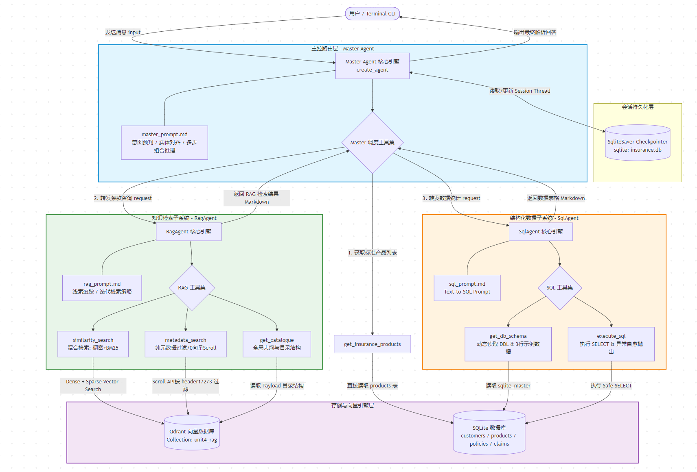

# 第四章：智能保险客服助手 — 多 Agent 项目实战

回顾：
- **第一章**中，我们学会了调用大模型，掌握了消息类型、多轮对话、工具调用（Tool Calling）和结构化输出。
- **第二章**中，我们从向量概念出发，学会了 Embedding、向量数据库、文档分块，最终构建了一个简易的 RAG 系统。
- **第三章**中，我们掌握了 Agent 的核心概念，从 ReAct 模式到底层原理，再到流式输出和 Text2SQL 实战。
- **第四章**中，我们学习了 Agent 的进阶能力——中间件、短期记忆、长期记忆和 HITL 人机交互。

至此，你已经具备了构建一个完整 Agent 的核心知识，那么本章就一起动手做一个多 Agent 协作架构的实战项目吧。

> 本章中你将学到：
> 1. 多Agent协作架构：如何用多agent实现上下文隔离、协作
> 2. Agentic RAG：能主动推理的高级RAG，相比第二章中的Naive RAG功能更强
> 3. 复杂任务提示词设计：如何让Agent能准确的完成复杂任务

---

## 4.1 项目介绍
《智能保险客服助手》是一个面向保险业务场景构建的企业级多Agent的知识问答与数据分析系统。

该项目最大的亮点在于解决了单一智能体无法处理的 “跨源信息关联” 难题，系统不仅能处理保险条款的知识问答（RAG）和业务数据的查询（SQL），
更能通过 Master Agent 的规划能力将两者串联，实现跨域问题的处理。

如 “客户张三购买的保险是否包含xx疾病保障” 这类需要 "业务数据+产品知识" 的复杂问题，
系统能将其分解为 “先查客户保单（获取保险产品），再查该产品的条款” 两个步骤，真正具备复杂业务逻辑的处理能力。


### 4.1.1 主要功能

#### 1 Master Agent
定位：全局分流网关与多步决策大脑。
> - **意图识别与分流**：Master Agent 能够精准识别用户意图。它能区分用户是在问条款（走知识库），还是在问数据（走数据库），或者是两者皆有（联合查询）。
> - **复杂决策流**：支持处理复杂的组合逻辑。例如，当用户问“张三买的保险等待期多久？”时，系统会自动拆解为两步：
>   1. 先调用 SQL Agent 查询“张三”买了哪款产品（获取数据）。
>   2. 再调用 RAG Agent 查询该产品的“等待期”条款（获取知识）。
> - **指代消解**：支持多轮对话中的代词理解（如“它”、“另一款”），极大提升了对话的自然度。

#### 2 RAG Agent
定位：专注于保险条款细节检索与解答的 Agentic RAG。
> - **混合检索 (Hybrid Search)**：底层结合了 **Qdrant** 向量数据库，同时利用 Dense Vector（语义检索）和 Sparse Vector（BM25 关键词检索），确保召回率。
> - **智能工具编排**：Agent 具备“思考”能力，能根据情况选择工具：
>   - `similarity_search`：常规语义搜索。
>   - `metadata_search`：利用 Markdown 的层级结构（Header）进行精准过滤，解决了“检索片段不完整”的痛点。
>   - `get_catalogue`：获取文档大纲，用于宏观问题解答。
> -   **查询重写 (Query Rewriting)**：自动去除口语化干扰，提取核心关键词，并对多意图问题进行拆解（如将“等待期和豁免？”拆分为两次检索）。

#### 3 SQL Agent
定位：专注于保险业务数据检索的 Agent。
> - **Schema 感知**：Agent 启动时自动读取数据库表结构（DDL）和样例数据，无需硬编码表结构。
> - **自动纠错**：当 SQL 执行出错时，Agent 会根据报错信息自动修正 SQL 语句并重试。
> - **格式化输出**：查询结果自动转化为 Markdown 表格，美观且易读。


### 4.1.2 架构设计
本项目采用 **1个Master agent + 2个Sub Agent** 的层级架构：



**各组件职责**：

| 组件               | 职责                    | 为什么拆分出来                                 |
|------------------|-----------------------|-----------------------------------------|
| **Master Agent** | 意图识别、产品路由、任务分发、结果整合   | 负责"宏观决策"，不参与具体检索或 SQL 编写                |
| **RAG Agent**    | 向量检索、元数据回溯、文档目录获取     | 专注文档检索，拥有独立的检索策略提示词                     |
| **SQL Agent**    | 查表结构、写 SQL、执行查询       | 专注结构化查询，不受 RAG 提示词干扰                    |

**子 Agent 的特点**：
- **无状态**：每次调用都是独立的，不保留历史上下文。这避免了跨会话的上下文污染。
- **专注单一领域**：每个子 Agent 的系统提示词只覆盖自己的领域，精确且短小。
- **Master Agent 是唯一的"大脑"**：子 Agent 不直接面向用户，只负责执行 Master 下达的任务。

> 💡 本项目虽然是练习项目，但架构设计非常接近真实的企业级应用，特别是提示词的设计——为了实现复杂的多跳检索、RAG+SQL 组合查询等场景，提示词需要覆盖大量边界情况，绝不是那种"3~5 行玩具级提示词"能搞定的，具有很高的参考价值。
> 
> 与真正的企业级应用的差距主要在于工程落地方面：
> 1. 服务化：作为练习项目，数据量较小，且我们的qdrant、sqlite都是本地部署的，企业级应用的数据库肯定需要服务化部署
> 2. 权限：我们没有用户体系，没有根据当前登录用户进行数据（对话记录）隔离
> 3. 风控：当前sql agent中是直连sqlite的，企业级应用中肯定是不允许让agent直连数据库，而是通过对接已有的业务系统API接口进行查询

---

## 4.2 什么是 Agentic RAG

### 4.2.1 回顾：第二章的 Naive RAG

在第二章中，我们构建的简易 RAG 是这样工作的：

```
用户提问 → 向量检索（一次） → 拼入提示词 → 大模型生成回答
```

它的特点是**单次交互**：用户问一次，系统检索一次，然后回答。这在简单场景下够用，但面对复杂问题就捉襟见肘：

| 痛点     | 场景                                                        | Naive RAG 的局限                   |
|--------|-----------------------------------------------------------|---------------------------------|
| 检索不准确  | 用户问："这个保险不想赔的情况有哪些？"，但文档中用的是"责任免除"                        | 语义不匹配，检索结果可能完全不相关               |
| 信息不完整  | 用户问："重大疾病具体有哪些病种？"，重症列表是一个包含50个病种的长列表，而每个chunk只保存一个病种的描述  | 只检索到部分 chunk 里的病种，无法获取完整的病种列表   |
| 无法拆解问题 | 用户问："这个保险的投保年龄有什么限制？不想投保了怎么办？"，实际上这是两个问题                  | 直接一起检索很难命中全部内容                  |
| 无法多跳推理 | 用户问："自主能力丧失的具体定义是什么？"，但条款正文中只说"无法独立完成六项基本日常生活活动（详见10.19）" | Naive RAG 只会返回这个"正文"，不会自动去追查附表一 |


### 4.2.2 Agentic RAG：让检索"活"起来
**Agentic RAG** 的核心思想是：**不再是一次性的检索，而是让 Agent 自主决策、多轮检索的智能过程。**

```
用户提问 → Agent 分析意图
  → 首轮检索（similarity_search）
  → 分析结果：信息不足？有面包屑线索？有交叉引用？
  → 第二轮检索（metadata_search 回溯 / similarity_search 改写重试）
  → 再分析……
  → 信息足够 → 生成最终回答
```

**Naive RAG vs Agentic RAG**：

| 对比维度       | Naive RAG | Agentic RAG             |
|------------|-----------|-------------------------|
| **检索次数**   | 1 次       | 多次，自主决策                 |
| **检索策略**   | 固定的向量相似度  | 动态切换：相似度 → 元数据回溯 → 语义重写 |
| **应对"指针"** | 只返回指针文本   | 自动追踪指针，递归检索             |
| **应对多意图**  | 混在一起检索    | 拆分后分别检索，各自追踪            |
| **应对检索失败** | 瞎编或放弃     | 语义泛化重试（同义词、上位概念）        |

在本项目中，RAG Agent 就是一个典型的 Agentic RAG 实现——它不是简单地调用一次 `similarity_search` 就完事，而是根据每次检索的结果，动态决定下一步用什么策略、调什么工具。

---

## 4.3 文档数据预处理
在进入 Agent 实现之前，先看数据是怎么准备的。预处理的质量直接决定了后续检索的效果。

### 4.3.1 PDF → Markdown
原始文档通常是 PDF 格式的保险条款。预处理的第一步是将 PDF 转为 Markdown，转换方式有很多，大家可以多试一下，看看哪种效果好

| 工具                                                | 描述                                     |
|---------------------------------------------------|----------------------------------------|
| [PaddleOCR](https://aistudio.baidu.com/paddleocr) | 老牌OCR产品，适合带图文的、有各种复杂公式的PDF，且每日有较多的免费额度 |
| [MinerU](https://mineru.net/)                     | 和PaddleOCR类似（操作界面都很像）                  |
| DeepSeek-OCR                                      | 没有在线服务，没试过                             |
| 各家的网页版AI                                          | 适合纯文本PDF，标题段落格式保持更准确                   |
| 各种本地智能体（如：Codex、xxxClaw、WorkBuddy）                | 没试过                                    |

**为什么选择 Markdown？**

| 格式           | 优势                       | 劣势                |
|--------------|--------------------------|-------------------|
| 纯文本          | 最简单                      | 丢失了所有标题层级信息       |
| **Markdown** | **标题（#、##、###）是天然的语义边界** | 需要 PDF 转 MD 的额外步骤 |

Markdown 的标题标记（`#`、`##`、`###`）可以非常精准地反映文档的**语义结构**——一个 `##` 下面的内容，就是同一个主题下的讨论。
利用这一点做切分，语义断裂的概率远低于按固定长度或递归切割。

### 4.3.2 文档切分
```python
from functools import lru_cache
from pathlib import Path

import tiktoken
from langchain_text_splitters import MarkdownHeaderTextSplitter
from langchain_core.documents import Document
from qdrant_client import QdrantClient, models
from qdrant_client.models import Filter, FieldCondition, MatchValue
from qdrant_client.http.models import Distance, SparseVectorParams, VectorParams
from langchain_qdrant import QdrantVectorStore, FastEmbedSparse, RetrievalMode
from unit2_rag_基础篇.b02_调用embedding模型 import create_embedding_model


# 加载并切分文件
def load_split_mdfile(file_path: str) -> list[Document]:
    with open(file_path, "r", encoding="utf-8") as f:
        markdown_content = f.read()
        
        # 根据哪些标题切分，切分后，对应层级的标题会自动挪到 Document 的 metadata 中
        headers_to_split_on = [
            ("#", "header1"),    # 一级标题 → 大章节
            ("##", "header2"),   # 二级标题 → 小节
            ("###", "header3"),  # 三级标题 → 细分点
        ]
        
        # 初始化轻量化的 Markdown 头部切分器
        markdown_splitter = MarkdownHeaderTextSplitter(
            headers_to_split_on=headers_to_split_on,
            strip_headers=False  # 是否去除正文的标题，False：不去除，默认True，去除
        )
        
        # split_text 方法会直接返回一个 list[Document]
        docs: list[Document] = markdown_splitter.split_text(markdown_content)
```


### 4.3.3 元数据填充
1. 给每个doc添加一些元数据，后期检索时，除了相似度检索之外，还可以用元数据检索
2. 面包屑导航：切分后的每个 chunk 默认只包含其所在小节的标题，我们给它注入了完整的**面包屑导航**，让每个 Chunk 都知道自己的定位

```python
        # 顺手把文件路径补进元数据（Metadata）里，方便后续做 RAG 溯源
        path = Path(file_path)
        
        for index, doc in enumerate(docs):
            doc.metadata["source"] = path.stem  # 文件名（产品名），用于数据隔离
            doc.metadata['index'] = index       # 用于检索排序，以一个有序的列表发给大模型，更容易理解
    
            # 从doc的元数据中提取出三级标题作为面包屑导航
            breadcrumbs = [] # ['第七章 附表', '附表一：重大疾病种类表', '脑中风后遗症']
    
            for level in ["header1", "header2", "header3"]:
                if level in doc.metadata: breadcrumbs.append(doc.metadata[level])
    
            if breadcrumbs:
                breadcrumb_str = " / ".join(breadcrumbs)    # 拼接后：第七章 附表 / 附表一：重大疾病种类表 / 脑中风后遗症
                doc.page_content = f"【{breadcrumb_str}】\n{doc.page_content}" # 将面包屑导航加到正文前面
    
        print(f"成功加载并切分出 {len(docs)} 个文档块")
        return docs
```

这样处理后，每个doc的数据格式就成了这样：
```json
Record(
    id='3f980eff05b743198e77b1d110c79aaa',
    payload={
        'page_content': '【第七章 附表 / 附表一：重大疾病种类表 / 三、脑中风后遗症】\n指因脑血管的突发病变引起脑血管出血、栓塞或梗塞，并导致神经系统永久性的功能障碍...',
        'metadata': {
            'header1': '第七章 附表',
            'header2': '附表一：重大疾病种类表',
            'header3': '三、脑中风后遗症',
            'source': '长生爱康保重大疾病保险',
            'index': 36
        }
    },
)
```

**这样做有两个关键目的**：
1. 补齐上下文语义：  
单独的"脑中风后遗症"定义如果没有上下文，Embedding 模型可能无法判断它属于哪个文档的哪个章节。加了面包屑后，检索时能更精准地匹配。
比如用户输入"重大疾病种类表"，那么所有面包屑中包含"重大疾病种类表"的 chunk 都能被检索到。

2. 实现另类的"父子文档"检索：  
面包屑本质上是该 chunk 的"父文档"路径，如果检索结果不完整，Agent 就可以通过面包屑提取上级标题（如 `附表一：重大疾病种类表`），然后用元数据检索回溯整个父章节的完整内容


### 4.3.4 Embedding 模型选择
向量化是 RAG 的核心环节，Embedding 模型的选择主要看两个方面：

| 考量因素      | 说明                          | 本项目选择                          |
|-----------|-----------------------------|--------------------------------|
| **支持的语言** | 中文文档必须选择支持中文的模型，否则语义理解会严重偏差 | 阿里云百炼 `text-embedding-v4`，中文优化 |
| **向量维度**  | 维度越高，对语义的描述越精细，但计算和存储成本也越高  | **1024 维**，这是一个比较均衡的选择         |


### 4.3.5 混合检索：稠密 + 稀疏（关键词）
单一的向量检索（稠密 Embedding）擅长**语义匹配**，但可能遗漏精确的关键词匹配。例如：

- 用户搜"严重脑损伤（重症）" → 向量检索可能返回"严重脑损伤"的语义相关内容（好），但也可能返回"轻微脑损伤"（轻症，语义相近但实际不相关）
- 用户搜"第 10.5 条" → 纯向量检索对这种"精确编号"的匹配效果较差

**混合检索**同时使用两种 Embedding：

| 类型       | 模型                  | 擅长                           | 示例                |
|----------|---------------------|------------------------------|-------------------|
| **稠密向量** | `text-embedding-v4` | 语义相似度（"癌症" ≈ "恶性肿瘤"）         | 用户用口语提问，向量能找到书面表述 |
| **稀疏向量** | `BM25`              | 关键词精确匹配（"第10.5条" = "第10.5条"） | 条款编号、专业术语的精确命中    |

```python
def init_qdrant_store(collection: str, path: str) -> QdrantVectorStore:
    print(f"初始化 Qdrant path：{path}")
    qdrant_client = QdrantClient(path=path)
    # 实例化 embedding 模型，用于语义检索
    embeddings = create_embedding_model()
    # 实例化本地 BM25 稀疏向量模型，用于关键词检索
    sparse_embeddings = FastEmbedSparse(model_name="Qdrant/bm25")

    # 创建集合
    if not qdrant_client.collection_exists(collection):
        qdrant_client.create_collection(
            collection_name=collection,
            # 稠密向量配置（保持原有的 size 和 distance）
            vectors_config={"dense": VectorParams(size=1024, distance=Distance.COSINE)},
            # 必须新增稀疏向量配置，否则无法存储 BM25 矩阵
            sparse_vectors_config={"sparse": SparseVectorParams(index=models.SparseIndexParams(on_disk=False))},
        )
        print(f"已创建 {collection} 集合")

    qdrant_store = QdrantVectorStore(
        client=qdrant_client,
        collection_name=collection,
        embedding=embeddings,
        sparse_embedding=sparse_embeddings,     # 绑定稀疏向量模型
        retrieval_mode=RetrievalMode.HYBRID,    # 显式声明为混合检索
        vector_name="dense",                    # 稠密向量空间的名称
        sparse_vector_name="sparse"             # 稀疏向量空间的名称
    )
    return qdrant_store
```


### 4.3.6 交互式测试脚本

```python
if __name__ == '__main__':
    name_list = ["长生爱康保重大疾病保险", "华泰人寿百万康宁终身重大疾病保险"]
    file_list = [r"../doc/长生爱康保重大疾病保险.md", r"../doc/华泰人寿百万康宁终身重大疾病保险.md"]

    collection = "unit4_rag"
    qdrant_store = init_qdrant_store(collection, "../db/qdrant")
    option = input("请选择操作：1.灌库；2.猫一眼；3.检索测试\n")

    if option == "1":   # 开始灌库
        for file_path in file_list:
            docs = load_split_mdfile(file_path)

            for i, doc in enumerate(docs):
                print(f'{i} metadata：{doc.metadata}')
                print(doc.page_content, end='\n\n')

            # 将文档块进行向量化并写入 Qdrant，忽略第一个文档块（产品名称）
            qdrant_store.add_documents(docs[1:])

    elif option == "2":     # 写入后检查一下qdrant中的数据
        enc = tiktoken.encoding_for_model("gpt-4o")
        index = input(f"0-[{name_list[0]}]，1-[{name_list[1]}]，要看哪个文档？\n")

        filter = Filter(must=[FieldCondition(key="metadata.source", match=MatchValue(value=name_list[int(index)]))])
        order_by = models.OrderBy(key="metadata.index", direction=models.Direction.ASC)
        records, next_offset = qdrant_store.client.scroll(collection, limit=1000, scroll_filter=filter, order_by=order_by)

        for i, record in enumerate(records, 1):
            tokens = enc.encode(record.payload['page_content'])
            text_len = len(record.payload['page_content'])
            print(f'{i} 文本长度：{text_len}，token长度：{len(tokens)}，比例：{(len(tokens) / text_len):.2f}')
            print(record, end="\n\n")

    elif option == "3":
        index = input(f"0-[{name_list[0]}]，1-[{name_list[1]}]，要检索哪个文档？\n")
        query = input(f"输入检索关键词：\n")

        filter = Filter(must=[FieldCondition(key="metadata.source", match=MatchValue(value=name_list[int(index)]))])
        results = qdrant_store.similarity_search_with_score(query=query, filter=filter, k=5)

        for doc, score in results:
            print(f"[得分: {score:.4f}] 元数据: {doc.metadata}")
            print(doc.page_content, end='\n\n')

    qdrant_store.client.close()
```

> **注意**：混合检索**必须在创建集合时就确定**！因为创建集合时需要同时配置稠密和稀疏两种向量空间，集合一旦创建，向量配置就无法修改。如果忘了配稀疏向量，只能删除集合重建。

[完整代码见 init_qdrant.py](./data_process/init_qdrant.py)

---

## 4.4 RAG Agent 实现
RAG Agent 是本项目的核心组件，负责从向量库中检索保险条款。它不止是一个简单的 `similarity_search` 检索途接，而是一个能多路召回的 **Agentic RAG** 系统。

三个工具，分别对应不同的检索场景和策略：  

| 工具                  | 类型      | 使用时机                  | 特点                           |
|---------------------|---------|-----------------------|------------------------------|
| `similarity_search` | 语义向量检索  | 首轮检索；或根据正文中的交叉引用改写重试  | 依赖 Embedding 模型，适合模糊匹配       |
| `metadata_search`   | 元数据精确检索 | 通过面包屑回溯，捞取整个父章节的完整内容  | 不依赖向量，走 Qdrant 的 scroll，性能极高 |
| `get_catalogue`     | 文档目录获取  | 用户问宏观概览；或检索无果时通过目录找线索 | 返回有序的目录树，帮助模型"读懂文档结构"        |


### 4.4.1 similarity_search
这是最基础的检索方式，将用户 query 转为向量后在 Qdrant 中做相似度搜索：

```python
def similarity_search(self, query: str, runtime: ToolRuntime[RagContext]):
    """
    知识库相似度搜索

    Args:
        query: 根据用户问题或正文线索动态构造的检索语句
    """

    source = runtime.context.source
    print(f"[rag agent] 相似度检索 | query: {query} | source: {source}")

    # 构建 Qdrant 的条件过滤器
    qdrant_filter = None

    if source:
        qdrant_filter = models.Filter(
            must=[  # must 所有条件都必须为 True
                models.FieldCondition(key="metadata.source", match=models.MatchValue(value=source))
            ]
        )

    results = self.qdrant_store.similarity_search_with_score(query=query, k=5, filter=qdrant_filter)

    if len(results) == 0:
        print("[rag agent] 未找到相关知识库内容。")
        return "未找到相关知识库内容。"

    for i, (doc, score) in enumerate(results, start=1):
        print(f"检索结果[{i}] score={score:.4f}] doc.metadata={doc.metadata}")
        print(doc.page_content, end="\n\n")

    page_content_list = [doc.page_content for doc, score in results]
    result = json.dumps(page_content_list, ensure_ascii=False)

    print(f'[rag agent] 相似度检索到{len(page_content_list)}个文档', end="\n\n")
    return result
```

**关键设计**：  
> `source` 通过 `context` 传入而非写死在工具参数中，因为产品名称是由 Master Agent 决定的，RAG Agent 不需要关心，只需要信任 Master 传过来的 `source` 即可。
这种"通过运行时传递上下文"的模式，是多 Agent 协作中**数据隔离**的常见做法。


### 4.4.2 metadata_search
这是实现**多跳检索**的关键工具。当首轮 `similarity_search` 返回的片段信息不完整时，Agent 可以从面包屑中提取上级标题，然后用 `metadata_search` 精准回溯整个父章节：

```python
def metadata_search(self, header_level: str, header_value: str, runtime: ToolRuntime[RagContext]):
    """
    知识库元数据搜索

    Args:
        header_level: 标题层级
        header_value: 标题文本
    """
    # 1. 从自动注入的 config 中安全获取运行时参数,确保只在当前保险条款中检索
    source = runtime.context.source
    print(
        f"[rag agent] 元数据检索 | header_level: {header_level} | header_value: {header_value} | source: {source}")

    # 2. 构建组合过滤条件
    must_conditions = [
        models.FieldCondition(key=f"metadata.{header_level}", match=models.MatchValue(value=header_value)),
        models.FieldCondition(key="metadata.source", match=models.MatchValue(value=source))
    ]

    qdrant_filter = models.Filter(must=must_conditions)
    order_by = models.OrderBy(key="metadata.index", direction=models.Direction.ASC)

    # 3. 使用底层 client 的 scroll 方法,直接按 Filter 获取记录(0 向量参与,性能极高)
    records, next_page_offset = self.qdrant_store.client.scroll(
        collection_name=self.collection,
        scroll_filter=qdrant_filter,
        order_by=order_by,
        limit=100,  # 一次性捞取该大章下的前 100 个分片(通常足够容纳一整章)
        with_payload=True,  # 必须为 True,否则拿不到文本
        with_vectors=False  # 不需要返回向量值
    )

    if len(records) == 0:
        print("[rag agent] 未找到相关知识库内容。")
        return f"未找到相关知识库内容"

    # 4. 提取文本(LangChain 存入 Qdrant 时,文本正文默认放在 payload 的 "page_content" 字段中)
    page_content_list = []

    for i, record in enumerate(records, start=1):
        payload = record.payload
        # 打印调试信息,看一眼拿到了哪些片段
        print(f"检索结果[{i}] metadata: {payload.get('metadata')}")
        # print(f"page_content: {payload['page_content']}", end="\n\n")
        page_content_list.append(payload["page_content"])

    # 5. 序列化并返回
    result = json.dumps(page_content_list, ensure_ascii=False)
    print(f'[rag agent] 元数据检索到{len(page_content_list)}个文档', end="\n\n")
    return result
```

**工作原理示例**：

```
首轮 similarity_search 返回了 chunk：
  【第七章 附表 / 附表一：重大疾病种类表 / 三十五、严重溃疡性结肠炎】...

Agent 分析：用户问的是完整病种列表，但只拿到了部分列表。
Agent 提取面包屑：header_level="header2", header_value="附表一：重大疾病种类表"
Agent 调用 metadata_search → 一次性捞取附表一的所有 chunk（所有病种）

这就是我们之前要把标题信息全部存入metadata中的目的
```


### 4.4.3 get_catalogue
有些用户的问题非常泛，比如"这个保险都有哪些内容"、"给我介绍一下"。这种问题无法从 query 中提取有效的检索关键词，`similarity_search` 也无从下手。  
`get_catalogue` 就是为这种场景设计的——直接返回整个文档的有序目录树：

```python
def get_catalogue(self, runtime: ToolRuntime[RagContext]):
    """获取文档目录结构"""
    print(f"[rag agent] 获取文档目录")
    source = runtime.context.source
    must_conditions = [models.FieldCondition(key="metadata.source", match=models.MatchValue(value=source))]
    qdrant_filter = models.Filter(must=must_conditions)
    order_by = models.OrderBy(key="metadata.index", direction=models.Direction.ASC)

    # 3. 使用底层 client 的 scroll 方法,直接按 Filter 获取记录(0 向量参与,性能极高)
    records, next_page_offset = self.qdrant_store.client.scroll(
        collection_name=self.collection,
        scroll_filter=qdrant_filter,
        order_by=order_by,
        limit=200,
        with_payload=True,  # 必须为 True,否则拿不到文本
        with_vectors=False  # 不需要返回向量值
    )

    print(f'检索到{len(records)}个文档目录')
    metadatas = [record.payload.get("metadata") for record in records]
    for m in metadatas: m.pop("source")  # 删除元数据中的 source 字段，减少数据量

    print(metadatas)
    return json.dumps(metadatas, ensure_ascii=False)
```

> Agent 拿到目录后，就能像人一样"翻阅目录"，然后用目录中寻找检索或者直接回答这类"泛泛"的问题


### 4.4.4 组装Agent
```python
import json
from dataclasses import dataclass
from typing import Callable
from pathlib import Path

from langchain_core.messages import SystemMessage
from langgraph.prebuilt import ToolRuntime
from langchain.agents import create_agent
from langchain.agents.middleware import wrap_model_call, ModelRequest, ModelResponse
from langchain_core.tools import tool
from qdrant_client.http import models

from unit1_大模型基础篇.a03_langchain调用模型 import create_model
from unit4_智能保险客服助手_v1.data_process.init_qdrant import init_qdrant_store

@dataclass
class RagContext:
    source: str

class RagAgent:
    def __init__(self):
        # 1. 资源初始化(只在实例化时执行一次)
        self.collection = "unit4_rag"
        self.base_dir = Path(__file__).resolve().parent.parent
        self.qdrant_store = init_qdrant_store(self.collection,  str(self.base_dir / "db" / "qdrant"))
        self.model = create_model(temperature=0)
        system_prompt = (self.base_dir / "prompt" / "rag_prompt.md").read_text(encoding="utf-8")

        self.agent = create_agent(
            model=self.model,
            system_prompt=system_prompt,
            tools=[
                tool(self.similarity_search, parse_docstring=True),
                tool(self.metadata_search, parse_docstring=True),
                tool(self.get_catalogue)
            ],
            context_schema=RagContext,
            middleware=[self.add_context]
        )

        
    @staticmethod
    @wrap_model_call
    def add_context(request: ModelRequest, handler: Callable[[ModelRequest], ModelResponse]) -> ModelResponse:
        source = request.runtime.context.source
        prompt = request.system_message.content.replace('{source}', source)
        system_message = SystemMessage(content=prompt)
        return handler(request.override(system_message=system_message))

    
    def similarity_search(self, query: str, runtime: ToolRuntime[RagContext]):
        pass

    def metadata_search(self, header_level: str, header_value: str, runtime: ToolRuntime[RagContext]):
        pass

    def get_catalogue(self, runtime: ToolRuntime[RagContext]):
        pass
    
    
    def run(self, input: str, source: str) -> str:
        print(f'[rag agent] 原始query：{input},source：{source}')

        response = self.agent.invoke(
            input={"messages": [("user", input)]},
            context=RagContext(source=source)
        )

        # 遍历消息历史,拦截所有工具投喂的原始文档片段
        print('-' * 80 + "Rag Agent 消息列表↓↓↓" + '-' * 80)
        for message in response["messages"]:
            print(f'[rag agent]：{type(message)}，{message}', end="\n\n")
        print('-' * 80 + "Rag Agent 消息列表↑↑↑" + '-' * 80, end="\n\n")

        return response["messages"][-1].content


if __name__ == '__main__':
    rag_agent = RagAgent()
    print('RAG Agent 已启动')

    while True:
        query = input('请输入想要检索的内容：')
        if not query: continue

        # 华泰人寿百万康宁终身重大疾病保险 长生爱康保重大疾病保险
        result = rag_agent.run(query, "长生爱康保重大疾病保险")
        print(f"最终回答：{result}")
        print('='*100)

    rag_agent.qdrant_store.client.close()
```

关键理解：
1. 动态提示词：prompt中的{source}变量依赖外部调用run方法时传入，我们无法在agent创建时就确定，所以我们使用上下文来传递source，并在wrap_model_call中拦截替换。
2. 工具绑定：由于我们的工具方法是定义在类中的，@tool 会把 self 也当作一个需要大模型传入的参数写入 JSON Schema，为了避免这个问题，我们换成tool方法来显式转换。

[完整代码见：rag_agent.py](./agent/rag_agent.py)


### 4.4.5 提示词设计
本项目的 RAG Agent 提示词确实比较长，但这是必要的。复杂场景下，短提示词 = 模型自行脑补 = 不可控。
长提示词的价值在于**把边界情况都写清楚，缩小让模型去猜测的空间**。

**提示词设计技巧**：

| 技巧                | 说明                                   | 本项目的体现                                     |
|-------------------|--------------------------------------|--------------------------------------------|
| **角色定位要精准**       | 用一句话锁定 Agent 的职责边界                   | "专注于为客户提供保险条款咨询服务"                         |
| **流程要具体**         | 不要只说"你要聪明地检索"，而是给出具体的决策路径            | 四个步骤，两种线索                                  |
| **给出必要的示例**       | "手把手"告诉模型，重写怎么做，线索如何提取               | 重写示例、面包屑导航或正文中寻找线索示例                       |
| **Query 预处理**     | 教模型在检索前先"加工"用户问题                     | 去产品名（脱水）、口语转书面、多意图拆分                       |
| **工具要有明确的"准入条件"** | 不是列出所有工具就完了，要告诉模型**什么时候该用什么**        | 比如：`get_catalogue` 明确写了"仅在用户提问属于宏观问题"时，才调用 |
| **结果评估**          | 要求模型每次检索后对结果进行评估，如果需要再次检索的，重试策略也得写明白 |                                            |
| **输出约束**          | 要求模型必须基于检索到的内容来回答问题，并且要标注出处          | "根据《{source}》第X章X节【XXX】的内容..."             |


[完整提示词见：rag_prompt.md](./prompt/rag_prompt.md)


### 4.4.6 知识扩展：Rerank（重排序）
对RAG有了解的同学可能会好奇，为什么这里检索之后没有重排序的环节？

> 答：是我偷懒了，我觉得目前的检索效果还可以，就没去加Rerank，
> 不过我相信大家既然都看到这里了，自己去尝试加入一个重排序的环节，应该问题也不大，所以，这个就当是作业了，大家自己去试着实现一下吧(●'◡'●)

---

## 4.5 SQL Agent 实现
SQL Agent 负责结构化数据查询，与第三章的 Text2SQL 实现基本一致

两个核心工具

| 工具              | 职责                          |
|-----------------|-----------------------------|
| `get_db_schema` | 返回所有表的 DDL 定义，让模型了解表结构      |
| `execute_sql`   | 执行 SQL 并返回 Markdown 表格或错误信息 |


### 4.5.1 get_db_schema
```python
def get_db_schema(self) -> str:
    """获取数据库中所有表的结构（DDL定义）"""
    self.cursor.execute("SELECT name FROM sqlite_master WHERE type='table' and name not in ('checkpoints', 'writes')")
    tables = self.cursor.fetchall()
    schema_list = []

    for table in tables:
        table_name = table[0]
        self.cursor.execute(f"SELECT sql FROM sqlite_master WHERE type='table' AND name='{table_name}';")
        ddl = self.cursor.fetchone()[0]

        self.cursor.execute(f"SELECT * FROM {table_name} limit 3;")
        # 1. 获取列名：cursor.description 是一个元组列表，其中第一个元素就是列名
        columns = [col[0] for col in self.cursor.description]
        # 2. 获取数据行
        rows = self.cursor.fetchall()
        # 3. 将每一行数据和列名打包成字典
        examples = [dict(zip(columns, row)) for row in rows]

        schema = {'table': table_name, 'ddl': ddl, 'examples': examples}
        schema_list.append(schema)

    return json.dumps(schema_list, ensure_ascii=False)
```

**关键理解**：与第三章中稍有不同，这次我们将返回的结果是一个json字符串，并且不仅只有ddl，还加上3条示例数据，让模型更准确的理解表结构与真实数据
```json
[
  {
    "table":"customers",
    "ddl":"CREATE TABLE customers (\n    customer_id VARCHAR(32) PRIMARY KEY,      -- 客户唯一ID\n    name VARCHAR(50) NOT NULL,                -- 客户姓名\n    gender VARCHAR(10) CHECK(gender IN ('男', '女')), -- 性别\n    age INTEGER NOT NULL,                     -- 年龄\n    city VARCHAR(50) NOT NULL,                -- 所属城市 (用于华东/华北等区域统计)\n    driving_years INTEGER DEFAULT 0           -- 驾龄 (车险风控核心字段，健康险用户为0)\n)",
    "examples":[
      {"customer_id":"C001", "name":"张伟", "gender":"男", "age":35, "city":"上海", "driving_years":10},
      {"customer_id":"C002", "name":"李娜", "gender":"女", "age":28, "city":"北京", "driving_years":5},
      {"customer_id":"C003", "name":"王强", "gender":"男", "age":45, "city":"杭州", "driving_years":20}
    ]
  },
  {
    "table":"products",
    "ddl":"CREATE TABLE products (\n    product_id VARCHAR(32) PRIMARY KEY,       -- 产品唯一ID\n    product_name VARCHAR(100) NOT NULL,       -- 产品名称\n    aliases VARCHAR(100),                     -- 产品简称\n    insurance_type VARCHAR(20) CHECK(insurance_type IN ('医疗险', '重疾险', '车险')), -- 险种分类\n    base_premium REAL NOT NULL,               -- 基础保费/年\n    waiting_period_days INTEGER DEFAULT 90    -- 等待期天数 (健康险特有，免责期)\n)",
    "examples":[
      {"product_id":"P001", "product_name":"长生爱康保重大疾病保险", "aliases":"爱康保,长爱保,长生爱康保", "insurance_type":"重疾险", "base_premium":500.0, "waiting_period_days":90},
      {"product_id":"P002", "product_name":"华泰人寿百万康宁终身重大疾病保险", "aliases":"百万康宁,华泰康宁", "insurance_type":"重疾险", "base_premium":300.0, "waiting_period_days":30}
    ]
  }
]
```

### 4.5.2 execute_sql
```python
def execute_sql(self, sql: str) -> str:
    """
    执行标准 SQL 查询语句，并以字符串形式返回执行结果

    Args:
        sql：要执行的sql语句
    """
    try:
        print(f"[sql agent]：执行SQL：{sql}")
        # 判断是否为查询语句
        if sql.strip().upper().startswith('SELECT'):
            self.cursor.execute(sql)
            result = self.cursor.fetchall()

            # 如果查询结果为空，直接提示
            if not result and not self.cursor.description:
                return "查询成功，但未返回任何数据。"

            # 提取列名
            columns = [description[0] for description in self.cursor.description]
            # 将每一行数据和列名打包成字典列表
            data_list = [dict(zip(columns, row)) for row in result]

            return json.dumps(data_list, ensure_ascii=False, default=str)
        else:
            return "SQL执行失败：只允许执行select查询语句"
    except Exception as e:
        # 关键点：把异常原封不动抛给 LLM，它看到报错后会自动修正 SQL 并重新运行！
        return f"execute_sql 执行失败: {str(e)}"
```

**关键理解**：同样的也调整了返回的数据格式，这样更加结构化，更利于模型理解
```json
[
  {
    "product_id":"P001",
    "product_name":"长生爱康保重大疾病保险",
    "aliases":"爱康保,长爱保,长生爱康保",
    "insurance_type":"重疾险",
    "base_premium":500.0,
    "waiting_period_days":90
  },
  {
    "product_id":"P002",
    "product_name":"华泰人寿百万康宁终身重大疾病保险",
    "aliases":"百万康宁,华泰康宁",
    "insurance_type":"重疾险",
    "base_premium":300.0,
    "waiting_period_days":30
  }
]
```

### 4.5.3 组装Agent
```python
import json
import sqlite3
from pathlib import Path
from typing import Callable

from langchain.agents import create_agent
from langchain_core.tools import tool
from unit1_大模型基础篇.a03_langchain调用模型 import create_model

class SqlAgent:
    
    def __init__(self):
        self.base_dir = Path(__file__).resolve().parent.parent
        conn = sqlite3.connect(str(self.base_dir / 'db' / 'sqlite' / 'insurance.db'), check_same_thread=False)
        self.cursor = conn.cursor()
        self.model = create_model()
        system_prompt = (self.base_dir / "prompt" / "sql_prompt.md").read_text(encoding="utf-8")

        # 获取表结构，注入到提示词中
        db_schema = self.get_db_schema()
        system_prompt = system_prompt.replace('{db_schema}', db_schema)
        print(system_prompt)

        self.agent = create_agent(
            model=self.model,
            system_prompt=system_prompt,
            tools=[tool(self.execute_sql, parse_docstring=True)],
        )


    def get_db_schema(self) -> str:
        pass

    def execute_sql(self, sql: str) -> str:
        pass

    
    def run(self, input: str):
        response = self.agent.invoke(input={"messages": [("user", input)]})
        print('-' * 80 + "Sql Agent 消息列表↓↓↓" + '-' * 80)

        for message in response["messages"]:
            print(f'[sql agent]：{type(message)}，{message}', end="\n\n")

        print('-' * 80 + "Sql Agent 消息列表↑↑↑" + '-' * 80, end="\n\n")
        return response["messages"][-1].content


if __name__ == "__main__":
    sql_agent = SqlAgent()
    # result = sql_agent.get_db_schema()
    # result = sql_agent.execute_sql("select * from products")

    while True:
        query = input('请输入想要检索的内容：')
        if not query: continue
        result = sql_agent.run(query)
        print(f"最终回答：{result}")
        print('=' * 100)
```
[完整代码见：sql_agent.py](./agent/sql_agent.py)

### 4.5.4 提示词设计
[完整提示词见：sql_prompt.md](./prompt/sql_prompt.md)

### 4.5.5 业务数据初始化
[初始化脚本见：init_sqlite.py](./data_process/init_sqlite.py)

---

## 4.6 Master Agent 实现
Master Agent 是整个系统的"大脑"，负责意图识别、任务分发和结果整合，它是不直接参与具体的业务处理的，而是把任务拆解，然后交给具体的sub agent来处理，并对结果进行整合

> 多agent的实现思路就是：将rag_agent和sql_agent包装为master agent的工具，给Master Agent调用


### 4.6.1 insurance_knowledge_expert
将`RAG Agent`包装为保险知识问答工具

```python
def insurance_knowledge_expert(self, query: str, product: str) -> str:
    """
    单文档知识检索: 当用户询问关于保险产品条款、理赔流程、保险业务咨询等专业问题时，调用此工具。

    Args:
        query: 用户咨询的问题
        product: 保险产品全称，如：长生爱康保重大疾病保险
    """
    print(f"[Master 检索] query: {query}，product: {product}")
    # 调用子 Agent 并返回纯文本
    rag_res = self.sub_rag_instance.run(input=query, source=product)
    return rag_res
```


### 4.6.2 insurance_data_expert
将`SQL Agent`包装为业务数据查询工具

```python
def insurance_data_expert(self, query: str) -> str:
    """
    结构化数据与运营统计查询，当用户询问关于保险业务数据时，调用此工具

    Args:
        query: 用户的数据查询诉求，必须是明确的中文业务描述
    """
    print(f"[Master 数据查询] query: {query}")
    # 调用子 SQL Agent，它内部会自己看 Schema、写 SQL 并执行返回 Markdown 表格
    sql_res = self.sub_sql_instance.run(input=query)
    return sql_res
```

### 4.6.3 组装agent
```python
import sqlite3
from pathlib import Path
from uuid import uuid4
from langchain.agents import create_agent
from langchain_core.tools import tool
from langgraph.checkpoint.sqlite import SqliteSaver
from unit1_大模型基础篇.a03_langchain调用模型 import create_model
from unit4_智能保险客服助手_v1.agent.rag_agent import RagAgent
from unit4_智能保险客服助手_v1.agent.sql_agent import SqlAgent


class MasterAgent:
    def __init__(self):
        # 实例化子 Agent（此时完成了数据库连接等操作，且只执行一次）
        self.base_dir = Path(__file__).resolve().parent.parent
        self.model = create_model(enable_thinking=True)
        self.sub_rag_instance = RagAgent()
        self.sub_sql_instance = SqlAgent()
        self.tools = [
            tool(self.insurance_knowledge_expert, parse_docstring=True),
            tool(self.insurance_data_expert, parse_docstring=True)
        ]

    def insurance_knowledge_expert(self, query: str, product: str) -> str:
        pass

    def insurance_data_expert(self, query: str) -> str:
        pass


    # 3. 构建 Master Agent
    def build_agent(self):
        system_prompt = (self.base_dir / "prompt" / "master_prompt.md").read_text(encoding="utf-8")
        products = self.sub_sql_instance.execute_sql(sql="select product_name, aliases from products")
        system_prompt = system_prompt.replace('{products}', products)

        conn = sqlite3.connect(f"{self.base_dir}/db/sqlite/insurance.db", check_same_thread=False)
        checkpointer = SqliteSaver(conn)
        checkpointer.setup()

        master_agent = create_agent(
            model=self.model,
            tools=self.tools,
            system_prompt=system_prompt,
            checkpointer=checkpointer
        )
        return master_agent


# 4. 运行测试
if __name__ == "__main__":
    master_agent_build = MasterAgent()
    master_agent = master_agent_build.build_agent()

    config = {"configurable": {"thread_id": str(uuid4())}}
    print('智能保险客服问答助手已启动，请输入你想咨询的问题')

    while True:
        user_input = input("你：")
        if user_input == "exit":
            break

        response = master_agent.invoke(input={"messages": [("user", user_input)]}, config=config)

        print('-'*80 + "Master Agent 消息列表↓↓↓" + '-'*80)
        for message in response["messages"]:
            print(type(message), message, end="\n\n")
        print('-' * 80 + "Master Agent 消息列表↑↑↑" + '-' * 80, end="\n\n")

        print(f'Master Agent 最终回复：\n{response["messages"][-1].content}', end="\n\n")
```
[完整代码见：master_agent.py](./agent/master_agent.py)


### 4.6.4 Master Agent 的提示词设计
Master Agent 的提示词是整个系统的"总控"，负责意图识别、调度决策和结果整合

**提示词设计的重点**：

| 设计点            | 说明                            | 示例                                   |
|----------------|-------------------------------|--------------------------------------|
| **意图分析**       | 先判断用户意图类型，再决定走哪个流程            | "保障哪些病种" → 产品知识咨询；"上个月卖了多少" → 业务数据查询 |
| **组合查询（串联路由）** | 支持"先查数据库 → 拿到产品名 → 再查条款"的链式调用 | "客户张伟的保险是否涵盖严重心肌炎" → 先 SQL 后 RAG     |
| **维度校验**       | 跨产品对比时，如果用户没说对比什么维度，先追问       | "哪个更好？" → "请问从哪些维度对比？"               |
| **指代消解**       | 多轮对话中处理"它"、"那款"、"另一款"等指代词     | 用户说"那另一款呢？" → 结合上文还原为具体产品名           |
| **复杂问题示例**     | 给出具体示例让模型参考                   | 跨产品对比、链式组合查询                         |

[完整提示词见：master_prompt.md](./prompt/master_prompt.md)

---

## 4.7 本章总结
### 📚 核心知识点回顾
1. **多 Agent 协作架构**：Master + 子 Agent 的层级架构，Master 负责宏观决策和路由，子 Agent 各自专注单一领域，避免上下文污染
2. **Agentic RAG**：不再是单次检索，而是让 Agent 自主决策多轮检索——语义检索 → 分析线索 → 回溯/改写 → 再检索
3. **文档预处理技巧**：Markdown 按标题切分、面包屑导航补齐语义、混合检索（稠密 + BM25）、元数据设计实现数据隔离
4. **RAG Agent 三工具**：`similarity_search`（语义检索）、`metadata_search`（元数据回溯）、`get_catalogue`（目录获取），三者配合实现多跳检索
5. **跨产品对比设计**：由 Master Agent 提示词驱动，逐个调用 `insurance_knowledge_expert` 检索各产品条款后，Master Agent 自行汇总对比并输出 Markdown 表格
6. **生产级提示词设计**：角色定位、工具准入条件、详细决策流、防御性约束、Query 预处理、引用规范、复杂问题处理示例

### 💡 关键理解
- **多 Agent 的本质是"关注点分离"**：不要让一个 Agent 同时操心 RAG 策略、SQL 语法和产品路由——拆分职责，各自专注
- **Agentic RAG 的灵魂是"线索追踪"**：不要期望一次检索就命中答案，要像侦探一样从检索结果中找线索、顺藤摸瓜
- **提示词是 Agent 的"工作手册"**：越详细越好——把你能想到的所有边界情况都写进去，别让模型"自由发挥"
- **数据隔离是严肃工程**：从入库时的 metadata 设计，到检索时的 Filter 过滤，再到运行时通过 config 传递 `source`，每一步都不能马虎