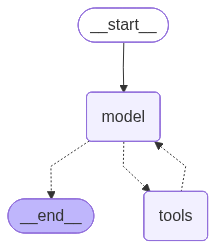
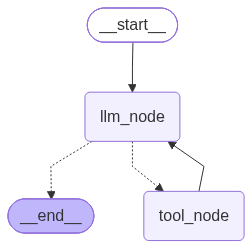
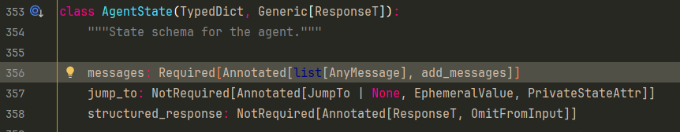
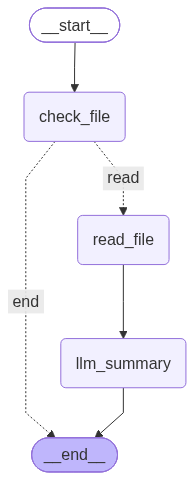
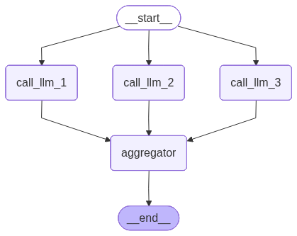
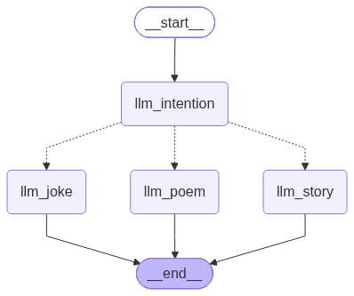
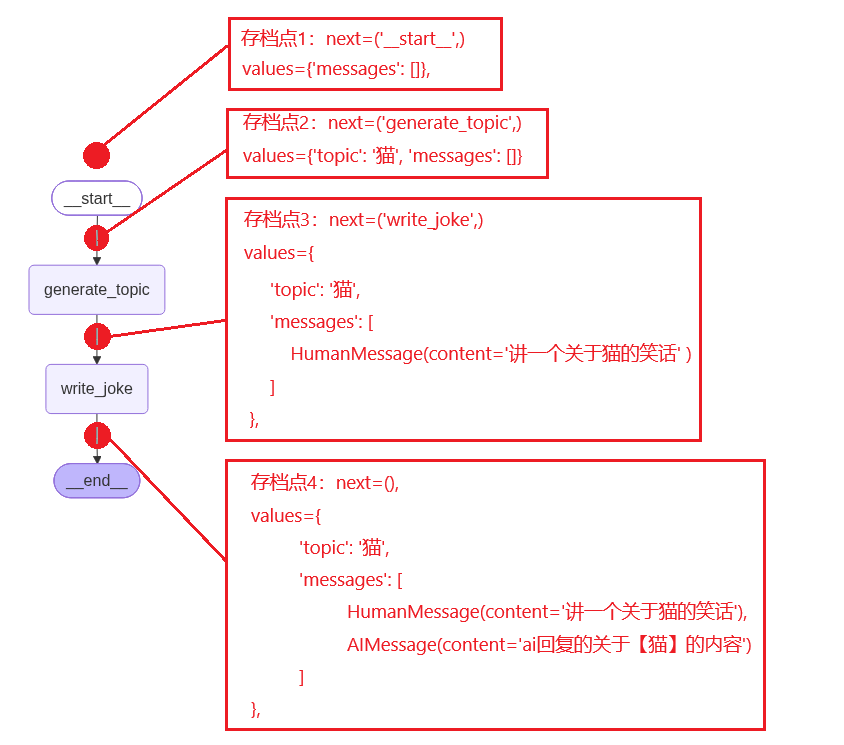

# 第五章：Graph 基础篇
在前两章的学习中，我们从 Agent 基础走到高级，构建了一套完整的 Agent 知识体系：

- **第三章**中，我们学习了 ReAct 模式的"思考→行动→观察"循环，用 `create_agent` 一行代码创建 Agent，又手搓了两版 ReAct 理解底层原理，还掌握了流式输出、结构化输出和 Text2SQL 实战。
- **第四章**中，我们为 Agent 装上了中间件、短期记忆、长期记忆和人机交互（HITL），让它从一个"聪明的执行者"进化为"可控、有记忆、能协作的生产级 Agent"。

**从第三章到第四章，我们所有的 Agent 都是通过 `create_agent` 创建的**。`create_agent` 帮我们封装好了 ReAct 循环、工具调用、消息管理，
甚至第四章的中间件和记忆也是挂载在它之上的。它就像一个"全自动洗衣机"——按下按钮就能跑，但你不知道里面到底怎么转的。

`create_agent` 代表的是 **ReAct Agent 模式**，由大模型自主决定调用什么工具、何时调用、何时停止。这种"自主决策"在开放性任务中非常强大，但在生产环境中，很多任务的流程是**固定的**：

| 场景                                            | 特点                                            |
|-----------------------------------------------|-----------------------------------------------|
| "读取数据 → 清洗 → 转换 → 聚合 → 输出报表"                  | 每一步都是确定性的操作，不需要模型"自主决策"，需要的是**按预设流程稳定运行**     |
| "爬取网页 → 解析内容 → 解析失败则重试（最多 3 次）→ 成功后生成摘要"      | 重试次数、跳转条件都是**开发者设定的**，不是模型临时决定的               |

这些场景的共同诉求是：**减少不确定性，让程序按照开发者预设的流程稳定运行**。ReAct 模式的"自主推理"在这里反而是风险。

LangChain 官方文档将这两种模式明确区分：
> - **Agent（智能体）**：动态的，由模型自行定义流程和工具使用。模型掌控流程。
> - **Workflow（工作流）**：有预设的代码路径，按确定的顺序运行。开发者掌控流程。
> https://docs.langchain.com/oss/python/langgraph/workflows-agents

`create_agent` 底层其实就是一个固定的 Graph（在第三章我们曾用 `agent.get_graph()` 导出过它的结构图），但这个 Graph 是框架预定义的，
你只能在它的框架内加中间件、加工具，**无法改变它的拓扑结构**。



而当你需要**自定义工作流程**时，就需要 **LangGraph**， 让你从 "使用别人预设的工作流" 变成 "自己设计工作流"，
你可以自由定义有哪些节点、节点之间怎么连接、在哪里分叉、在哪里循环。

> 💡 理解了这一点，你就明白了为什么有了 ReAct Agent 还需要 Graph：**ReAct Agent 是一种特定模式的 Graph（ReAct 循环），
> 而 Graph 是更通用的编排框架，既能表达 Agent 的动态决策，也能表达 Workflow 的确定流程**。

---

## 5.1 Graph 初体验
本章我们就来揭开 ReAct Agent 的"神秘面纱"，我们使用graph api来手搓一个效果与create_agent效果类似的graph agent。
通过这个示例，你将理解 Agent 底层的 Graph 到底长什么样。

Graph 本质上就是一个工作流：有 State、Node、Edge、Conditional Edge这些核心主件构成。 下面我们就按照构建一个 Graph 的实际步骤，逐步讲解每个核心概念。

### 5.1.1 Step 1：定义工具和模型
我们准备了三个数学工具（加、乘、除），并将它们绑定到模型上，这个相信大家都很熟悉了，不再赘述

```python
import operator
import os
import rich
from langchain.messages import AnyMessage
from langchain_core.tools import tool
from typing_extensions import TypedDict, Annotated
from langchain.messages import SystemMessage, ToolMessage, HumanMessage
from typing import Literal
from langgraph.graph import StateGraph, START, END
from unit1_大模型基础篇.a03_langchain调用模型 import create_model
from unit3_agent_基础篇.c01_create_agent import draw_graph
from unit5_graph_基础篇.e01_graph_初体验.e011_tools import add, multiply, divide

@tool(parse_docstring=True)
def add(a: int, b: int) -> int:
    """Adds `a` and `b`.

    Args:
        a: First int
        b: Second int
    """
    return a + b

@tool(parse_docstring=True)
def multiply(a: int, b: int) -> int:
    """Multiply `a` and `b`.

    Args:
        a: First int
        b: Second int
    """
    return a * b

@tool(parse_docstring=True)
def divide(a: int, b: int) -> float:
    """Divide `a` and `b`.

    Args:
        a: First int
        b: Second int
    """
    return a / b

tools = [add, multiply, divide]
tools_map = {tool.name: tool for tool in tools}

model = create_model()
model_with_tools = model.bind_tools(tools)
```
> 示例代码来自：https://docs.langchain.com/oss/python/langgraph/quickstart


### 5.1.2 Step 2：定义 State（状态）
**State 是贯穿整个 Graph 执行周期的共享数据结构。** 每个节点（Node）都能读取 state 中的数据，也能将节点中产生的数据更新到state中  

State 声明了graph执行过程中需要用到的所有数据字段
```python
class MessagesState(TypedDict):
    messages: Annotated[list[AnyMessage], operator.add]
    llm_calls: int
    tool_calls: int
```
本示例定义了三个字段：
- `messages`：对话消息列表，保存所有的聊天记录
- `llm_calls`：大模型调用次数计数器
- `tool_calls`：工具调用次数计数器

或者也可以去继承`AgentState`，`AgentState`就是`create_agent`内部的默认state，它里面也有messages字段
```python
from langchain.agents import AgentState

class MessagesState(AgentState):
    llm_calls: int
    tool_calls: int
```
> 扩展：关于state的类型，除了`TypedDict`之外，还可以用 `Pydantic (BaseModel)` 和 `dataclass`


**关于 `messages` 属性的 `operator.add`**

operator.add是Python 标准库 operator 模块里的一个函数，它就是普通加法运算符 "+" 的函数形式，operator.add(3, 5)，等价于 3 + 5，结果是 8。
但 messages 这里的 operator.add 不是普通意义的"相加"语义，而是 LangGraph 定义的一个 reducer（归约器）。

messages作为历史消息列表，它是需要累计的，节点中产生的新的消息应该是添加到现有的消息列表中，而不是替换原有的消息列表，
所以这里的 `operator.add` 作用是告诉 LangGraph：把节点中产生的新消息合并到 messages 中

```python
# ❌ 错误写法：messages 会用覆盖策略，历史消息全丢
class BadState(TypedDict):
    messages: list[AnyMessage]

# ✅ 正确写法：messages 用追加策略，历史被保留
class GoodState(TypedDict):
    messages: Annotated[list[AnyMessage], operator.add] # 追加
    llm_calls: int # 覆盖
```

> 扩展：LangGraph文档中的示例代码用的是`operator.add`可能这是为了好理解，实际开发中应该要用`add_messages`，它是 LangGraph 专门为消息设计的归约器，
> AgentState 源码中用的也是`add_messages`
> 
> - operator.add：是纯列表拼接，属于"无状态追加"
> - add_messages：除了追加之外，还支持按ID去重、更新、删除等操作


### 5.1.3 Step 3：定义 Node（节点）
**Node 是 Graph 中的执行单元，每个 Node 就是一个普通的 Python 函数。** 它接收当前的 State 作为入参，执行自己的逻辑后， 返回一个字典表示对 State 的更新。

```
Node 入参：当前的 State（完整状态）
Node 出参：State 的增量更新（一个字典，不是完整 State）
```

我们需要两个节点：
- **`llm_node`**：调用大模型，模型会根据用户问题决定是否调用工具
- **`tool_node`**：执行模型请求的工具调用，把结果封装为 `ToolMessage` 返回

```python
def llm_node(state: MessagesState):
    # 1. 取出当前对话历史
    messages = state["messages"]
    print('llm_node被执行')

    # 2. 拼接系统提示词 + 用户对话历史，调用大模型，拿到回复
    system_prompt = SystemMessage(content="你是一个乐于助人的助手，你可以帮助用户做一些数学运算。")
    ai_message = model_with_tools.invoke([system_prompt] + messages)
    # 3. 累计 LLM 调用次数
    call_count = state.get("llm_calls", 0) + 1
    # 4. 返回状态更新
    return {"messages": [ai_message], "llm_calls": call_count}

def tool_node(state: MessagesState):
    tool_messages = []
    tool_calls = state.get("tool_calls", 0)
    print(f'tool_node toll_calls: {state["messages"][-1].tool_calls}')

    for tool_call in state["messages"][-1].tool_calls:
        tool_calls += 1
        tool = tools_map[tool_call["name"]]
        observation = tool.invoke(tool_call["args"])
        tool_messages.append(ToolMessage(content=observation, tool_call_id=tool_call["id"]))

    return {"messages": tool_messages, "tool_calls": tool_calls}
```

**⚠️ 关键理解：**
- `llm_node` 返回的 `messages` 是一个**只含新消息的列表**，不是完整列表。框架会通过 `operator.add` 把它追加到 State 中已有的消息列表后面。
- `llm_calls`、`tool_calls` 是标量字段，返回的新值直接覆盖旧值。
- 读取 State 时推荐用 `state.get("field", default)`，防止首次执行时字段没有初始值。
- Node 通常只需返回发生变化的部分，而非整个 State
  
> 初学者最容易犯的错误是把 Node 理解为"接收 State → 修改 State → 返回完整 State"。但实际上，Node 只需要返回**发生变化的部分**。  
> 
> 框架会自动把返回值合并（merge）到 State 中——合并策略就是上一步讲的 reducer（覆盖 or 追加）。
  当然，返回全量 State 也是允许的，框架会逐字段按 reducer 合并，只是没有必要把未变化的字段也回传一遍。
> 
> 如果你返回了 State 中不存在的字段名会怎样？会报错！返回字典的 key 必须在 State 定义中有对应字段。如果不想更新某个字段，不把它放进返回字典即可。


### 5.1.4 Step 4：定义路由函数
**路由函数（Router）是为 Conditional Edge 服务的**——它根据当前 State 动态决定下一步去哪个节点。
我们的逻辑很简单：模型如果要调工具，就去 `tool_node`；不要调工具，就结束：

```python
def should_continue(state: MessagesState) -> Literal["tool_node", END]:
    last_message = state["messages"][-1]
    if last_message.tool_calls:
        return "tool_node"
    return END
```

> 路由函数的返回值就是**目标节点的名称**（或内置的 `END`）。它本身不执行任何操作，只负责"指路"。


### 5.1.5 Step 5：构建 Graph
**Edge（边）定义了 Node 之间的执行顺序**——执行完节点 A 后，接下来执行节点 B。Edge 是"无条件"的，只要源节点执行完，就一定会走到目标节点。  
**Conditional Edge（条件边）则是有条件的**——根据路由函数的返回值决定走哪条边。

```python
graph_builder = StateGraph(MessagesState)

# 注册节点
graph_builder.add_node("llm_node", llm_node)
graph_builder.add_node("tool_node", tool_node)

# 连接边
graph_builder.add_edge(START, "llm_node")                          # 起点 → llm_node
graph_builder.add_conditional_edges("llm_node", should_continue)   # llm_node → 条件路由
graph_builder.add_edge("tool_node", "llm_node")                    # tool_node → llm_node（形成循环）
```

这三行边定义构成了整个流程的"骨架"：
1. 从 `START` 进入 `llm_node`
2. `llm_node` 执行完后，由 `should_continue` 决定去 `tool_node` 还是 `END`
3. 如果去了 `tool_node`，执行完后固定回到 `llm_node`，形成循环


### 5.1.6 Step 6：编译 Graph
定义好的 `StateGraph` 只是一张"设计图纸"，必须调用 `compile()` 编译成可执行的 `CompiledGraph` 对象：

```python
graph = graph_builder.compile()
# 画出流程图
output = os.path.join(os.path.dirname(__file__), "react_graph.png")
draw_graph(graph, output)
```

  
编译后的 Graph 才能调用 `invoke` / `stream` 等方法运行。编译过程中框架会做一些校验工作，比如检查节点是否都已注册、边的连接是否合法等。


### 5.1.7 Step 7：运行 Graph
传入初始 State，Graph 就会按照你定义的流程自动执行：

```python
# 构建初始state
input_state = {
    "messages": [HumanMessage(content="123加210，再乘2等于几？")],
    # "llm_calls": 0,
    # "tool_calls": 0
}

# Step 7: 把state对象传入invoke，运行graph程序
result_state = graph.invoke(input=input_state)
rich.print(result_state)
```

**invoke 传入的字典必须符合 State 定义，可以是完整的 State，也可以是部分 State。**
> 思考：回想一下我们前面学的 `create_agent`：为什么它的 invoke 只传 `{"messages": [...]}`？

```python
messages = {"messages": [{"role": "user", "content": "杭州今天天气怎么样？"}]}
result = agent.invoke(input=messages)
rprint(result)
```

> 因为 **`create_agent` 底层的 Graph 默认使用的 State 是框架预定义的 `AgentState`**，
> 而 `AgentState` 只包含一个必填字段 `messages`。

  
[完整代码见：e012_graph_api.py](./e01_graph_初体验/e012_graph_api.py)


通过本节的学习，你应该已经理解了 LangGraph 的核心概念。回头再看第三章 `create_agent` 导出的那张图——你会发现它本质上就是一个 `StateGraph`，
其中 `model_node` 负责调用模型、`tool_node` 负责执行工具、`should_continue` 负责条件路由。
`create_agent` 帮你把这些都封装好了，而现在你已经知道里面每一块是怎么拼起来的了。

--- 

## 5.2 graph运行模式
在 5.1 中，我们用 LangGraph 手动搭建了一个类似 ReAct 的循环图——模型调用 → 工具执行 → 回到模型。
但那只是 Graph 的一种形态。在实际生产中，任务的流程拓扑是多样的：有的需要严格的串行流水线，有的需要并行执行，
有的需要根据输入动态分流，还有的需要嵌套子图来管理复杂度。

本节我们来系统学习 LangGraph 支持的几种常见运行模式，理解它们的拓扑结构和适用场景。


### 5.2.1 串行模式
**拓扑特征：** 节点首尾相连，像一条单行道——A → B → C → END。每个节点执行完，无条件进入下一个节点。  
**适用场景：** 流程固定的流水线任务。比如"检查文件类型 → 读取文件内容 → 调用模型做总结 → 把总结结果写入文件"，每一步流程都是固定的，模型只在部分节点中参与执行。



```python
import os
import rich

from pathlib import Path
from typing_extensions import TypedDict
from langgraph.graph import StateGraph, START, END
from unit1_大模型基础篇.a03_langchain调用模型 import create_model
from unit3_agent_基础篇.c01_create_agent import draw_graph


class State(TypedDict):
    file: str   # 文件名称
    check: bool # 文件类型检查结果
    content: str # 文件内容
    summary: str # 模型总结内容

# 节点1：检查文件类型
def check_file(state: State):
    print(f"[check_file] file: {state['file']}")
    path = Path(state['file'])
    return {"check": path.is_file() and path.suffix == ".py"}

# 节点2：读取文件内容
def read_file(state: State):
    print(f"[read_file] file: {state['file']}")
    content = Path(state['file']).read_text(encoding="utf-8")
    print(f"[read_file] content：{content[:100]}", end="\n\n")
    return {"content": content}

# 节点3：调用大模型对文件内容做总结
def llm_summary(state: State):
    model = create_model()
    msg = model.invoke(f"对这段代码逻辑做一个简单总结，字数控制在500以内：{state['content']}")
    print(f"[llm_summary] 总结: {msg.content}", end="\n\n")
    return {"summary": msg.content}

# 路由函数
def check_router(state: State):
    if state["check"]:
        return "read"
    return "end"


# 构建工作流
workflow = StateGraph(State)

workflow.add_node("check_file", check_file)
workflow.add_node("read_file", read_file)
workflow.add_node("llm_summary", llm_summary)

workflow.add_edge(START, "check_file")
workflow.add_conditional_edges(
    "check_file", check_router, {"read": "read_file", "end": END}
)
workflow.add_edge("read_file", "llm_summary")
workflow.add_edge("llm_summary", END)

graph = workflow.compile()
current = Path(__file__).resolve()
draw_graph(graph, (current.parent / "e021_串行.png"))

# 开始运行
state = graph.invoke({"file": current})
rich.print(state)
```

**关键理解：**  
> `add_conditional_edges` 的第三个参数是一个**路径映射字典**，明确了每个路由返回值对应的目标节点，
这个映射字典是可选的——5.1 中我们没有传它，因为路由函数直接返回的就是节点名（`"tool_node"` 或 `END`），框架能自动匹配。
但当路由函数返回的值和目标节点名不一致时（比如返回 `"read"` 但要映射到 `read_file`），就必须显式提供映射字典。  

[完整代码见：e021_串行.py](./e02_graph_工作模式/e021_串行.py)


### 5.2.2 并行模式
**拓扑特征：** 从一个节点同时分出多条边，多个节点并行执行，最后汇聚到一个聚合节点。  
**适用场景：** 同一个输入需要多种独立处理，互不依赖，最后合并结果。比如对同一个主题同时生成笑话、故事和诗歌，三个 LLM 调用并行跑，全部完成后聚合输出。



**实现方式：** 从 `START` 向多个节点各添加一条 Edge，再从这些节点各添加一条 Edge 到聚合节点：

```python
import rich
from pathlib import Path
from typing import TypedDict
from langgraph.constants import START, END
from langgraph.graph import StateGraph
from unit1_大模型基础篇.a03_langchain调用模型 import create_model
from unit3_agent_基础篇.c01_create_agent import draw_graph


class State(TypedDict):
    topic: str # 主题
    joke: str   # 笑话
    story: str  # 故事
    poem: str   # 诗歌
    combined_output: str # 合并


model = create_model()

# 第一个LLM调用生成初始笑话
def call_llm_1(state: State):
    print(f"[call_llm_1] 生成笑话: {state['topic']}")
    msg = model.invoke(f"写一个关于{state['topic']}的小笑话(200字以内)")
    print(f"  [call_llm_1] 笑话: {msg.content}", end="\n\n")
    return {"joke": msg.content}


# 第二个LLM调用生成故事
def call_llm_2(state: State):
    print(f"[call_llm_2] 创建故事: {state['topic']}")
    msg = model.invoke(f"写一个关于{state['topic']}的小故事(200字以内)")
    print(f"  [call_llm_2] 故事: {msg.content}", end="\n\n")
    return {"story": msg.content}


# 第三个LLM的呼叫生成诗歌
def call_llm_3(state: State):
    print(f"[call_llm_3] 创建诗歌: {state['topic']}")
    msg = model.invoke(f"写一首关于{state['topic']}的诗(200字以内)")
    print(f"  [call_llm_3] 诗歌: {msg.content}", end="\n\n")
    return {"poem": msg.content}


# 将笑话、故事和诗歌合并成一个输出
def aggregator(state: State):
    combined = f"这里有一个关于{state['topic']}的故事、笑话和诗歌！\n\n"
    combined += f"STORY:\n{state['story']}\n\n"
    combined += f"JOKE:\n{state['joke']}\n\n"
    combined += f"POEM:\n{state['poem']}"
    return {"combined_output": combined}


workflow = StateGraph(State)

workflow.add_node("call_llm_1", call_llm_1)
workflow.add_node("call_llm_2", call_llm_2)
workflow.add_node("call_llm_3", call_llm_3)
workflow.add_node("aggregator", aggregator)

workflow.add_edge(START, "call_llm_1")
workflow.add_edge(START, "call_llm_2")
workflow.add_edge(START, "call_llm_3")
workflow.add_edge("call_llm_1", "aggregator")
workflow.add_edge("call_llm_2", "aggregator")
workflow.add_edge("call_llm_3", "aggregator")
workflow.add_edge("aggregator", END)

graph = workflow.compile()
draw_graph(graph, (Path(__file__).resolve().parent / "e022_并行.png"))

result = graph.invoke({"topic": "猫"})
rich.print(result)
```

**聚合节点什么时候执行？**  
> LangGraph 的并行是 **屏障式（barrier）** 的，`aggregator` 节点会等待所有三个并行节点都完成后才执行。

[完整代码见：e022_并行.py](./e02_graph_工作模式/e022_并行.py)


### 5.2.3 路由模式
**拓扑特征：** 一个路由节点根据输入内容决定走哪条分支，分支之间互斥——只走一条，不像并行那样同时走多条。  
**适用场景：** 意图分类、请求分发。比如用户说"讲个笑话"就走笑话分支，说"讲故事"就走故事分支。



**实现方式：** 先调用模型对用户输入做意图分析，然后在路由节点中根据意图类型，返回对应的节点名

```python
import rich
from pathlib import Path
from typing import TypedDict
from langgraph.constants import START, END
from langgraph.graph import StateGraph
from langchain.messages import HumanMessage, SystemMessage
from unit1_大模型基础篇.a03_langchain调用模型 import create_model
from unit3_agent_基础篇.c01_create_agent import draw_graph

class State(TypedDict):
    input: str      # 用户问题
    intention: str   # 意图类型（story-讲故事，joke-讲笑话，poem-写诗歌）
    output: str     # 最终结果

model = create_model()

# 意图分析
def llm_intention(state: State):
    messages = [
        SystemMessage(content="分析用户输入的意图，如果是讲故事，则输出 story；如果是讲笑话，则输出 joke；如果是写诗歌，则输出poem；只能输出这三个词之一，不要输出任何其他内容"),
        HumanMessage(content=state["input"]),
    ]

    res = model.invoke(messages)
    print(f"[llm_call_router] 意图分析结果: {res.content}")
    return {"intention": res.content}

# 写故事
def llm_call_1(state: State):
    print(f"[llm_call_1] 创建故事: {state['input']}")
    result = model.invoke(state["input"])
    print(f"  [llm_call_1] 故事: {result.content}", end="\n\n")
    return {"output": result.content}

# 写笑话
def llm_call_2(state: State):
    print(f"[llm_call_2] 创建笑话: {state['input']}")
    result = model.invoke(state["input"])
    print(f"  [llm_call_2] 笑话: {result.content}", end="\n\n")
    return {"output": result.content}

# 写首诗
def llm_call_3(state: State):
    print(f"[llm_call_3] 创建诗歌: {state['input']}")
    result = model.invoke(state["input"])
    print(f"  [llm_call_3] 诗歌: {result.content}", end="\n\n")
    return {"output": result.content}

# 路由函数
def intention_router(state: State):
    # 返回接下来要访问的节点名称
    if state["intention"] == "story":
        return "llm_call_1"
    elif state["intention"] == "joke":
        return "llm_call_2"
    elif state["intention"] == "poem":
        return "llm_call_3"


workflow = StateGraph(State)

workflow.add_node("llm_intention", llm_intention)
workflow.add_node("llm_call_1", llm_call_1)
workflow.add_node("llm_call_2", llm_call_2)
workflow.add_node("llm_call_3", llm_call_3)

workflow.add_edge(START, "llm_intention")
workflow.add_conditional_edges("llm_intention", intention_router)
workflow.add_edge("llm_call_1", END)
workflow.add_edge("llm_call_2", END)
workflow.add_edge("llm_call_3", END)

graph = workflow.compile()
draw_graph(graph, (Path(__file__).resolve().parent / "e023_路由.png"))

result = graph.invoke({"input": "给我讲一个关于猫的笑话"})
rich.print(result)
```

> 💡 **路由 vs 并行**：路由是"N 选 1"，只走一条路；并行是"N 全走"，所有路同时走。选择哪种取决于任务之间是否独立——独立就并行，互斥就路由。

[完整代码见：e023_路由.py](./e02_graph_工作模式/e023_路由.py)


### 5.2.4 动态扇出模式
**拓扑特征：** 这是并行模式的进化版——并行模式的分支数量在编译时就固定了，而动态扇出的分支数量在**运行时**根据 State 动态决定。

**适用场景：** 编排者-执行者（Orchestrator-Worker）模式。比如生成报告：先由编排者规划出 N 个章节，然后每个章节分发给一个 Worker 并行撰写，最后由汇总者合并。

```
                     ┌→ llm_call (section 1) ┐
START → orchestrator ┼→ llm_call (section 2) ┼→ aggregator → END
                     └→ llm_call (section N) ┘
```

```python
import operator
import rich

from pathlib import Path
from typing import Annotated, List, TypedDict
from langchain_core.messages import SystemMessage, HumanMessage
from langgraph.constants import START, END
from langgraph.graph import StateGraph
from langgraph.types import Send
from pydantic import BaseModel, Field
from unit1_大模型基础篇.a03_langchain调用模型 import create_model

# 定义结构化输出
class Section(BaseModel):
    # 章节名称
    name: str = Field(description="章节名称",)
    # 章节概述
    description: str = Field(description="章节概述",)

class Sections(BaseModel):
    # 章节列表
    sections: List[Section] = Field(description="章节列表",)

# Graph state
class State(TypedDict):
    topic: str  # 主题
    sections: list[Section]  # 规划的章节列表
    section_contents: Annotated[list, operator.add]  # 已完成的章节列表


planner_model = create_model(response_format={"type": "json_object"})
structured_planner_model = planner_model.with_structured_output(Sections)
worker_model = create_model()

# 生成报表计划的编排器
def planner(state: State):
    messages = [
        SystemMessage(content="你是一个研究报告规划者，你的任务是根据研究主题，为研究报告生成一个章节列表（数量控制在5个以内），后续将由其它模型负责去为每个章节生成具体的研究报告"),
        HumanMessage(content=f"研究的主题是: {state['topic']}"),
    ]

    report_sections = structured_planner_model.invoke(messages)
    print(f"[planner] 创建计划: {report_sections}", end="\n\n")
    return {"sections": report_sections.sections}

# 每个执行者撰写报告的一部分
def worker(args: dict):
    print(f"[worker] 创建报告片段: {args['section']}")
    messages = [
        SystemMessage(content="你是一个研究报告撰写专家，你的任务是根据当前的研究主题和章节描述，完成本章节的报告内容，字数控制在500以内"),
        HumanMessage(content=f"研究主题: {args['topic']}，章节名称: {args['section'].name}，章节描述: {args['section'].description}"),
    ]

    section = worker_model.invoke(messages)
    print(f"[worker]: {args['section'].name} 已完成", end="\n\n")
    return {"section_contents": [section.content]}

# 将各个片段整合为完整报告
def write_file(state: State):
    # 已完成的片段列表
    section_contents = state["section_contents"]
    # 转为字符串
    completed_report_sections = "\n\n---\n\n".join(section_contents)

    path = Path(__file__).resolve().parent / '研究报告.md'
    path.write_text(completed_report_sections, encoding="utf-8")
    print('[write_file] 报告已生成')

# 动态扇出，利用 Send API 动态派发多个任务并行执行
def fanout(state: State):
    send_list = []

    for section in state["sections"]:
        send = Send("worker", {'topic': state["topic"], 'section': section})
        send_list.append(send)

    print(f'len(send_list)={len(send_list)}')
    return send_list


workflow = StateGraph(State)

workflow.add_node("planner", planner)
workflow.add_node("worker", worker)
workflow.add_node("write_file", write_file)

workflow.add_edge(START, "planner")
workflow.add_conditional_edges("planner", fanout, ["worker"])
workflow.add_edge("worker", "write_file")
workflow.add_edge("write_file", END)

graph = workflow.compile()

result = graph.invoke({"topic": "java和python语言的简单对比"})
rich.print(result)
```

**关键机制：Send API**  
> 这是 LangGraph 中实现动态并行的关键，普通的条件边返回一个字符串（目标节点名），而 `Send` API 返回一个 **`Send` 对象列表**，
每个 `Send` 对象指定一个目标节点和**该节点专属的输入数据**：

**执行流程：**  
1. `orchestrator` 节点：调用 LLM 规划章节结构，返回 `sections` 列表
2. `assign_workers` 条件边：为每个章节创建 `Send` 对象，动态派发 N 个并行 Worker
3. `llm_call` 节点（N 个并行实例）：每个 Worker 撰写一个章节，返回 `completed_sections` 片段
4. `aggregator` 节点：所有 Worker 完成后（屏障同步），将所有片段拼接为最终报告

[完整代码见：e024_动态扇出.py](./e02_graph_工作模式/e024_动态扇出.py)


### 5.2.5 子图模式
当图变得复杂时，把一部分节点封装成 **子图（SubGraph）** 是管理复杂度的有效手段，每个子图负责一个功能。
LangGraph 提供了两种子图使用方式，适用于不同的场景：

**方式一：在父节点中调用SubGraph**

**适用场景：** 父图和子图的 State Schema 不同，没有共享的字段。常见于多智能体系统中，每个 Agent 维护自己的私有状态。  
**实现方式：** 在父图的节点函数中，手动完成"父 State → 子图 State"的转换，调用子图，再把结果转回来：

定义 subgraph
```python
from langgraph.constants import END
from typing_extensions import TypedDict
from langgraph.graph.state import StateGraph, START

# 定义 subgraph，这些键都不与父图状态共享
class SubState(TypedDict):
    input: str
    name: str

def s_node_1(state: SubState):
    print("s_node_1")
    return {"name": "sub graph"}

def s_node_2(state: SubState):
    print("s_node_2")
    return {"input": state["input"] + '-' + state["name"]}

subgraph_workflow = StateGraph(SubState)
subgraph_workflow.add_node(s_node_1)
subgraph_workflow.add_node(s_node_2)
subgraph_workflow.add_edge(START, "s_node_1")
subgraph_workflow.add_edge("s_node_1", "s_node_2")
subgraph_workflow.add_edge("s_node_2", END)
subgraph = subgraph_workflow.compile()
```

定义 parent graph
```python
class ParentState(TypedDict):
    input: str
    name: str

def p_node_1(state: ParentState):
    print("p_node_1")
    return {"name": 'parent graph'}

def p_node_2(state: ParentState):
    # 将状态转换为子图状态
    print("p_node_2")
    sub_state = subgraph.invoke({"input": state["input"]})
    print(f'sub_state：{sub_state}')
    return {"input": state["input"] + ' ' + state["name"]}

workflow = StateGraph(ParentState)
workflow.add_node("p_node_1", p_node_1)
workflow.add_node("p_node_2", p_node_2)
workflow.add_edge(START, "p_node_1")
workflow.add_edge("p_node_1", "p_node_2")
workflow.add_edge("p_node_2", END)
graph = workflow.compile()

parent_state = graph.invoke({"input": "hello world"})
print(f'parent_state：{parent_state}')
```

这种方式的特点是**完全手动**——你掌控所有的状态转换逻辑。子图内部用了什么 State、跑了哪些节点，父图完全不关心，只看输入输出。


**方式二：将子图直接作为节点**

**适用场景：** 父图和子图有共享的 State 字段。常见于多个 Agent 通过共享的 `messages` 字段通信。  
**实现方式：** 把编译后的子图直接传给 `add_node`，不需要写包装函数：

定义 subgraph
```python
from langgraph.constants import END
from typing_extensions import TypedDict
from langgraph.graph.state import StateGraph, START

class SubState(TypedDict):
    input: str  
    name: str 

def s_node_1(state: SubState):
    print(f"s_node_1 state: {state}")
    return {"name": "sub graph"}

def s_node_2(state: SubState):
    # 这个节点使用子图私有的 'bar'，然后更新共享的 'foo'
    print(f's_node_2: state: {state}')
    return {"input": state["input"] + ' ' + state["name"]}

subgraph_workflow = StateGraph(SubState)
subgraph_workflow.add_node(s_node_1)
subgraph_workflow.add_node(s_node_2)
subgraph_workflow.add_edge(START, "s_node_1")
subgraph_workflow.add_edge("s_node_1", "s_node_2")
subgraph_workflow.add_edge("s_node_2", END)
subgraph = subgraph_workflow.compile()
```

定义 parent graph
```python
class ParentState(TypedDict):
    input: str
    name: str

def p_node_1(state: ParentState):
    print(f"p_node_1 state: {state}")
    return {"name": 'parent graph'}

workflow = StateGraph(ParentState)
workflow.add_node("p_node_1", p_node_1)
workflow.add_node("p_node_2", subgraph)  # 直接把子图当节点

workflow.add_edge(START, "p_node_1")
workflow.add_edge("p_node_1", "p_node_2")
workflow.add_edge("p_node_2", END)
graph = workflow.compile()

parent_state = graph.invoke({"input": "hello!"})
print(f'parent_state：{parent_state}')
```

LangGraph会自动把 `ParentState` 中**与 `SubState` 匹配的字段**传给子图，子图执行完后再把更新的字段写回父图。不匹配的字段不会被传递。

> 💡 **选择建议**：如果父图和子图天然共享状态（比如都操作 `messages`），用方式二更简洁。如果子图有自己独立的内部状态结构，不想暴露给父图，用方式一更安全。

--- 

## 5.3 checkpointer
unit4中我们已经学习过如何通过`checkpointer`来实现消息列表的持久化，并且还介绍了几种不同的存储后端，本章不再重复介绍前面讲过的基础内容，
而是介绍`checkpointer`的一些高级用法


### 5.3.1 graph中添加checkpointer
编译 Graph 时传入一个 Checkpointer 实例，框架就会在每次节点执行前后自动保存 State 快照。

前置代码
```python
import sqlite3
import rich

from langgraph.checkpoint.sqlite import SqliteSaver
from langgraph.graph import StateGraph, START, END
from langchain_core.runnables import RunnableConfig
from langgraph.graph.state import CompiledStateGraph
from langgraph.types import StateSnapshot
from typing_extensions import TypedDict
from uuid_utils import uuid4

class State(TypedDict):
    topic: str
    messages: Annotated[list[AnyMessage], add_messages]

def generate_topic(state: State):
    print(f"generate_topic state={state}", end="\n\n")
    human_message = HumanMessage(content=f"讲一个关于{state['topic']}的笑话")
    return {"messages": [human_message]}

def write_joke(state: State):
    print(f"write_joke state={state}", end="\n\n")
    ai_message = AIMessage(content=f'假装这是ai回复的关于【{state['topic']}】的笑话-{str(uuid4())}')
    return {"messages": [ai_message]}

if __name__ == "__main__":
    workflow = StateGraph(State)
    workflow.add_node(generate_topic)
    workflow.add_node(write_joke)
    workflow.add_edge(START, "generate_topic")
    workflow.add_edge("generate_topic", "write_joke")
    workflow.add_edge("write_joke", END)

    os.makedirs('sqlite', exist_ok=True)
    conn = sqlite3.connect("sqlite/checkpoints.db", check_same_thread=False)
    checkpointer = SqliteSaver(conn)
    checkpointer.setup()

    graph = workflow.compile(checkpointer=checkpointer)
    config: RunnableConfig = {"configurable": {"thread_id": '014'}} #  str(uuid4())
    result = graph.invoke({"topic": "猫"}, config)

    print(f"{'=' * 50} main result ↓↓↓ {'=' * 50}")
    rich.print(result)
    print(f"{'='*50} main result ↑↑↑ {'='*50}")
```

### 5.3.2 Super Step
LangGraph会在每个`Super-step`的边界处创建一个`StateSnapshot`，串行情况下，一个节点就是一个Super-step，并行情况下，多个并行节点属于同一个Super-step

以START -> A -> B -> END这个流程为例，会有4个"存档点"：  




### 5.3.3 StateSnapshot（快照）
**历史快照：**

`get_state_history` 可获取`StateSnapshot`的历史记录，按时间倒序排列，每个快照都是执行过程中的一个"存档点"，
有了历史快照，你就可以像git一样回到任何一个版本重新执行，这就是实现`time-travel`的基础

```python
def print_history(graph: CompiledStateGraph, config):
    history = list(graph.get_state_history(config))
    print(f"{'='*50} history ↓↓↓ {'='*50}")
    for i, state in enumerate(history, start=1):
        print(i)
        rich.print(state)
        print('-' * 100)
    print(f"{'=' * 50} history ↑↑↑ {'=' * 50}")
```

`StateSnapshot` 历史数据示例：
```json
StateSnapshot(
  values={'keyword': '猫', 'topic': '讲一个关于猫的笑话', 'joke': '假装这是ai回复的关于【讲一个关于猫的笑话】的内容'}, 
  next=(), 
  config={'configurable': {'thread_id': '019f076e-81a7-71d1-b072-46c0837d10e8', 'checkpoint_ns': '', 'checkpoint_id': '1f171e46-02ad-6144-8002-964c7f8ce252'}}, 
  metadata={'source': 'loop', 'step': 2, 'parents': {}}, created_at='2026-09-17T14:55:10.509702+00:00', 
  parent_config={'configurable': {'thread_id': '019f076e-81a7-71d1-b072-46c0837d10e8', 'checkpoint_ns': '', 'checkpoint_id': '1f171e46-02ad-6143-8001-1af9e201e0fb'}}, 
  tasks=(), 
  interrupts=()
)

StateSnapshot(
  values={'keyword': '猫', 'topic': '讲一个关于猫的笑话'}, 
  next=('write_joke',), 
  config={'configurable': {'thread_id': '019f076e-81a7-71d1-b072-46c0837d10e8', 'checkpoint_ns': '', 'checkpoint_id': '1f171e46-02ad-6143-8001-1af9e201e0fb'}}, 
  metadata={'source': 'loop', 'step': 1, 'parents': {}}, 
  created_at='2026-09-17T14:55:10.509702+00:00', 
  parent_config={'configurable': {'thread_id': '019f076e-81a7-71d1-b072-46c0837d10e8', 'checkpoint_ns': '', 'checkpoint_id': '1f171e46-02aa-62c0-8000-e720e801acbe'}}, 
  tasks=(PregelTask(id='5ed36d85-b1b8-ff8b-894e-b21de394d8f9', name='write_joke', path=('__pregel_pull', 'write_joke'), error=None, interrupts=(), state=None, result={'joke': '假装这是ai回复的关于【将一个关于猫的笑话】的内容'}),), 
  interrupts=()
)

StateSnapshot(
  values={'keyword': '猫'}, 
  next=('generate_topic',), 
  config={'configurable': {'thread_id': '019f076e-81a7-71d1-b072-46c0837d10e8', 'checkpoint_ns': '', 'checkpoint_id': '1f171e46-02aa-62c0-8000-e720e801acbe'}}, 
  metadata={'source': 'loop', 'step': 0, 'parents': {}}, 
  created_at='2026-09-17T14:55:10.508512+00:00', 
  parent_config={'configurable': {'thread_id': '019f076e-81a7-71d1-b072-46c0837d10e8', 'checkpoint_ns': '', 'checkpoint_id': '1f171e46-02a5-6436-bfff-e073f2c95840'}}, 
  tasks=(PregelTask(id='38fb9666-ec04-066e-e28f-913ef9f1122d', name='generate_topic', path=('__pregel_pull', 'generate_topic'), error=None, interrupts=(), state=None, result={'topic': '讲一个关于猫的笑话'}),), interrupts=()
)

StateSnapshot(
  values={}, 
  next=('__start__',), 
  config={'configurable': {'thread_id': '019f076e-81a7-71d1-b072-46c0837d10e8', 'checkpoint_ns': '', 'checkpoint_id': '1f171e46-02a5-6436-bfff-e073f2c95840'}}, 
  metadata={'source': 'input', 'step': -1, 'parents': {}}, 
  created_at='2026-09-17T14:55:10.506501+00:00', 
  parent_config=None, 
  tasks=(PregelTask(id='8e3c11fb-144e-aac5-e01b-6f53a50bcd2f', name='__start__', path=('__pregel_pull', '__start__'), error=None, interrupts=(), state=None, result={'keyword': '猫'}),), 
  interrupts=()
)
```

`StateSnapshot` 数据解析：

| 字段              | 含义                                                                                                                |
|-----------------|-------------------------------------------------------------------------------------------------------------------|
| `values`        | 当前的 State 数据（完整的）                                                                                                 |
| `next`          | 下一个待执行的Super-step（元组），<br/>比如：next=("write_joke",) 表示这个快照是在 write_joke 节点执行之前拍的                                   |
| `config`        | 当前快照对应的配置信息（含 thread_id 和 checkpoint_id）                                                                          |
| `metadata`      | source：触发来源（input：invoke传入的初始输入；loop：graph执行循环中，fork：节点重做；update：通过update_state() 手动更新状态）<br/>step：super step的计数器 |
| `parent_config` | 上一个快照的配置信息，通过它可以实现Time Travel和版本回溯                                                                                |
| `tasks`         | 当前等待执行或正在执行的任务列表（PregelTask）                                                                                      |
| `interrupts`    | 当前节点触发的中断信息列表                                                                                                     |
| `created_at`    | 快照创建时间                                                                                                            |

> 如果 `state.next` 为空元组 `()`，表示图已执行完毕（到达 END）。如果非空，说明图停在某个中间步骤——这在HITL场景中非常有用。

**当前快照：**

通过 `get_state` 获取当前state快照，默认情况下 `get_state` 获取的最新快照，等同于 `get_state_history` 列表中的第一个元素（因为倒序的），
如果 config 中指定了具体的 checkpoint_id，那就相当于按id获取指定版本的快照

```python
config: RunnableConfig = {"configurable": {"thread_id": 'xxx'}}
state: StateSnapshot = graph.get_state(config)
rich.print(state)
```


### 5.3.4 Replay（重放）
**概念：Replay 是从某个历史检查点重新执行后续步骤。** 不修改State，只是从这一步再跑一遍

**应用场景：**
- LLM 调用结果不满意，想重新生成
- 节点逻辑有 bug，修复后想重跑这一步

```python
def test_replay(graph: CompiledStateGraph, config):
    print(f'\n{'=' * 50} test_replay start {'=' * 50}')
    state_history = list(graph.get_state_history(config))
    before_joke_state = next(s for s in state_history if s.next == ("write_joke",))

    print(f'before_joke_state：{before_joke_state}', end="\n\n")
    result = graph.invoke(input=None, config=before_joke_state.config)

    print(f'test_replay result：{result}')
    print(f'{'=' * 50} test_replay end {'=' * 50}', end="\n\n")
```

**参数解析：** 
- `invoke` 的第一个参数 `input` 传 `None`，表示不提供新的输入，而是从指定检查点继续执行。
- 第二个参数是 `config`，它包含了 `checkpoint_id`，LangGraph需要根据它定位到那个存档点。

思考：create_agent中能实现Replay吗？
> 前面我们已经分析过，create_agent的流程图，它很简单，只有model节点和tool节点，假设你的代码中有10个工具方法，
> 在StateSnapshot层面，你会看到一堆的`next=('tools',)`，你无法根据节点名称精确的找到想要重放的点（比如write_joke工具执行之前），
> 只能自己去解析messages列表，根据AIMessage.tool_calls，找到某个工具执行之前的位置，然后截取出前面的消息列表，重新调用invoke，过程极其繁琐


### 5.3.5 Fork（分支）
概念：Fork 是在 Replay 的基础上，先修改 State 再重新执行。

```python
def test_fork(graph: CompiledStateGraph):
    print(f"test_fork start {'=' * 100}")
    history = list(graph.get_state_history(config))
    before_joke = next(s for s in history if s.next == ("write_joke",))

    fork_config = graph.update_state(
        before_joke.config,
        values={"topic": "讲一个关于猫的笑话"},
        # as_node：从哪个节点的视角写入状态，假装这是 generate_topic 产生的更新，所以会从 write_joke 开始继续
        as_node="generate_topic",
    )

    rprint(fork_config)
    graph.invoke(None, fork_config)
    print(f'test_fork end {'=' * 100}')
```

**update_state 参数解析：**

| 参数        | 作用                               |
|-----------|----------------------------------|
| `config`  | 要修改的检查点的 config                  |
| `values`  | 要写入的新 State 值（增量更新，不是全量替换）       |
| `as_node` | **伪装来源节点**——告诉框架"这次更新假装是某个节点产生的" |

**`as_node` 的作用：** 框架根据 `as_node` 判断"从修改后的状态继续执行时，下一个节点是什么"。设为 `"generate_topic"`，框架会查看 Graph 拓扑，找到 `generate_topic` 之后的节点是 `write_joke`，于是从 `write_joke` 开始继续执行。

fork后的快照示例：
```json
StateSnapshot(
    values={'keyword': '猫', 'topic': '讲一个关于狗的笑话', 'joke': '假装这是ai回复的关于【讲一个关于狗的笑话】的内容'},
    next=(),
    config={'configurable': {'thread_id': '5957873f-1bb2-498e-91e2-037ac1121cd0', 'checkpoint_ns': '', 'checkpoint_id': '1f194e6e-d2c9-6675-8003-0b3f747d44b2'}},
    metadata={'source': 'loop', 'step': 3, 'parents': {}},
    created_at='2026-09-17T18:11:36.770725+00:00',
    parent_config={'configurable': {'thread_id': '5957873f-1bb2-498e-91e2-037ac1121cd0', 'checkpoint_ns': '', 'checkpoint_id': '1f194e6e-d296-61b7-8002-4b20d5a96f02'}},
    tasks=(),
    interrupts=()
)
----------------------------------------------------------------------------------------------------
StateSnapshot(
    values={'keyword': '猫', 'topic': '讲一个关于狗的笑话'},
    next=('write_joke',),
    config={'configurable': {'thread_id': '5957873f-1bb2-498e-91e2-037ac1121cd0', 'checkpoint_ns': '', 'checkpoint_id': '1f194e6e-d296-61b7-8002-4b20d5a96f02'}},
    metadata={'source': 'update', 'step': 2, 'parents': {}},
    created_at='2026-09-17T18:11:36.749714+00:00',
    parent_config={'configurable': {'thread_id': '5957873f-1bb2-498e-91e2-037ac1121cd0', 'checkpoint_ns': '', 'checkpoint_id': '1f194e6e-d27a-69ae-8001-12937ee21831'}},
    tasks=(PregelTask(id='9bbc82b6-930e-c817-5446-ad38bc8c37aa', name='write_joke', path=('__pregel_pull', 'write_joke'), error=None, interrupts=(), state=None, result={'joke': '假装这是ai回复的关于【讲一个关于狗的笑话】的内容'}),),
    interrupts=()
)
后面紧接5.3.4中的快照数据...
```


### 5.3.6 上下文裁剪与压缩
unit4中我们已经学习过 `create_agent` 中的上下文管理，我们是通过中间件来实现上下的裁剪和压缩的，但是`graph`中是没有中间件的概念了，我们该如何实现上下文裁剪与压缩呢？  

思考：`graph`中为什么没有中间件的概念了？
> 因为`create_agent`中你无法直接控制底层的逻辑，只能通过预定义的钩子（中间件）在指定位置添加一些自定义逻辑，
> 而`graph`中的所有节点都是开放的，你有绝对的控制权，可以自由地在任何节点（Node）执行前后编排自定义逻辑，完全不需要中间件

**实现思路：** 在llm节点执行之前，判断消息数量，当超过一定阈值进行裁剪或压缩

```python
import rich
from langchain.agents import AgentState
from langgraph.graph import StateGraph, START, END
from langgraph.checkpoint.memory import InMemorySaver
from langchain_core.messages import HumanMessage, SystemMessage, AIMessage
from langgraph.types import Overwrite

# 模拟总结节点
def summarize_node(state: AgentState):
    print(f"  [summarize_node] 当前消息数: {len(state['messages'])}。开始生成总结...")
    # 1. 提取需要总结的旧消息（排除最后1条最新消息）
    messages_to_summarize = state["messages"][:-1]

    # 2. 假装调用大模型生成总结
    summary = '总结：' + '；'.join([message.content for message in messages_to_summarize])
    print(f"  [summarize_node] 生成摘要: {summary}")

    # 3. 将摘要和最后一条新消息组合为新的消息列表
    messages = [SystemMessage(content=summary)] + state["messages"][-1:]

    # 4. 用新的消息列表去覆盖state中的消息列表
    return {"messages": Overwrite(messages)}

# 模拟聊天节点
def chat_node(state: AgentState):
    ai_message = AIMessage(content=f"模拟模型回复【{state["messages"][-1].content}】")
    return {"messages": [ai_message]}

# 路由函数
def before_agent(state: AgentState):
    # 路由条件：超过 5 条消息触发清理流程
    if len(state["messages"]) > 6:
        return "summarize"
    return "chat"


if __name__ == "__main__":
    builder = StateGraph(AgentState)

    builder.add_node("summarize", summarize_node)
    builder.add_node("chat", chat_node)

    builder.add_conditional_edges(START, before_agent)
    builder.add_edge("summarize", "chat")
    builder.add_edge("chat", END)

    graph = builder.compile(checkpointer=InMemorySaver())
    config = {"configurable": {"thread_id": "001"}}

    print("\n--- 开始执行 Graph ---")
    while True:
        user_input = input("请输入：")
        result = graph.invoke(input={"messages": [HumanMessage(content=user_input)]}, config=config)
        rich.print(result)
        print('=' * 100, end='\n\n')
```

> 本示例代码仅作为流程演示，没有真正接入模型做压缩（偷个懒，我相信大家都学到这儿了，肯定看的明白）

--- 

## 5.4 store
unit4中我们同样已经在 Agent 层面讲过 Store 的基本用法，本节不再重复这些基础内容，而是聚焦两个新主题：

- 在 Graph 中如何配置和使用 Store（与 create_agent 的差异）
- 给 Store 配置 Embedding 模型，实现语义检索（自动召回记忆，而非手动指定 key）

### 5.4.1 创建store
store的创建方式和unit4中一致，本次我们给 store 加上 embedding 模型，实现语义化检索

```python
import sqlite3
from dataclasses import dataclass
from langchain_core.messages import HumanMessage
from langgraph.store.base import IndexConfig
from langgraph.graph import START, END, MessagesState, StateGraph
from langgraph.runtime import Runtime
from langgraph.store.sqlite import SqliteStore

from unit1_大模型基础篇.a03_langchain调用模型 import create_model
from unit2_rag_基础篇.b02_调用embedding模型 import create_embedding_model

def get_store():
    # sqlite连接
    conn = sqlite3.connect("sqlite/store.db", check_same_thread=False, isolation_level=None)
    # 初始化向量模型
    embeddings = create_embedding_model()
    # 使用 IndexConfig 定义嵌入模型、维度以及需要建立索引的字段，"$" 表示对整个 JSON 值进行嵌入
    index = IndexConfig(embed=embeddings, dims=1024, fields=["$"])
    # 给store配置向量模型
    store = SqliteStore(conn, index=index)
    store.setup()  # 初始化 SqliteStore，并配置 index
    return store

def test_put(store):
    namespace = ("user_preferences", "u001")
    store.put(namespace, "food", {"text": "我喜欢吃烤鸭和牛肉"})
    store.put(namespace, "job", {"text": "我是一个资深java开发者，并且也会python"})
    print('store 添加成功')

def test_search(store, query):
    namespace = ("user_",)
    items = store.search(
        namespace,
        query=query, limit=1
    )
    for item in items: print(item)
    print(f'len(items)：{len(items)}')
    
if __name__ == "__main__":
    store = get_store()
    test_put(store)
    test_search(store, '师傅你是做什么工作的？')
```

fields使用的是`JSONPath`语法，假设有这么一条记忆数据：
> namespace=['user_preferences', 'u001'], key='user_profile', value={'name': '坤坤', 'job': '艺人', 'interest': '唱、跳、rap、篮球'}  
> - fields=["$"]：将整个value（json）向量化
> - fields=["interest"]：只对interest字段向量化


### 5.4.2 graph中使用store
和checkpointer类似，编译 Graph 时传入一个 store 实例，就可以在节点中通过runtime来访问store

```python
def chat(state: MessagesState, runtime: Runtime):
    namespace = ("user_preferences", runtime.context.user_id)
    items = runtime.store.search(namespace, query=state["messages"][-1].content, limit=1)
    print(f'store检索结果: {items}')

    memories = "\n".join(item.value["text"] for item in items)
    memories = f"用户的记忆内容：\n{memories}" if memories else ""

    model = create_model()
    response = model.invoke([{"role": "system", "content": f"你是个乐于助人的助手\n{memories}"}] + state["messages"])
    return {"messages": [response]}

if __name__ == "__main__":
    store = get_store()
    
    workflow = StateGraph(MessagesState)
    workflow.add_node(chat)
    workflow.add_edge(START, "chat")
    workflow.add_edge("chat", END)
    graph = workflow.compile(store=store)

    result = graph.invoke(
        input={"messages": [HumanMessage(content="我喜欢吃什么？")]},
        context=Context(user_id="u003")
    )
    print(result["messages"][-1].content)
```

**Runtime 包含两个重要属性：**

| 属性                | 说明                           |
|-------------------|------------------------------|
| `runtime.store`   | 编译时传入的 Store 实例，用于读写长期记忆     |
| `runtime.context` | 调用时传入的上下文对象（自定义类型），携带请求级别的信息 |

--- 

## 5.5 本章小结
本章我们从 `create_agent` 的"黑盒"走到 Graph 的"白盒"，系统学习了 LangGraph 的核心概念和常用模式：

**核心概念：**
- **State**：Graph 的共享数据结构，通过 `Annotated` + reducer 指定字段的合并策略（追加 or 覆盖）
- **Node**：Graph 的执行单元（普通 Python 函数），接收 State、返回增量更新
- **Edge**：节点间的无条件连接，定义固定执行顺序
- **Conditional Edge**：条件边，通过路由函数动态选择下一个节点
- **compile()**：将 StateGraph 编译为可执行的 CompiledGraph

**Graph 运行模式：**
- **串行模式**：节点首尾相连的流水线，中间可搭配条件边做分支
- **并行模式**：多条边同时执行，屏障式同步汇聚
- **路由模式**：LLM 结构化输出 + 条件边实现互斥分支
- **动态扇出模式**：通过 `Send` API 在运行时动态决定并行分支数量
- **子图模式**：节点中调用子图（父子状态独立）或直接将子图作为节点（共享状态自动传递）

**Checkpointer 高级用法：**
- **Super Step**：串行模式中，一个节点就是一个Super Step，并行模式中，多个并行的节点作为一个Super Step
- **StateSnapshot 历史快照**：按时间倒序获取所有存档点
- **Replay**：从历史检查点重新执行后续步骤
- **Fork**：修改 State 后从指定检查点分支执行
- **上下文裁剪与压缩**：在节点中手动实现消息裁剪与摘要压缩

**Store 长期记忆：**
- **Runtime**：节点中访问 Store 和 Context 的运行时上下文
- **IndexConfig**：配置嵌入模型开启语义搜索
- **store.search**：基于向量相似度自动召回相关记忆

> 下一章我们将进入 Graph 的进阶篇，学习graph中的容错机制和HITL。