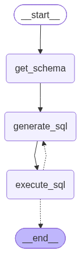
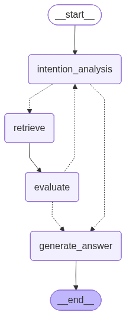
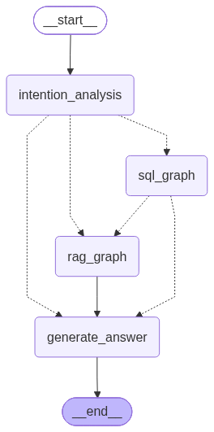

# 第六章：智能保险客服助手 Graph版

在第四章中，我们用 ReAct Agent 构建了一个多 Agent 协作的智能保险客服助手。
本章将用前面所学的graph知识，来重构一版智能保险客服助手，通过两个版本的对比，让大家更深刻的理解二者的差异。

---

## 6.1 从 LangChain 到 LangGraph
LangChain 的 `create_agent` 创建的是ReAct模式Agent，它的核心特点是**模型驱动**：每一步做什么，由 LLM 自己决定，这个特点很适合处理开放性任务：
- **开放性任务**：执行路径无法事先穷举（例如开放式调研、探索性分析），模型根据每一步的中间结果边走边调整策略，这种灵活性正是 ReAct 的**优势**
- **有固定流程的任务**：流程的先后顺序是确定的（例如本项目的数据查询：获取 Schema → 生成 SQL → 执行），此时依赖模型自主推理反而会**引入不确定性**，可能跳过某个步骤、顺序错乱，同样的输入两次执行还可能走出不同路径

LangGraph 的核心思想是：**用状态图（StateGraph）定义 Agent 的执行流程**，把控制权从模型手中拿回到开发者手中，在 Graph 中：
- **每个节点**是一个明确的功能单元（意图分析、SQL 生成、检索执行、质检评估、回答生成）
- **每条边**是一个确定的流转条件（意图是 knowledge → 走 RAG，意图是 data → 走 SQL）
- **循环**是受控的（可以设置最大重试次数，不是无限循环）
- **质检**是独立的（有专门的评估节点，不依赖模型的"自觉性"）


**选型判断标准**：**任务的流程是否确定**，流程不确定、需要边走边探索 → 用 ReAct；流程已确定 → 用 Graph。

| 特性        | ReAct Agent   | Graph Agent    |
|-----------|---------------|----------------|
| **控制流**   | 模型自主决策，路径不固定  | 开发者预定义，路径确定    |
| **流程可见性** | 黑盒，模型内部决定下一步  | 白盒，图结构一目了然     |
| **重试控制**  | 模型自己决定要不要重试   | 开发者设定最大重试次数和条件 |
| **质检环节**  | 无（模型自己判断"够了"） | 可插入独立的质检节点     |
| **并发控制**  | 可并行执行多个工具     | 可并行执行多个节点      |
| **灵活性**   | 高（模型自由发挥）     | 中等（在预定义框架内灵活）  |
| **可预测性**  | 低             | 高              |

---

## 6.2 项目架构
本项目同样是采用**1个Master graph + 2个Sub graph** 的架构，但底层实现从 ReAct Agent 切换为 **LangGraph 实现**：

| Graph            | 职责                  | 核心特点                  |
|------------------|---------------------|-----------------------|
| **Master Graph** | 意图识别、路由分发、结果整合      | 确定性工作流，意图分析用结构化输出驱动路由 |
| **RAG Graph**    | 文档检索、质量评估、回答生成      | 内含质检循环，支持多轮检索直到质量达标   |
| **SQL Graph**    | Schema 获取、SQL 生成、执行 | 内含错误重试循环              |

> 💡 **子图（Subgraph）是 LangGraph 的关键能力**：一个 Graph 可以作为另一个 Graph 的节点被调用，实现了与"子 Agent"类似的效果，但控制更精确。

---

## 6.3 SQL Graph 实现

我们从最简单的子图开始，SQL Graph。它负责结构化数据查询，流程清晰，适合作为 LangGraph 的入门。

SQL Graph 的流程设计：



### 6.3.1 状态设计

```python
import json
import sqlite3
import rich
from pathlib import Path
from typing import TypedDict, List, Annotated
from langchain_core.messages import AIMessage, ToolMessage, HumanMessage
from langgraph.constants import START, END
from langgraph.graph import StateGraph, add_messages
from unit1_大模型基础篇.a03_langchain调用模型 import create_model


class SqlState(TypedDict):
    messages: Annotated[list, add_messages] # 对话历史
    db_schema: List[dict[str, any]]  # 表结构
    execute_success: bool  # SQL执行结果标志
    loop_count: int  # 重试次数
```

**设计要点**：State 中的每个字段都有明确的"生产者"节点和"消费者"节点。例如 `db_schema` 由 `get_schema_node` 生产，由 `generate_sql_node` 消费。这种"字段-节点"的对应关系让数据流一目了然。

### 6.3.2 get_schema_node节点
该节点与unit4中基本相同，不再赘述，唯一区别是return的结果是存到了state中。

```python
class SqlGraph:
    def __init__(self):
        self.base_dir = Path(__file__).resolve().parent.parent
        self.model = create_model()
        self.conn = sqlite3.connect(self.base_dir / "db" / "sqlite" / "insurance.db", check_same_thread=False)
        self.cursor = self.conn.cursor()


    # 节点1：获取数据库 schema
    def get_schema_node(self, state: SqlState):
        self.cursor.execute("SELECT name FROM sqlite_master WHERE type='table' and name not in ('checkpoints', 'writes')")
        tables = self.cursor.fetchall()
        schema_list = []

        for table in tables:
            table_name = table[0]
            self.cursor.execute(f"SELECT sql FROM sqlite_master WHERE type='table' AND name='{table_name}';")
            ddl = self.cursor.fetchone()[0]

            self.cursor.execute(f"SELECT * FROM {table_name} limit 3;")
            # 1. 获取列名：cursor.description 是一个元组列表，其中第一个元素就是列名
            columns = [col[0] for col in self.cursor.description]
            # 2. 获取数据行
            rows = self.cursor.fetchall()
            # 3. 将每一行数据和列名打包成字典
            examples = [dict(zip(columns, row)) for row in rows]

            schema = {'table': table_name, 'ddl': ddl, 'examples': examples}
            schema_list.append(schema)

        return {"db_schema": schema_list, "loop_count": 0}
```

### 6.3.3 generate_sql_node节点
这个节点将 Schema 和用户问题组装成提示词，让模型生成 SQL。

```python
    def generate_sql_node(self, state: SqlState):
        print(f"[generate_sql_node] 开始生成sql")
        prompt_template = (self.base_dir / "prompt" / "sql_prompt.md").read_text(encoding="utf-8")
        prompt = prompt_template.replace("{db_schema}", json.dumps(state["db_schema"], ensure_ascii=False, default=str))

        # print(f"[generate_sql_node] prompt: {prompt}", end="\n\n")
        messages = [("system", prompt)] + state["messages"]
        ai_message = self.model.invoke(messages)
        return {"messages": [ai_message], "loop_count": state.get("loop_count", 0) + 1}
```

> [生成sql提示词：sql_prompt.md](./prompt/sql_prompt.md)  
> **关键约束**：要求模型"仅输出 SELECT 语句文本"，不要 markdown 代码块、不要解释。这样 `execute_sql_node` 就能直接拿来执行，不需要额外的解析。

### 6.3.4 execute_sql_node节点
```python
    def execute_sql_node(self, state: SqlState) -> str:
        try:
            sql = state["messages"][-1].content
            print(f"[execute_sql_node]：执行SQL：{sql}")

            # 判断是否为查询语句
            if sql.strip().upper().startswith('SELECT'):
                self.cursor.execute(sql)
                fetch_result = self.cursor.fetchall()

                columns = [description[0] for description in self.cursor.description]
                data_list = [dict(zip(columns, row)) for row in fetch_result] or ['未查到相关数据']
                result = {'content': json.dumps(data_list, ensure_ascii=False, default=str), 'execute_success': True}
            else:
                result = {'content': 'SQL执行失败：只允许执行select查询语句', 'execute_success': False}
        except Exception as e:
            # 把异常原封不动抛给 LLM，它看到报错后会自动修正 SQL 并重新运行！
            result = {'content': f"SQL执行失败: {str(e)}", 'execute_success': False}

        print(f"[execute_sql_node]：执行结果：{result}")
        return {"messages": [HumanMessage(content=result['content'])], "execute_success": result['execute_success']}

```

关键理解：
> - 正常来说 `execute_sql` 节点的执行结果应该包装为`ToolMessage`，但是`ToolMessage`需要先有tool calls，我们这里并没有让模型去调用工具，所以就用`HumanMessage`来代替了。
> - **错误即上下文**的设计：SQL 执行报错时，错误信息被包装成 `HumanMessage` 放回 messages 中，下一个循环的 `generate_sql_node` 会看到这条错误信息，从而修正 SQL。这就是自纠错循环的核心机制。


### 6.3.5 路由函数
```python
    def route_after_execute(self, state: SqlState) -> Literal["generate_sql", END]:
        print(f"[route_after_execute] 开始判断sql执行结果 execute_success={state['execute_success']}", end="\n\n")

        if not state.get("execute_success") and state["loop_count"] < 3:
            print(f"[SQL Graph] 触发自纠错 (第{state['loop_count']}/3次)")
            return "generate_sql"
        return END
```

**重试次数限制**：通过 `loop_count < 3` 限制最多循环 3 次。如果 3 次还失败，就退出循环，把错误结果返回给 Master Graph


### 6.3.6 SQL Graph 构建
```python
    def build(self):
        builder = StateGraph(SqlState)

        builder.add_node("get_schema", self.get_schema_node)
        builder.add_node("generate_sql", self.generate_sql_node)
        builder.add_node("execute_sql", self.execute_sql_node)

        builder.add_edge(START, "get_schema")
        builder.add_edge("get_schema", "generate_sql")
        builder.add_edge("generate_sql", "execute_sql")
        builder.add_conditional_edges("execute_sql", self.route_after_execute)
        return builder.compile()


if __name__ == "__main__":
    sql_graph = SqlGraph()
    graph = sql_graph.build()
    # draw_graph(graph, "../image/sql_graph.png")

    while True:
        query = input('请输入想要检索的内容：')
        if not query: continue

        result = graph.invoke({"messages": [HumanMessage(content=query)]})
        print(result)
        rows = json.loads(result['messages'][-1].content)

        print(f"最终回答：")
        for row in rows: print(row)
        print('=' * 100, end="\n\n")
```

[完整代码见：sql_graph.py](./graph/sql_graph.py)

---

## 6.4 RAG Graph 实现
RAG Graph 是本项目最复杂的子图，它实现了一个带**质检循环**的 Agentic RAG 流程。



RAG Graph 的执行路径：

1. **正常路径**：意图分析 → 检索 → 质检通过 → 生成回答
2. **重试路径**：意图分析 → 检索 → 质检不通过 → 回到意图分析（带上 feedback）→ 重新检索
3. **直通路径**：意图分析阶段模型认为不需要调工具（与保险业务无关的问题）→ 直接生成回答


### 6.4.1 状态设计
```python
import json
from pathlib import Path
from typing import Annotated, List, Literal, Dict
from langchain_core.runnables import RunnableConfig
from langchain_core.tools import InjectedToolArg
from langgraph.prebuilt import ToolNode
from typing_extensions import TypedDict
from pydantic import BaseModel, Field
from qdrant_client.http import models
from langchain.tools import tool
from langgraph.graph import StateGraph, START, END
from langgraph.graph.message import add_messages
from langchain_core.messages import HumanMessage, SystemMessage, AIMessage, ToolMessage
from unit1_大模型基础篇.a03_langchain调用模型 import create_model
from unit3_agent_基础篇.c01_create_agent import draw_graph
from unit4_智能保险客服助手_v1.data_process.init_qdrant import init_qdrant_store


class GraderSchema(BaseModel):
    binary_score: Literal["yes", "no"] = Field(description="评估结果：yes-评估通过，no-评估不通过")
    feedback: str = Field(default="", description="评估反馈：简要说明不通过的原因，并给出下一轮检索的明确建议")


class RagState(TypedDict):
    messages: Annotated[list, add_messages]  # 完整的对话历史，用于消指代和上下文理解
    source: str  # 目标保险产品全称（主网关传过来）
    grade: GraderSchema  # 质检评级
    loop_count: int  # 重试计数器（卡死保护）
```

**设计要点**：`GraderSchema` 是质检节点用来做结构化输出的，评估节点会将评估的结果存到state的grade中，`feedback` 字段会携带"为什么不通过"以及"下一步该怎么检索"的指导信息，直接喂给下一轮的意图分析节点。

### 6.4.2 检索工具
这三个检索工具和第四章是一样的

```python
class RagGraph:
    def __init__(self):
        self.base_dir = Path(__file__).resolve().parent.parent
        self.collection = "unit4_rag"
        self.qdrant_store = init_qdrant_store(self.collection, str(self.base_dir / "db" / "qdrant"))
        
        self.tools = [
            tool(self.get_catalogue),
            tool(self.similarity_search, parse_docstring=True),
            tool(self.metadata_search, parse_docstring=True)
        ]

        # 可以根据任务分配不同的模型
        self.intention_model = create_model().bind_tools(self.tools)   # 意图分析模型
        self.evaluate_model = create_model(response_format={"type": "json_object"}).with_structured_output(GraderSchema)    # 结果评估模型
        self.generate_model = create_model(temperature=0)   # 最终回答模型


    def similarity_search(self, query: str, config: Annotated[RunnableConfig, InjectedToolArg()]):
        """
        在向量数据库中进行相似度搜索。

        Args:
            query: 根据用户问题或正文线索动态构造的检索语句
        """

        # 从自动注入的 config 中安全获取运行时参数
        source = config["configurable"].get("source", None)
        print(f"[rag graph] 相似度检索 | query: {query} | source: {source}")

        # 构建 Qdrant 的条件过滤器
        qdrant_filter = models.Filter(
            must=[models.FieldCondition(key="metadata.source", match=models.MatchValue(value=source))]
        )

        results = self.qdrant_store.similarity_search_with_score(query=query, k=5, filter=qdrant_filter)
        page_content_list = ['未找到相关知识库内容']
        
        for doc, score in results:
            print(f"    ↳ [已捞取] score={score:.4f}] doc.metadata={doc.metadata}")
            # print(doc.page_content, end="\n\n")

        page_content_list = [doc.page_content for doc, score in results] if results else page_content_list
        result = json.dumps(page_content_list, ensure_ascii=False)
        print(f'[rag graph] 相似度检索到{len(page_content_list)}个文档', end="\n\n")
        return result

    def metadata_search(self, header_level: str, header_value: str, config: Annotated[RunnableConfig, InjectedToolArg()]):
        """
        在向量数据库中进行元数据搜索。

        Args:
            header_level: 从面包屑导航中动态判断层级，第一层用"header1"，第二层用"header2"，第三层用"header3"
            header_value: 从面包屑导航中动态提取对应层级的标题文本，必须来自实际检索结果，不可自行编造
        """

        # 1. 从自动注入的 config 中安全获取运行时参数,确保只在当前保险条款中检索
        source = config["configurable"].get("source", None)
        print(f"[rag graph] 元数据检索 | header_level: {header_level} | header_value: {header_value} | source: {source}")

        # 2. 构建组合过滤条件
        must_conditions = [
            models.FieldCondition(key=f"metadata.{header_level}", match=models.MatchValue(value=header_value)),
            models.FieldCondition(key="metadata.source", match=models.MatchValue(value=source))
        ]

        qdrant_filter = models.Filter(must=must_conditions)

        # 3. 使用底层 client 的 scroll 方法,直接按 Filter 获取记录(0 向量参与,性能极高)
        records, next_page_offset = self.qdrant_store.client.scroll(
            collection_name=self.collection,
            scroll_filter=qdrant_filter,
            limit=100,  # 一次性捞取该大章下的前 100 个分片(通常足够容纳一整章)
            with_payload=True,  # 必须为 True,否则拿不到文本
            with_vectors=False  # 不需要返回向量值
        )

        # 4. 提取文本(LangChain 存入 Qdrant 时,文本正文默认放在 payload 的 "page_content" 字段中)
        page_content_list = []

        for record in records:
            payload = record.payload
            if payload and "page_content" in payload:
                # 打印调试信息,看一眼拿到了哪些片段
                print(f"    ↳ [已捞取] metadata: {payload.get('metadata')}")
                # print(f"        page_content: {payload['page_content']}", end="\n\n")
                page_content_list.append(payload["page_content"])

        # 5. 序列化并返回
        result = json.dumps(page_content_list or ['未找到相关知识库内容'], ensure_ascii=False)
        print(f'[rag graph] 元数据检索到{len(page_content_list)}个文档', end="\n\n")
        return result
    
    def get_catalogue(self, config: Annotated[RunnableConfig, InjectedToolArg()]):
        """获取文档目录"""
        source = config["configurable"].get("source", None)
        print(f"[rag graph] 获取文档目录，source={source}")
        must_conditions = [models.FieldCondition(key="metadata.source", match=models.MatchValue(value=source))]
        qdrant_filter = models.Filter(must=must_conditions)

        # 3. 使用底层 client 的 scroll 方法,直接按 Filter 获取记录(0 向量参与,性能极高)
        records, next_page_offset = self.qdrant_store.client.scroll(
            collection_name=self.collection,
            scroll_filter=qdrant_filter,
            limit=200,
            with_payload=True,  # 必须为 True,否则拿不到文本
            with_vectors=False  # 不需要返回向量值
        )

        print(f'检索到{len(records)}个文档目录')
        metadatas = [record.payload.get("metadata") for record in records]
        metadatas.sort(key=lambda x: x.get("index", 0))
        for m in metadatas: m.pop("source")  # 删除元数据中的 source 字段，减少数据量
        return json.dumps([json.dumps(m, ensure_ascii=False) for m in metadatas], ensure_ascii=False)
```

### 6.4.3 intention_analysis_node节点
意图理解与检索规划

```python
    def intention_analysis_node(self, state: RagState, config: RunnableConfig):
        source = config["configurable"].get("source", None)
        feedback = getattr(state.get("grade"), "feedback", None) or "无"

        prompt_template = (self.base_dir / "prompt" / "rag_intent_prompt.md").read_text(encoding="utf-8")
        prompt = prompt_template.replace('{source}', source).replace('{feedback}', feedback)
        print(f"[rag_intent_analyze_node] 意图分析开始 input={state['messages'][0].content}")

        messages = [SystemMessage(content=prompt)] + state['messages']
        ai_message = self.intention_model.invoke(messages, config)

        print(f"[rag_intent_analyze_node] 意图分析结果: {ai_message}", end="\n\n")
        return {"messages": [ai_message], "loop_count": state.get("loop_count", 0) + 1}
```

**关键设计**：
- **source 通过 config 注入**：与第四章一致，产品名称通过 `RunnableConfig` 传入，实现数据隔离
- **feedback 注入**：如果上一轮质检不通过，`feedback` 会被注入到提示词中，告诉模型"上一轮检索哪里不够好，应该怎么调整"
- `intention_model` 绑定了三个检索工具，可以自主选择调用哪个（这是 Graph 中保留的"局部灵活性"）

> 意图分析提示词：[rag_intent_prompt.md](./prompt/rag_intent_prompt.md)  
> 
> **与第四章的对比**：第四章的 RAG Agent 提示词更长更复杂，因为它需要在同一个提示词中同时定义"检索策略"和"回答规范"。而 Graph 方式下，检索和回答被拆到了不同节点，每个节点的提示词只需要关注自己的职责，更简洁。


### 6.4.4 retrieve节点
检索节点，负责解析意图分析节点返回的 tool_calls 并执行对应的检索工具

**方式1：显式定义（好理解）**
```python
    def retriever_node(self, state: RagState, config: RunnableConfig):
        print("[retriever_node] 检索节点开始执行工具...")
        
        # 实例化 LangGraph 预置的 ToolNode 执行器
        tool_node = ToolNode(self.tools)
        # 显式执行 tool_executor 并返回状态更新结果
        result = tool_node.invoke(state, config)

        print(f"[retriever_node] 检索完毕：result={result}", end='\n\n')
        return result
```

**方式2：隐式定义（更方便）**
```python
    # 不需要定义retriever_node方法，直接把工具传入 ToolNode
    builder.add_node("retriever", ToolNode(self.tools))
```

> `ToolNode` 是 LangGraph 中用于执行工具（Tools）的预构建节点（Prebuilt Node），
> 它会自动执行模型上一轮产生的 `tool_calls`，并将结果包装为 `ToolMessage` 放回 messages 中。

### 6.4.5 evaluate_node节点
质检评估节点，用一个独立的模型对检索结果进行评估，如果评估通过则进入生成回答的流程，如果评估不通过则进入下一轮检索的流程。

```python
    def evaluate_node(self, state: RagState):
        print(f"[evaluate_node] evaluate 评估开始")
        prompt = (self.base_dir / "prompt" / "rag_evaluate_prompt.md").read_text(encoding="utf-8")

        messages = [SystemMessage(content=prompt)] + state["messages"]
        response = self.evaluate_model.invoke(messages)

        print(f"[evaluate_node] evaluate 评估结果: {response}", end="\n\n")
        return {'grade': response}
```

**这是 Graph 方式和 ReAct 方式比较大的区别**，在第四章的 ReAct Agent 中，模型自己判断"检索结果够不够，能不能回答了"，这个决策是在模型的"脑子"里完成的，不可观测、不可干预。
而在 Graph 方式中，质检是一个**独立节点**，有专门的提示词和结构化输出。

质检结果通过 `GraderSchema` 结构化输出：
- `binary_score: "yes"` → 检索通过，进入生成阶段
- `binary_score: "no"` → 检索不通过，`feedback` 字段携带下一步检索建议，回到意图分析节点重新检索

> 质检评估提示词：[rag_evaluate_prompt.md](./prompt/rag_evaluate_prompt.md)  
> 关键设计：在评估不通过时，要反馈原因，并给出下一步检索建议，让模型重新检索。


### 6.4.6 generate_answer_node节点
生成回复
```python
    def generate_answer_node(self, state: RagState, config: RunnableConfig):
                doc_set = set()
        for msg in state["messages"]:
            if isinstance(msg, ToolMessage):
                doc_set.update(json.loads(msg.content))

        doc_list = list(doc_set)
        print(f"[rag_generate_answer_node] 生成回复 docs: {len(doc_list)}")

        source = config["configurable"].get("source", None)
        print(f"[generate_answer_node] 生成回复 source: {source}", end="\n\n")

        docs = json.dumps(doc_list, ensure_ascii=False) if len(doc_list) > 0 else '未检索到相关文档'
        question = state["messages"][0].content

        prompt_template = (self.base_dir / "prompt" / "rag_generate_prompt.md").read_text(encoding="utf-8")
        prompt = prompt_template.replace('{source}', source).replace('{docs}', docs).replace('{question}', question)

        response = self.generate_model.invoke([SystemMessage(content=prompt)])
        print(f"[rag_generate_answer_node] 生成回复: {response}", end="\n\n")
        return {"messages": [response], "loop_count": 0}
```

**设计要点**：
- **检索结果集中提取**：从所有 `ToolMessage` 中收集检索到的文档片段，去重后统一交给生成模型
- **提示词职责单一**：生成节点的提示词只需要关注"如何基于检索结果回答用户问题"，不需要关心检索策略

> 生成回复提示词：[rag_generate_prompt.md](./prompt/rag_generate_prompt.md)


### 6.4.7 路由函数

```python
    def route_after_intention(self, state: RagState) -> Literal["retriever", "generate_answer"]:
        last_message = state["messages"][-1]
        if getattr(last_message, "tool_calls", None):
            return "retriever"
        return "generate_answer"

    def route_after_evaluate(self, state: RagState) -> Literal["intention_analysis", "generate_answer"]:
        if state["loop_count"] >= 3:
            print('超出重试上限')
            return "generate_answer"
        
        if state["grade"].binary_score == "yes":
            print('评估通过，开始生成结果')
            return "generate_answer"
        else:
            print(f'评估不通过，开始次{state["loop_count"]}次重试')
            return "intention_analysis"
```

**两道安全阀**：
1. `loop_count >= 3`：最多重试 3 次，防止无限循环
2. `binary_score == "yes"`：质检通过才进入生成阶段


### 6.4.8 RAG Graph 构建
```python
    def build(self):
        builder = StateGraph(RagState)
        builder.add_node("intention_analysis", self.intention_analysis_node)
        builder.add_node("retriever", self.retriever_node)
        builder.add_node("evaluate", self.evaluate_node)
        builder.add_node("generate_answer", self.generate_answer_node)

        builder.add_edge(START, "intention_analysis")
        builder.add_conditional_edges("intention_analysis", self.route_after_intention)
        builder.add_edge("retriever", "evaluate")
        builder.add_conditional_edges("evaluate", self.route_after_evaluate)
        builder.add_edge("generate_answer", END)
        return builder.compile()


if __name__ == "__main__":
    rag_graph = RagGraph()
    graph = rag_graph.build()
    # draw_graph(graph, "./rag_graph.png")

    while True:
        query = input('请输入想要检索的内容：')
        if not query: continue

        result = graph.invoke(
            {"messages": [HumanMessage(content=query)]},
            {"configurable": {"source": "长生爱康保重大疾病保险"}}
        )

        print(f"最终回答：{result['messages'][-1].content}")
        print('=' * 100)

    rag_graph.qdrant_store.client.close()
```
[完整代码见：rag_graph.py](./graph/rag_graph.py)

---

## 6.5 Master Graph 实现
Master Graph 是整个系统的主控图，负责意图识别、路由分发和结果整合。




### 6.5.1 状态设计
```python
import json
import rich
from pathlib import Path

from pydantic import BaseModel, Field
from typing import Annotated, TypedDict, List, Literal, Optional
from langgraph.checkpoint.memory import InMemorySaver
from langgraph.graph import StateGraph, START, END
from langgraph.graph.message import add_messages
from langchain_core.messages import BaseMessage, SystemMessage, HumanMessage, AIMessage, ToolMessage
from unit1_大模型基础篇.a03_langchain调用模型 import create_model
from unit6_智能保险客服助手_v2.graph.rag_graph import RagGraph
from unit6_智能保险客服助手_v2.graph.sql_graph import SqlGraph

# 意图分析结构化输出
class IntentSchema(BaseModel):
    intent: Literal["chitchat", "knowledge", "data", "joint"] = Field(description="意图分类：chitchat(闲聊寒暄), data(业务数据查询), knowledge(知识查询), joint(组合查询:业务数据+产品内容)")
    product_names: Optional[List[str]] = Field(default=[], description="对齐后的保险产品全称")
    sql_query_rewrite: Optional[str] = Field(default=None, description="改写后的业务数据检索诉求，仅在 intent 为 joint 时提供，否则为 null")
    rag_query_rewrite: Optional[List[str]] = Field(default=None, description="改写后的保险知识检索诉求列表。多产品比对时每维度一项；joint 组合查询时为单元素列表；其余场景为 null")

# 状态定义
class MasterState(TypedDict):
    messages: Annotated[List[BaseMessage], add_messages]
    intent: IntentSchema            # 意图分类
    sql_result: Optional[str]       # SQL 查询结果
    rag_result: Optional[str]       # RAG 检索结果
```

**设计要点**：  
- `IntentSchema` 使用 `Literal` 类型限定意图取值，配合 `with_structured_output` 保证输出是确定性的四个分类之一。  
- `product_names`、`sql_query_rewrite`、`rag_query_rewrite` 字段都是为后续调用 sub graph 准备的"指令参数"。


### 6.5.2 intent_analyze_node节点
| 意图          | 说明     | 典型场景             | 路由                      |
|-------------|--------|------------------|-------------------------|
| `chitchat`  | 闲聊寒暄   | "你好"、"谢谢"        | → generate_answer       |
| `knowledge` | 产品知识咨询 | "长爱保的免责条款有哪些"    | → rag_graph             |
| `data`      | 业务数据查询 | "上个月卖了多少单"       | → sql_graph             |
| `joint`     | 组合查询   | "客户张伟的保险是否涵盖心肌炎" | → sql_graph → rag_graph |

```python
class MasterGraph:
    def __init__(self):
        self.base_dir = Path(__file__).resolve().parent.parent
        self.intention_model = create_model(response_format={"type": "json_object"}).with_structured_output(IntentSchema)
        self.generate_model = create_model(temperature=0)

        # 实例化两个子graph
        self.sql_graph_builder = SqlGraph()
        self.sql_graph = self.sql_graph_builder.build()
        self.rag_graph_builder = RagGraph()
        self.rag_graph = self.rag_graph_builder.build()

        # 产品字典
        res = self.sql_graph_builder.execute_sql_node({"messages": [HumanMessage(content="SELECT * FROM products")]})
        self.product_dict: List[dict[str, str]] = json.loads(res["messages"][-1].content)


    # 节点1：意图分析
    def intention_analysis_node(self, state: MasterState):
        print("[intention_analysis_node] 开始意图分析")

        prompt_template = (self.base_dir / "prompt" / "master_intent_prompt.md").read_text(encoding="utf-8")
        prompt = prompt_template.replace('{products}', json.dumps(self.product_dict, ensure_ascii=False))
        # print(f"[intention_analysis_node] 意图分析prompt: {prompt}", end="\n\n")

        messages = [SystemMessage(content=prompt)] + state["messages"]
        intent = self.intention_model.invoke(messages)

        print(f"[intention_analysis_node] 意图分析结果: {intent}", end="\n\n")
        return {"intent": intent}
```

**关键设计**：
- **结构化意图识别**：显式输出意图分类，给后续的路由提供依据
- **产品字典注入**：将产品列表注入提示词，让模型在意图分析阶段就完成产品名称对齐（口语化名称 → 官方全称）

**意图分析提示词**（[master_intent_prompt.md](./prompt/master_intent_prompt.md)）：

**query 改写**是意图分析的核心能力之一。对于 `joint` 意图，模型需要将用户原始问题拆分为两个子查询：
```
用户："客户张三的保险是否涵盖严重心肌炎"
  → sql_query_rewrite: "查询客户张三购买的保险信息"
  → rag_query_rewrite: ["严重心肌炎"]
```

对于 `knowledge` 意图中的跨产品对比，也需要改写 query，剥离无关信息：
```
用户："长爱保和百万康宁在免责条款上有什么区别？"
  → product_names: ["长生爱康保重大疾病保险", "华泰人寿百万康宁终身重大疾病保险"]
  → rag_query_rewrite: ["有哪些免责条款？"]
```

### 6.5.3 sql_graph_node节点

```python
    def sql_graph_node(self, state: MasterState):
        print("[sql_graph_node] 调用 SQL Graph...")
        # 如果是 joint 意图，优先使用 LLM 改写过的 query
        sql_query = state['intent'].sql_query_rewrite or state['messages'][-1].content
        result = self.sql_graph.invoke({"messages": [HumanMessage(content=sql_query)]})
        
        sql_res_str = result['messages'][-1].content # sql_graph返回的原始结果字符串
        product_name_list = state['intent'].product_names

        # 仅在联合查询时，尝试通过“确定性属性判断”，从SQL结果中动态剥离出产品名称
        if state['intent'].intent == "joint":
            try:
                db_rows = json.loads(sql_res_str)
                first_row = db_rows[0]

                # 确定性检查：判断返回的数据行中是否包含产品名称的属性标签
                if "product_name" in first_row:
                    product_name_list = [row.get("product_name") for row in db_rows]
                    print(f"[sql_graph_node] 成功解析出关联产品: {product_name_list}")
            except Exception as e:
                print(f"[sql_graph_node] 尝试解析 SQL 结果中的产品失败: {e}")

        # 更新意图分类中的 product_names
        intent = state['intent'].model_copy(update={"product_names": product_name_list})
        return {"sql_result": sql_res_str, "intent": intent}
```

**关键理解**：
- **调用 SQL Graph**：用 `intent.sql_query_rewrite`（如果有）或原始用户问题作为输入，invoke SQL Graph
- **动态产品提取**（joint 意图时）：从 SQL 查询结果中尝试提取产品名称。例如查到"客户张伟购买的是长生爱康保重大疾病保险"，就把这个产品名提取出来，传给后续的 RAG 节点

### 6.5.4 rag_graph_node节点
```python
    def rag_graph_node(self, state: MasterState):
        print("[rag_graph_node] 调用 RAG Graph...")
        rag_query_list = state['intent'].rag_query_rewrite or [state['messages'][-1].content]
        rag_results = []

        for rag_query in rag_query_list:
            for product in state['intent'].product_names:
                result = self.rag_graph.invoke(
                    {"messages": [HumanMessage(content=rag_query)]},
                    {"configurable": {"source": product}}
                )
                rag_results.append({"query": rag_query, "product": product, "content": result['messages'][-1].content})
        return {"rag_result": json.dumps(rag_results, ensure_ascii=False)}
```

**关键理解**：  

两层 for 循环做的事情其实就是在填一个表格，横轴是产品，纵轴是比对维度，检索完后给每个结果打上"标签"，用来区分这个结果"是哪个维度、哪个产品"查出来的，
这样，后续在生成回答时才能"对号入座"

| 维度\产品 | 产品a        | 产品b        |
|-------|------------|------------|
| 免责条款  | 检索产品a的免责条款 | 检索产品b的免责条款 |
| 投保年龄  | 检索产品a的投保年龄 | 检索产品b投保年龄  |
| ...   | 检索产品a的...  | 检索产品b的...  |


### 6.5.5 generate_answer_node节点
把每个节点产出的数据塞到提示词中，发给模型做最终回答

```python
    def generate_answer_node(self, state: MasterState):
        print("[generate_answer_node] 开始生成回复...")
        prompt_template = (self.base_dir / "prompt" / "master_generate_prompt.md").read_text(encoding="utf-8")

        prompt = (
            prompt_template
            .replace('{products}', json.dumps(self.product_dict, ensure_ascii=False))
            .replace('{intent}', state["intent"].intent)
            .replace('{sql_result}', state.get("sql_result") or "未检索到数据")
            .replace('{rag_result}', state.get("rag_result") or "未检索到内容")
        )

        messages = [SystemMessage(content=prompt)] + state["messages"]
        response = self.generate_model.invoke(messages)
        print(f"[generate_answer_node] 生成回复完成: {response.content}")

        # 4. 返回最终答案，顺便清空本次的中间件数据（防止污染下一轮对话）
        return {"messages": [response], "sql_result": None, "rag_result": None}
```

**生成回答提示词**（[master_generate_prompt.md](./prompt/master_generate_prompt.md)）：
> `generate_answer` 的提示词会根据 `intent` 类型切换不同的回复策略。意图分类在前面已经确定，这里只需要"照方抓药"即可。
对比第四章 Master Agent 在一个巨型提示词中同时处理意图识别、产品路由、工具调用和结果整合，Graph 方式的职责拆分让每个提示词都更简洁、更聚焦。


### 6.5.6 路由函数

```python
    def route_after_intent(self, state: MasterState) -> Literal["sql_graph", "rag_graph", "generate_answer"]:
        route_map = {"chitchat": "generate_answer", "knowledge": "rag_graph", "joint": "sql_graph", "data": "sql_graph",}
        intent = state["intent"].intent
        return route_map.get(intent, "generate_answer")

    def route_after_sql(self, state: MasterState) -> Literal["rag_graph", "generate_answer"]:
        intent = state["intent"].intent
        return "rag_graph" if intent == "joint" else "generate_answer"
```

**两条关键路由**：
1. **`intent_analyze` → 各功能节点**：根据意图分类分流
2. **`sql_graph` → `rag_graph` 或 `generate_answer`**：只有 `joint` 意图才会在 SQL 查询后继续走 RAG，其他情况直接生成回复

### 6.5.7 Master Graph 构建

```python
    def build_graph(self):
        # 4. 构建确定性工作流
        workflow = StateGraph(MasterState)
        workflow.add_node("intention_analysis", self.intention_analysis_node)
        workflow.add_node("sql_graph", self.sql_graph_node)
        workflow.add_node("rag_graph", self.rag_graph_node)
        workflow.add_node("generate_answer", self.generate_answer_node)

        # 串联执行
        workflow.add_edge(START, "intention_analysis")
        workflow.add_conditional_edges("intention_analysis", self.route_after_intent)
        workflow.add_conditional_edges("sql_graph", self.route_after_sql)
        workflow.add_edge("rag_graph", "generate_answer")
        workflow.add_edge("generate_answer", END)
        
        return workflow.compile(checkpointer=InMemorySaver()) #


if __name__ == "__main__":
    master_graph = MasterGraph()
    graph = master_graph.build_graph()
    # draw_graph(graph, "../image/master_graph.png")

    print('智能保险客服问答助手已启动，请输入你想咨询的问题')
    config = {"configurable": {"thread_id": "1"}}

    while True:
        user_input = input("你：").strip()
        if not user_input: continue

        result = graph.invoke({"messages": [HumanMessage(content=user_input)]}, config)
        # rich.print(result)
        print('='*100, end='\n\n')

    # 客户张伟购买的是哪个保险产品？他这款保险的免责条款有哪些？
    master_graph.rag_graph_builder.qdrant_store.client.close()
```

---

## 6.6 关键设计解析

### 6.6.1 意图驱动路由 vs 工具驱动路由
这是第四章和第六章最本质的区别。

**第四章（工具驱动路由）**：
```
用户提问 → Master Agent 的 ReAct 循环
  → 模型思考：这个问题需要查数据库还是查条款？
  → 模型决定：调 insurance_data_expert 工具
  → 工具返回结果
  → 模型思考：结果够了吗？要不要再调 insurance_knowledge_expert？
  → 模型决定：够了，直接回答
```

路由决策完全在模型的"脑子"里完成。你能做的只是通过提示词"建议"它该怎么走，但无法强制。

**第六章（意图驱动路由）**：

```
用户提问 → intent_analyze 节点
  → 模型用结构化输出显式分类：intent = "joint"
  → 同时产出 sql_query_rewrite 和 rag_query_rewrite
  → 代码路由函数根据 intent 字段确定性分流
  → sql_graph 节点执行 SQL 查询
  → 代码路由函数根据 intent == "joint" 确定性流转到 rag_graph
  → rag_graph 节点执行文档检索
  → generate_answer 节点整合所有结果生成回复
```

路由决策由**代码的条件边**完成，确定性强、可预测、可测试。


### 6.6.2 RAG 质检节点
第四章的 RAG Agent 没有独立的质检环节，模型检索几次之后自己决定"差不多了，回答吧"。如果模型判断失误，就会基于不充分的检索结果生成回答。

第六章的 RAG Graph 引入了独立的质检节点 `evaluate_node`，分工更明确：

```
检索完成 → evaluate_node 质检
  → binary_score = "yes" → 通过，进入生成阶段
  → binary_score = "no"  → 不通过，feedback 注入下一轮意图分析
                              ↓
                          重新检索（带上 feedback 指导）
```

**feedback 的作用**是让重试"有方向"，不是盲目重试，而是质检节点明确指出"上一轮检索缺什么、应该用什么策略补全"。例如：
> feedback: "资料不完整，用户问的是完整重疾病种列表，当前只检索到第35种，面包屑显示位于【第七章 附表 / 附表一：重大疾病种类表】。
> 建议调用 metadata_search，header_level='header2'，header_value='附表一：重大疾病种类表'。"

下一轮的 `intention_analysis_node` 会看到这条 feedback，据此调整检索策略。


### 6.6.3 sub graph的消息传递
Master Graph 调用 sub graph 时，sub graph 的执行结果是存放在 state 中的独立字段

```python
# 调用 sql_graph 伪代码：
def sql_graph_node(self, state: MasterState):
    sql_result = self.sql_graph.invoke({"messages": [HumanMessage(content=sql_query)]})
    return {"sql_result": sql_result, "intent": intent}

# 调用 rag_graph 伪代码：
def rag_graph_node(self, state: MasterState):
    rag_result = self.rag_graph.invoke(
        {"messages": [HumanMessage(content=rag_query)]},
        {"configurable": {"source": product}}
    )
    return {"rag_result": rag_result}

# 每轮回答后清空
def generate_answer_node(self, state: MasterState):
    # ...
    return {"messages": [response], "sql_result": None, "rag_result": None}
```

**为什么这样设计**？  
sql_result 和 rag_result 属于单轮对话里的中间数据，无需写进 master 的 messages 中，
每轮对话的最终回答里已经把当轮的 SQL/RAG 结果消化成自然语言结论写进去了


### 6.6.4 组合查询（joint）的链式编排
`joint` 意图是 Master Graph 最复杂的路由路径：

```
用户："客户张伟的保险是否涵盖严重心肌炎"
  │
  ▼
intent_analyze
  → intent = "joint"
  → sql_query_rewrite = "查询客户张伟购买的保险信息"
  → rag_query_rewrite = ["严重心肌炎"]
  → product_names = []  （还不知道产品名）
  │
  ▼
sql_graph_node
  → 调用 SQL Graph，查询客户张伟的保单
  → SQL 结果：[{"customer_name": "张伟", "product_name": "长生爱康保重大疾病保险", ...}]
  → 从结果中动态提取 product_name → product_names = ["长生爱康保重大疾病保险"]
  → 更新 intent.product_names
  │
  ▼
rag_graph_node
  → 遍历 product_names（此时已有值）
  → 对"长生爱康保重大疾病保险"调用 RAG 子图，检索"严重心肌炎"
  → 返回条款检索结果
  │
  ▼
generate_answer_node
  → 综合 SQL 结果（客户保单信息）+ RAG 结果（条款内容）
  → 生成最终回复
```

**核心机制**：SQL 结果中的 `product_name` 字段被动态提取并传递给 RAG 节点。这个"跨子图数据传递"是通过更新 `intent.product_names` 字段实现的，SQL 节点更新 State，RAG 节点读取 State，完成了一次"隐式"的数据接力。


### 6.6.5 上下文隔离
- sub graph 被调用时，只会看到传入的 `HumanMessage`，Master 的完整消息列表并不会传递到 sub graph 中，执行完毕后返回最终结果。
- master graph 只接收 sub graph 的最终结果，sub graph 内部的中间数据同样也不会传递到 master 中。

---

## 6.7 提示词工程
从"全能提示词"到"职责分离"

```
第四章：ReAct Agent
  ├── Master Agent (create_agent + 工具)
  ├── RAG Agent (create_agent + 3个工具)
  └── SQL Agent (create_agent + 2个工具)
                    │
                    │  演进动机：流程不可控、无质检、重试不可限
                    ▼
第六章：Graph Agent
  ├── Master Graph (StateGraph + 条件路由)
  │     ├── 意图分析：结构化输出显式分类
  │     └── 回复生成：按意图分策略
  ├── RAG Graph (StateGraph + 质检循环)
  │     ├── 检索规划：保留 bind_tools 的局部灵活性
  │     ├── 质检评估：独立节点 + 结构化评分 + feedback
  │     └── 回复生成：只基于已通过质检的检索结果
  └── SQL Graph (StateGraph + 自纠错循环)
        └── 生成→执行→失败重试（最多3次）
```

### 6.7.1 ReAct vs Graph 的提示词对比

| 提示词        | 第四章（ReAct）                                 | 第六章（Graph）                                                                             |
|------------|--------------------------------------------|----------------------------------------------------------------------------------------|
| **Master** | 1 个巨型提示词，涵盖意图识别、产品路由、工具调用规范、跨产品对比流程、结果整合策略 | 拆为 2 个：`master_intent_prompt`（意图分析+query改写）和 `master_generate_prompt`（回复生成）            |
| **RAG**    | 1 个提示词，同时定义检索策略、工具使用规范、回答格式                | 拆为 3 个：`rag_intent_prompt`（检索规划）、`rag_evaluate_prompt`（质检）、`rag_generate_prompt`（回答生成） |
| **SQL**    | 基本一致                                       | 基本一致                                                                                   |

**核心变化**：Graph 方式把原本挤在一个提示词里的多个职责拆分到了不同节点，每个节点的提示词只需要关注自己的事情。

### 6.7.2 提示词拆分的好处

| 好处         | 说明                                      | 
|------------|-----------------------------------------|
| **更短更聚焦**  | 每个提示词只负责一件事，不需要写"如果你要检索就这样做，如果你要回答就那样做" | 
| **独立优化**   | 修改质检标准不会影响检索策略，修改回答格式不会影响检索逻辑           | 
| **模型选择灵活** | 不同节点可以用不同的模型参数                          | 
| **可测试性**   | 每个节点的提示词可以单独测试                          | 

---

## 6.8 本章总结

### 核心知识点回顾
1. **LangGraph 的核心思想**：用状态图（StateGraph）定义 Agent 的执行流程，把控制权从模型手中拿回到开发者手中，从"模型驱动"到"代码驱动"
2. **三层 Graph 嵌套架构**：Master Graph 负责意图识别和路由分发，SQL Graph 和 RAG Graph 作为子图被调用，各司其职
3. **State 设计**：用 `TypedDict` 定义状态结构，`Annotated` + reducer 函数控制字段的合并方式，每个字段有明确的生产者和消费者
4. **条件边路由**：用代码函数而非模型决策来控制流转方向，确定性路由让流程可预测、可测试
5. **质检循环**：RAG Graph 引入独立的 `evaluate_node`，用结构化输出评分 + feedback 机制驱动多轮检索，替代了 ReAct 模式下模型的"自觉性"
6. **自纠错循环**：SQL Graph 的 `execute_sql → generate_sql` 回环，配合 `loop_count` 卡死保护，实现了受控的错误重试
7. **意图驱动的 query 改写**：意图分析阶段一次性产出路由决策、产品对齐、query 改写，后续节点照单执行
8. **组合查询（joint）的链式编排**：SQL 查询结果中动态提取产品名 → 传给 RAG 子图，通过 State 字段实现跨子图数据传递
9. **提示词职责分离**：一个提示词只负责一件事，更短、更聚焦、更易维护

### 关键理解
- **Graph 不是替代 ReAct，而是在需要控制的地方替代**：RAG 的检索策略选择仍然保留了模型决策（bind_tools），但在流程编排和质量把关上用代码控制。好的架构是"该确定的地方确定，该灵活的地方灵活"
- **质检节点是 Agentic RAG 的"安检员"**：没有质检的 RAG 是"检索一次就回答"，有质检的 RAG 是"检索→评估→不够就再检索→够了才回答"。
- **子图 = 子 Agent 的 Graph 版**：第四章用工具包装子 Agent，第六章用子图节点包装子 Graph。效果类似，但子图的优势是内部流程可控（质检、重试、多节点编排）
- **意图分析是 Master Graph 的"大脑"**：所有的路由决策都在这里一次性产出，后续节点只需要"执行"而非"决策"。这与 ReAct 的"边走边想"形成鲜明对比
- **提示词拆分反映职责拆分**：当你在 Graph 中把一个复杂任务拆成了多个节点，提示词自然也就拆分了，每个节点只需要自己的"工作手册"