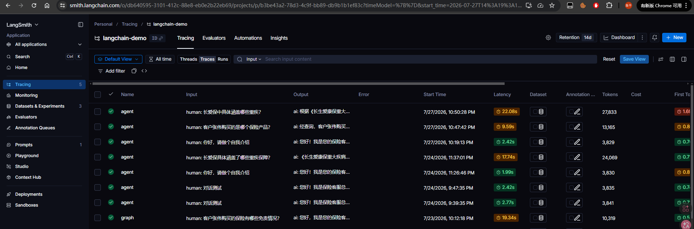
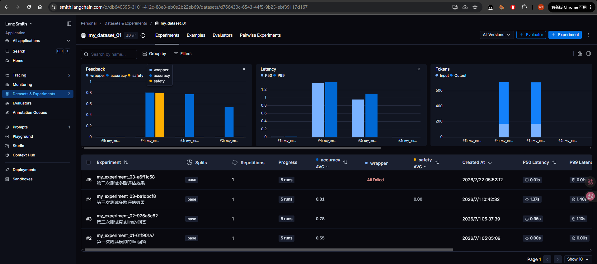

# 第七章：LangSmith篇

LangSmith 是 LangChain 官方推出的**全生命周期的agent应用开发与运维平台**，本篇主要讲解观测和评估的核心功能：

- **链路追踪（Tracing）**：自动记录 LLM 应用运行过程中的每一次调用、每一个步骤的输入输出、耗时、Token 消耗等详细信息。
- **数据集管理（Datasets）**：将测试用例结构化地存储到平台上，便于反复使用和版本管理。
- **评估实验（Evaluation）**：基于数据集批量运行你的应用，并使用自定义评估器（或 LLM 自动评分）对结果打分，生成实验报告。

**为什么要做链路追踪？**  
> 如果你有传统 Web 开发的经验，一定听说过 SkyWalking 这类链路追踪工具。
> 它们的思路其实很简单：一个请求会经过多个服务，每个服务都会打日志，但这些日志散落在各个服务的机器上，出了问题没法一眼看出整条链路是怎么走的。
> 于是这类工具会统一收集所有服务的执行记录，再提供一个可视化面板，把"一次请求 → 调用链 → 每一步的耗时/结果"完整还原出来，这就是链路追踪的价值。
>
> LangChain 的 Agent 应用也是同样的问题：一次回答，可能要经过多次模型调用、工具调用、检索步骤，本质上就是一条由多个环节组成的"调用链"。
> 如果全靠自己打日志，会面临三个问题：
> - **日志散落**：部署了多个 Agent 应用后，日志分散在各处，难以汇总排查；
> - **缺少关联**：普通日志是"点状"的，无法把"这次回答"涉及的所有步骤串联成一棵树，看不出是哪一步拖慢或出错；
> - **没有可视化面板**：观察不直观，排查效率低。
>
> 链路追踪（如 LangSmith）就是把这套"统一采集 + 可视化"的能力自动帮你做好，让你能：
> - **定位问题**：一次回答不对，是 Prompt 写得不好？是检索没召回正确文档？还是模型本身能力不够？
> - **监控性能**：每一步花了多少时间？消耗了多少 Token？
> - **调试复现**：完整记录每次运行的输入输出，可以回溯和复现问题。

**为什么要使用数据集来评估模型？**  
> 日常开发中，我们往往只凭感觉"手动问几个问题"来判断效果好不好。这种方式有明显缺陷：
> - **不可复现**：每次问的问题不一样，无法对比改进前后的效果。
> - **主观偏差**：人脑判断"好不好"很主观，缺乏量化标准。
> - **覆盖不足**：手动测试几条无法覆盖各种边界情况。

**使用数据集评估的好处：**
> - **一致性**：每次评估都用同一批数据，结果可对比。
> - **量化打分**：通过评估器给出分数，用数据说话。
> - **规模化**：一次运行几十上百条测试用例，全面覆盖各种场景。

---

## 7.1 接入 Smith 平台实现链路追踪
接入 LangSmith 非常简单。如果你使用的是 LangChain 的 API 来调用模型，**只需要设置好几个环境变量，就能无缝接入 LangSmith 实现链路追踪**，无需修改任何业务代码。


### 7.1.1 环境变量配置
需要设置以下 4 个环境变量：

| 环境变量                 | 说明                   | 示例值                               |
|----------------------|----------------------|-----------------------------------|
| `LANGSMITH_TRACING`  | 是否开启追踪               | `true`                            |
| `LANGSMITH_ENDPOINT` | LangSmith平台接入地址      | `https://api.smith.langchain.com` |
| `LANGSMITH_API_KEY`  | 你的 LangSmith API Key | `lsv2_pt_xxxx`                    |
| `LANGSMITH_PROJECT`  | 项目名称，用于分组管理追踪数据      | `langchain-demo`                  |

> langsmith平台地址：https://smith.langchain.com/

### 7.1.2 代码实现
本教程中为了方便，是在代码去添加环境变量的，你也可以配置在本机的环境变量中，或者使用.env配置文件的方式去配置。

```python
# util/env_util.py
import os

def setup_langsmith():
    print("已开启langsmith追踪")
    os.environ['LANGSMITH_TRACING'] = 'true'
    os.environ['LANGSMITH_ENDPOINT'] = 'https://api.smith.langchain.com'
    os.environ['LANGSMITH_API_KEY'] = 'lsv2_pt_xxxx'  # 替换为你的 API Key
    os.environ['LANGSMITH_PROJECT'] = 'langchain-demo'
```

在需要追踪的代码中，只需在**最前面**调用这个函数即可：

```python
from util import env_util
env_util.setup_langsmith()  # 必须在其他 langchain 导入之前执行

# 后续所有 langchain 的调用都会自动被追踪
from langchain_core.messages import SystemMessage, HumanMessage
from unit1_大模型基础篇.a03_langchain调用模型 import create_model

model = create_model()
messages = [
    SystemMessage(content="你是一个问答助手"),
    HumanMessage(content="什么是哺乳动物的主要特征？")
]
result = model.invoke(input=messages)
print(result.content)
```


### 7.1.3 追踪效果
配置完成后，你在 LangSmith 平台的 `langchain-demo` 项目中就能看到：
- 每一次模型调用的完整输入输出
- 调用链路的树状结构（如果一个步骤内嵌套了其他步骤）
- 每步的耗时、Token 消耗
- 运行状态（成功/失败/报错）



> 💡 **提示**：`setup_langsmith()` 必须在 LangChain 相关模块导入**之前**调用，因为环境变量需要在 LangChain 初始化时被读取。

---

## 7.2 创建数据集
在 LangSmith 中，**数据集（Dataset）** 是一组结构化的测试用例集合。每个测试用例包含三个部分：

- **inputs**：输入数据（如用户问题）
- **outputs**：期望输出 / 参考答案（用于评估时对比）
- **metadata**：元数据（如难度、来源等，方便筛选和管理）


### 7.2.1 数据集的数据结构
一个典型的数据集示例：

```python
my_examples = [
    {
        "inputs": {"question": "《长生爱康保重大疾病保险》的等待期是多久？"},
        "outputs": {"answer": "根据《长生爱康保重大疾病保险》第二章第三条【保险责任】的内容，该产品的等待期为**自本合同生效日或复效日（以较迟者为准）起九十天**"},
        "metadata": {"desc": "产品条款检索", "difficulty": "简单"}
    },
    # ... 更多测试用例
]
```

**字段说明**：

| 字段                | 作用    | 说明               |
|-------------------|-------|------------------|
| `inputs.question` | 模型的输入 | 会被传给目标函数，是测试的起点  |
| `outputs.answer`  | 参考答案  | 评估时作为标准答案来对比打分   |
| `metadata`        | 元数据   | 可自由定义，用于标记难度、分类等 |

> 完整数据集：[dataset.json](./dataset.json)

### 7.2.2 数据集的设计思路
数据集应该尽可能的覆盖多种情况，以便全面评估模型表现。以课件中的 11 条数据为例，我们设计了不同难度的、不同检索路径的测试用例：

| #  | 难度 | 说明                    |   推断路由    |
|:--:|----|-----------------------|:---------:|
| 1  | 简单 | 不涉及数据检索               | chitchat  |
| 2  | 简单 | 不涉及数据检索，越界拒答          | chitchat  |
| 3  | 简单 | 不涉及数据检索，未知产品兜底        | knowledge |
| 4  | 简单 | 产品条款检索                | knowledge |
| 5  | 简单 | 产品条款检索，触发文档目录概览       | knowledge |
| 6  | 中等 | 产品条款检索，多子问题需 query 拆分 | knowledge |
| 7  | 中等 | 多产品条款比对               | knowledge |
| 8  | 简单 | 业务数据检索，聚合统计           |   data    |
| 9  | 简单 | 业务数据检索，条件过滤 + 排序      |   data    |
| 10 | 复杂 | 业务数据 + 产品条款组合查询       |   joint   |
| 11 | 复杂 | 业务数据 + 多产品条款比对        |   joint   |


### 7.2.3 代码实现：创建数据集
使用 `langsmith.Client` 来创建数据集并添加数据：

```python
import json
from langsmith import Client


# 创建数据集
client = Client()
dataset_name = "insurance_dataset"

dataset = client.create_dataset(
    dataset_name=dataset_name,
    description="保险业务数据集",
)

# 给数据集添加数据
with open('dataset.json', 'r', encoding='utf-8') as f:
    examples = json.load(f)
    client.create_examples(dataset_id=dataset.id, examples=examples)
```

---

## 7.3 使用数据集测试评估
创建了数据集之后，就可以使用它来**批量评估**你的 LLM 应用了。评估流程的核心是三件事：

1. **目标函数（Target Function）**：你要评估的"主体"，接收数据集里的问题，返回实际的回答。
2. **评估器（Evaluator）**：定义评分规则，对比模型输出和参考答案给出打分。
3. **运行评估（Run Evaluation）**：将目标函数、数据集、评估器组合起来，批量执行并生成实验报告。

### 7.3.1 评估流程概览

```
数据集（inputs） → 目标函数（生成 outputs） → 评估器（对比 outputs vs reference_outputs） → 实验报告
     │                    │                          │
     │                    │                          └─ 返回 {key, score, comment}
     │                    └─ 返回 {answer: "..."}
     └─ {question: "..."}
```

LangSmith 的 `client.evaluate()` 会：
1. 从数据集中逐条取出 `inputs`
2. 调用目标函数，得到实际输出 `outputs`
3. 将 `inputs`、`outputs`、`reference_outputs`（数据集中的 outputs）传给每个评估器
4. 收集所有评估器的打分结果，生成实验报告


### 7.3.2 定义目标函数
目标函数是你要评估的"主体"，它可以是一个 chain、一个agent或者一个 graph 程序。

**前置代码**
```python
from util import env_util
env_util.setup_langsmith()

import uuid
from pathlib import Path
from pydantic import BaseModel, Field
from langsmith import Client

from unit4_智能保险客服助手_v1.agent.master_agent import MasterAgent
from unit6_智能保险客服助手_v2.graph.master_graph import MasterGraph
from unit1_大模型基础篇.a03_langchain调用模型 import create_model


class EvaluationResult(BaseModel):
    score: int = Field(description="针对回答的准确性打分，范围 0 到 100")
    reason: str = Field(description="给出打分的判定依据，说明哪些要点命中、哪些缺失或冲突")


# 创建评估模型
eva_model = create_model(model="qwen3.8-max", temperature=0, response_format={"type": "json_object"})
structured_eva_model = eva_model.with_structured_output(EvaluationResult)
```

> 注意：评估模型最好要比被评估的模型强一档，尽量不要用同系列（自家人）的模型，同系列模型输出的风格类型，可能会有系统性偏袒，temperature要设为0

**目标函数**
```python
# 创建MasterAgent
agent_builder = MasterAgent()
agent = agent_builder.build_agent()

metadata = {
    "master": {
        "model_name": agent_builder.model.model_name,
        "temperature": agent_builder.model.temperature,
        "thinking": agent_builder.model.extra_body['enable_thinking']
    },
    "eva": {
        "model_name": eva_model.model_name,
        "temperature": eva_model.temperature,
        "thinking": eva_model.extra_body['enable_thinking']
    },
}

# 定义目标函数
def target(inputs: dict) -> dict:
    thread_id = str(uuid.uuid4())
    print(f'target [{thread_id}] inputs={inputs}')
    
    config = {"configurable": {"thread_id": thread_id}}
    response = agent.invoke(input={"messages": [("user", inputs["question"])]}, config=config)
    result = response["messages"][-1].content
    
    print(f'target [{thread_id}] result={result}')
    return {"answer": result}
```

**关键理解**：
> - metadata：元数据用于记录所有参与模型的配置信息，方便后续对比不同模型组合的效果
> - 目标函数的入参 `inputs` 就是数据集中的 `inputs` 字段，返回值是一个字典，字段名需要和评估器中读取的一致。


### 7.3.3 定义评估器
评估器是一个 Python 函数，接收三个参数，返回一个包含 `key`、`score`、`comment` 的字典，评估方式是用另一个 LLM 来对回答进行打分。

```python
# 定义评估器（准确性评估）
def evaluator(inputs: dict, outputs: dict, reference_outputs: dict) -> dict:
    """
    input：来自于数据集中的inputs
    outputs: 目标函数运行返回的字典
    reference_outputs: 数据集中的outputs
    """
    print(f"\n{'='*50} [evaluator] 开始↓↓↓ {'='*50} ")
    print("[evaluator] 问题:", inputs, end='\n\n')
    print("[evaluator] 参考答案:", reference_outputs, end='\n\n')
    print("[evaluator] agent实际回答:", outputs, end='\n\n')

    prompt_template = (Path(__file__).resolve().parent / "eva_prompt.md").read_text(encoding="utf-8")
    prompt = (prompt_template.replace('{question}', inputs["question"])
                .replace('{reference_answer}', reference_outputs["answer"])
                .replace('{key_point}', reference_outputs["key_point"])
                .replace('{llm_answer}', outputs['answer']))

    response = structured_eva_model.invoke(prompt)
    print(f'evaluator 评估结果：{response}')     # response 直接就是一个 EvaluationResult 对象
    print(f"{'=' * 50} evaluator 结束↑↑↑ {'=' * 50} ", end='\n\n')

    # 我们不仅把 score 传给 LangSmith，还可以把理由塞进 comment 里，方便在 UI 中查看
    return {"key": "accuracy", "score": response.score / 100.0, "comment": response.reason}
```
> 评估提示词：[eva_prompt.md](eva_prompt.md)


### 7.3.4 运行评估
使用 `client.evaluate()` 将目标函数、数据集和评估器组合起来：

```python
if __name__ == "__main__":
    client = Client()
    experiment_results = client.evaluate(
        target,  # 被评估的目标函数
        data='insurance_dataset',  # 数据集名称
        evaluators=[evaluator],  # 评估器列表
        experiment_prefix="agent_experiment",  # 评估后生成的实验报告的前缀
        description="agent版第1次评估",  # 实验描述，用来记录这次测试的背景
        max_concurrency=1,  # 最大并发数，可选参数。如果你的数据集很大（比如 1000 条数据），一条一条去请求 LLM 会非常慢
        metadata=metadata,  # 可选参数，实验元数据
    )
    print(experiment_results)
```

**关键理解：**
> evaluators是一个列表，你可以同时传入多个评估器来做不同维度的评估，LangSmith 会对每条数据并行执行所有评估器，在报告中同时展示多个维度的分数。

**参数说明**：

| 参数                  | 说明                              |
|---------------------|---------------------------------|
| `target`            | 目标函数，接收 inputs 字典，返回 outputs 字典 |
| `data`              | 数据集名称（字符串），或数据集 ID              |
| `evaluators`        | 评估器列表，可以传一个或多个                  |
| `experiment_prefix` | 实验名称前缀，LangSmith 会自动加上时间戳后缀     |
| `description`       | 实验描述，记录这次测试的背景和目的               |
| `max_concurrency`   | 最大并发数，数据量大时可适当调高（注意 API 限流）     |
| `metadata`          | 实验元数据（可选），记录模型参数等信息，方便对比        |


### 7.3.5 查看评估结果
评估运行完成后，在 LangSmith 平台上可以看到：


- **实验列表**：每次评估运行为一个实验，按 `experiment_prefix + 时间戳` 命名
- **逐条结果**：每条测试用例的输入、模型输出、参考答案、各评估器的分数和评语
- **汇总统计**：各评估指标的平均分、得分分布
- **对比视图**：选择多个实验进行横向对比，直观看到改进效果

> 💡 **最佳实践**：
> 1. 每次修改 Prompt、切换模型、调整架构后都跑一次评估，形成实验记录
> 2. 在 `metadata` 中记录关键配置（模型名、温度、是否开启 thinking 等），方便回溯
> 3. 评估模型建议使用与目标函数不同的模型，避免"自评自"带来的偏差
> 4. 数据集要尽量覆盖到所有的业务场景，简单、中等、困难各种难度，确保全面性

---

## 7.4 本章小结

| 知识点          | 核心内容                                                   |
|--------------|--------------------------------------------------------|
| LangSmith 追踪 | 设置 4 个环境变量即可无缝接入，自动记录 LLM 调用全链路                        |
| 数据集          | 结构化存储测试用例（inputs + outputs + metadata），支持代码创建和 JSON 导入 |
| 目标函数         | 被评估的主体，接收 inputs 返回 outputs，可以是简单模型调用或复杂 Agent         |
| 评估器          | 定义评分规则，支持 LLM-as-Judge（结构化输出打分）和规则型评估                  |
| 运行评估         | `client.evaluate()` 组合目标函数 + 数据集 + 评估器，生成实验报告          |
| 实验对比         | 通过 experiment_prefix 和 metadata 管理多次实验，横向对比改进效果        |
